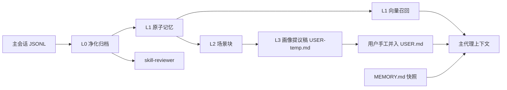
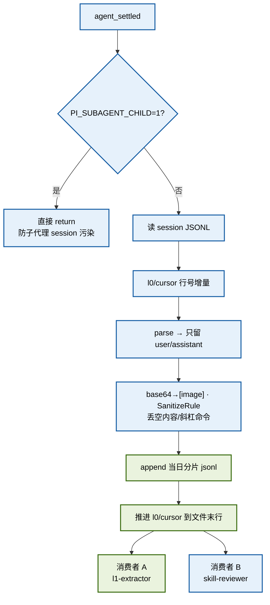
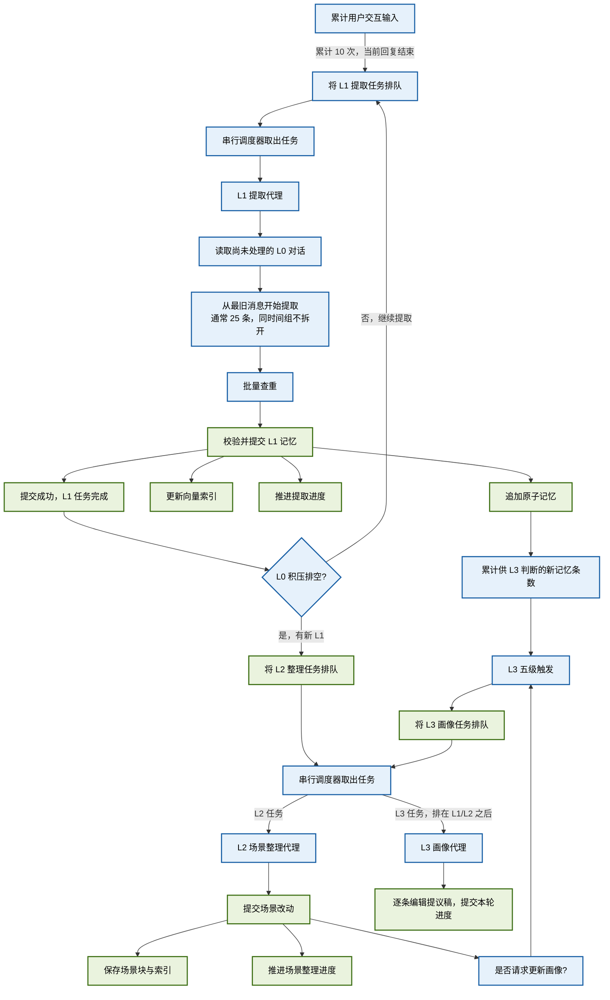
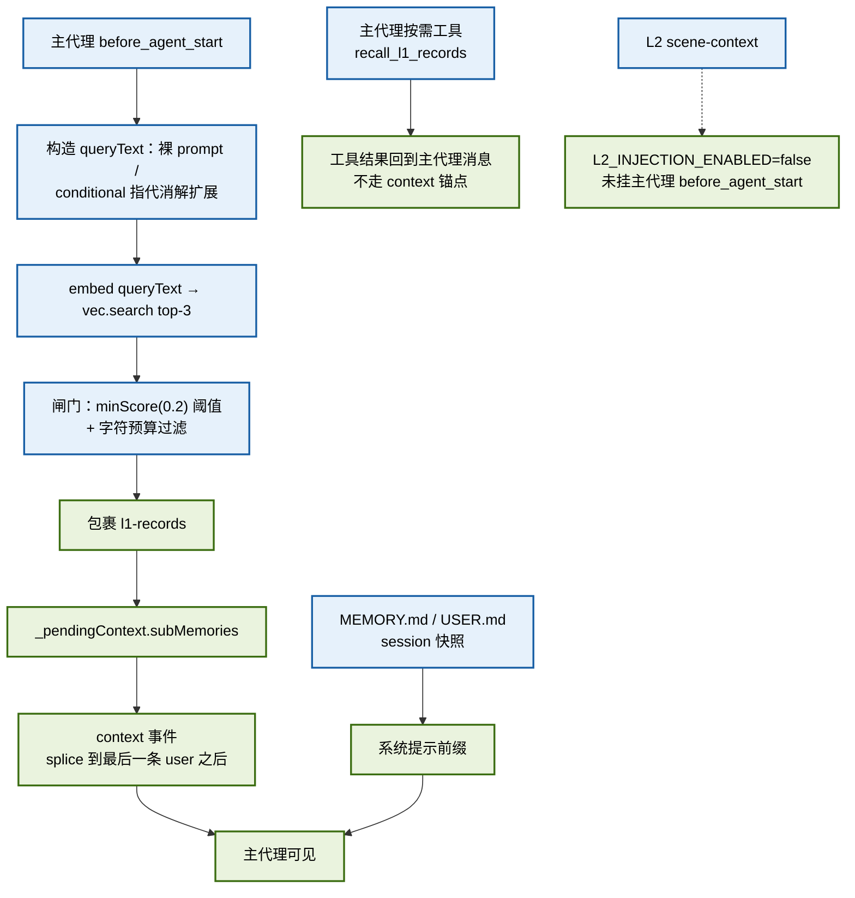
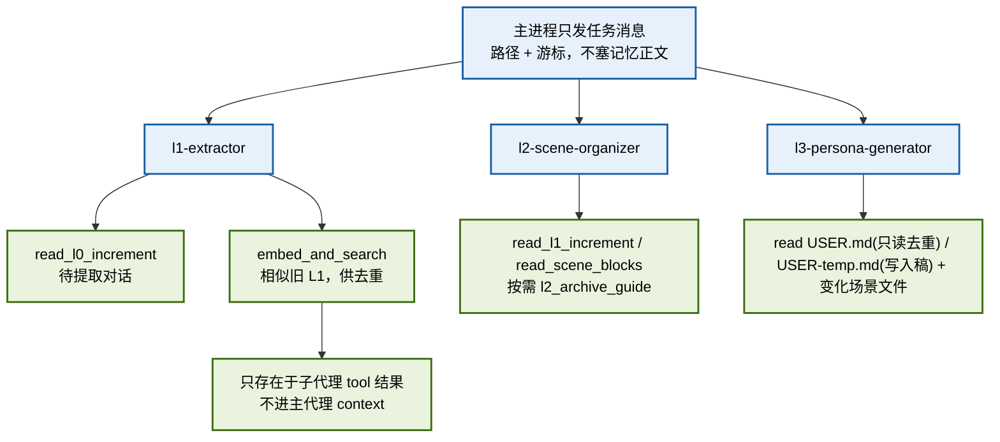
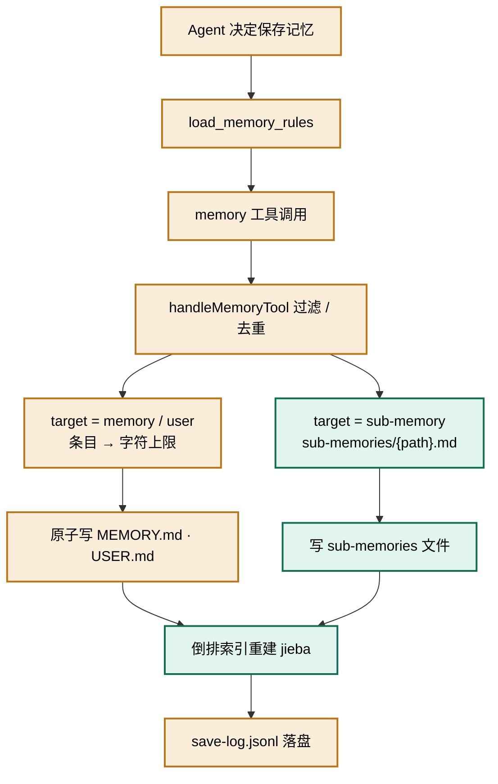
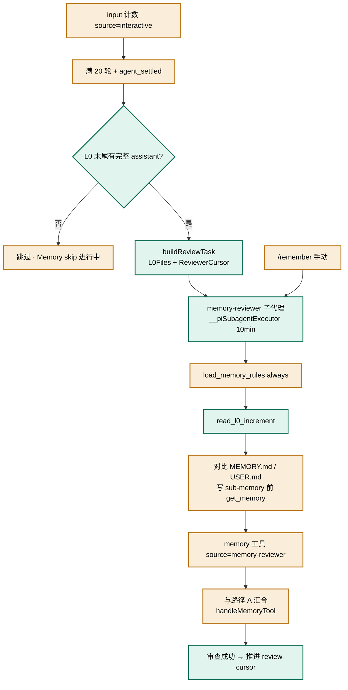
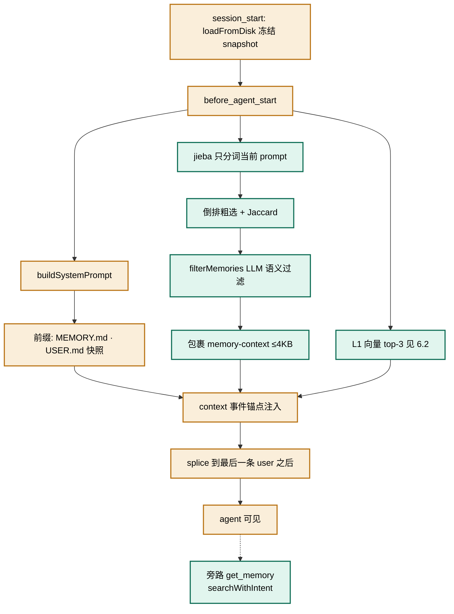

# memory-system：实现与历史参考

本文件配合[《memory-system 扩展架构说明》](C:/Users/leaf/.pi/agent/extensions/memory-system/记忆系统架构说明.md)阅读。主文档负责解释当前用途和流程；这里按原章节保留重构前的实现细节、参数口径、事故、测试结果、未闭环记录和退役设计，便于追溯。历史内容不代表当前行为。

## 阅读方式

第 1–10 节是重构前说明的逐节原文，收在可展开部分，供核对原有信息；第 11 节按原日期保留变更及验证记录；附录 A 保留旧实现和原系统边界。查看当前行为时以主文档和当前代码为准。原文出现文件路径、方法名或“现行”状态时，应按记录日期理解。

## 原说明第 1–10 节：逐节原文

以下各节逐字保留重构前说明中的对应内容。主文档已重写这些内容的组织方式与说明文字；此处作为细节核对资料。

<details>
<summary>展开原说明导言与阅读顺序</summary>

整理日期：2026-10-01。本文以当前工作区的实现与原有说明为依据；工作区中仍有未提交改动。历次改动的时间、事故、验证结果和未闭环事项保留在 §11，不能把旧日期的“现状”当作今天的行为。

原说明建议先看 §1 确认仍运行的链路，再按 §3、§4、§6 阅读 L0 归档、游标和各层读写，然后看 §7–§9 的边界、风险及代码索引，最后查附录 A 与 §11 的旧设计和变更证据。原文还区分旧 MemoryStore 与 L0–L3 新管线，并说明当时两者只在文件快照注入与 L1 召回并存。当前导读和系统分工已重写在主文档第 1、2 节。

原说明表示整理遵循[功能与流程说明写作原则](C:/Users/leaf/.pi/agent/extensions/memory-system/功能与流程说明写作原则.md)。具体原则及代码引用块的使用方式保存在该原则文档中。

</details>

<a id="original-1"></a>

<details>
<summary>展开原说明 §1：1. 当前架构速览</summary>

## 1. 当前架构速览

| 链路 | 当前状态 | 主要入口或产物 |
| --- | --- | --- |
| L0 净化归档 | 运行 | 主进程 `agent_settled` → `l0/conversations/*.jsonl` |
| L1 提取与主代理主动记录 | 运行 | `l1-extractor` / `l1_commit(source="main-agent")` → L1 records；主代理路径不推进 L1 游标 |
| L2 场景组织与归档 | 运行 | L1 积压排空后由串行 worker 入队 L2；场景块可 `archive` / `restore` |
| L3 画像 | 运行 | 串行队列末位执行；`l3_edit` 写 `USER-temp.md`，`l3_commit` 收尾；live `USER.md` 由用户并入 |
| 前台读取 | 运行 | `MEMORY.md` / `USER.md` 的 session 快照；L1 向量自动召回或 `recall_l1_records` |
| 子代理取数 | 运行 | 任务消息给路径；子代理通过各自白名单工具读取，主代理的注入块不会继承过去 |
| `skill-reviewer` / skill-feed | 运行 | 与 L1 共用 L0 净化对话，产物进入 skill 库 |
| 旧 `memory` / `memory-reviewer` / `get_memory` / jieba 倒排 | 已退役 | 旧实现与原因见附录 A、§11.1–§11.2 |
| workflow 保存系统 | 休眠 | 入口注释，未进入现行记忆写入链 |

L1/L2/L3 共用 `{profile}/memoryDB/pipeline/jobs.sqlite`，由主进程串行消费；**任一时刻只运行一个管线子代理**。同层写入另由子代理持有运行级锁。提示词由 `prompts/registry.ts` 单源加载。`cwd` 始终表示**会话工作台**；项目归属写在 `metadata.project`，适用范围由 `metadata.scope` 表示（§11.22–§11.23）。



---

</details>

<a id="original-2"></a>

<details>
<summary>展开原说明 §2：2. 图例与配色</summary>

## 2. 图例与配色

下表沿用原图的配色。琥珀色、蓝绿色的旧保存与检索路径只出现在附录 A 的历史图中；现行数据流请看 §6。

| 色系            | 含义                                          | 出现的图                   |
| ------------- | ------------------------------------------- | ---------------------- |
| 琥珀色 `#FAEEDA` | 旧系统：文件落盘主链路（MEMORY.md / USER.md / save-log） | 旧·显式保存、旧·reviewer、旧·注入 |
| 蓝绿色 `#E1F5EE` | 旧系统：sub-memory 分支、检索/召回、L0 增量读取             | 旧·显式保存、旧·reviewer、旧·注入 |
| 蓝色 `#E6F1FB`  | 新系统：处理/调度/子代理轨道                             | L0、新·提取、新·注入           |
| 绿色 `#EAF3DE`  | 新系统：落盘提交节点（l1/l2/l3_commit）与注入汇聚节点          | L0、新·提取、新·注入           |

> 设计约束：单张图最多使用 2 个色系，并通过分支/并行/锯齿布局避免把所有节点串成一条直线。

---

</details>

<a id="original-3"></a>

<details>
<summary>展开原说明 §3：3. L0 共享净化归档层</summary>

## 3. L0 共享净化归档层

L0 把 pi 宿主 session JSONL 转成干净、按天分片、生命周期独立的长期资产。它不属于已退役的旧写入链；现行的 L1 提取与 skill-reviewer 共用这份输入。

数据目录：`{profile}/memoryDB/l0/conversations/{YYYY-MM-DD}.jsonl`
游标文件：`{profile}/memoryDB/l0/cursor.json`



流程：

1. **触发**：主进程 `agent_settled`。子代理进程设了 `PI_SUBAGENT_CHILD=1` 时直接跳过——否则子代理自己的 `.../run-0/session.jsonl` 会被当成主会话归档，L0 会被 thinking / tool_call / commit 响应污染。
2. **增量键**：`l0/cursor.json` 以 **session 绝对路径 → 行号** 记录水位。session JSONL 是 append-only，行号即去重键。只解析 `cursor+1` 之后的行；写成功（或本轮无记录）才把游标推到文件末行，失败不推进以便重试。
3. **净化**：角色过滤（只留 user/assistant）→ 图片 base64 换成 `[image]` → `SanitizeRule`（内置 generic/memory/framework + 可选 `l0-sanitize-rules.json`）→ `shouldCaptureL0` 丢掉空内容、斜杠命令、纯 `[image]`。
4. **落盘**：按**本地日期**追加到当日分片，跨 session 混排。每行含 `sessionKey / recordedAt / id / role / content / timestamp / cwd`。`cwd` 优先 `ctx.cwd`，否则从 session 目录名启发式解码。
5. **消费**：`l1-extractor` 与 `skill-reviewer` 都从 L0 取净化后的增量；旧 `memory-reviewer` 的消费方式见附录 A。

`read_l0_increment` 返回约定：

| 字段           | 含义                                               |
| ------------ | ------------------------------------------------ |
| `messages`   | `recordedAt > cursor` 的新消息，时间升序；超 200 条时返回最旧的 200 条 |
| `background` | 游标**之前**最近 5 条，只供理解语境，**禁止提取**                   |
| `nextCursor` | 返回消息中最后一条的 `recordedAt`，仅供参考；实际提交游标取本批真正处理到的位置 |
| `truncated`  | 是否因 200 条上限截断（剩余留给下轮）                            |

### 3.1 为什么 2-role 净化不损失 L1 提取信息（2026-08-23 验证）

L0 只保留 user/assistant、丢弃 tool_call/tool_result，是有意为之的抽象：**L1 提取的是结论而非过程**。依据：

- **意图在调用前**：tool_call 之前，user 消息携带问题/需求，assistant 消息携带调用意图（如"先读 http-dispatcher.js 确认"），这些都在 L0 中保留。
- **结论在调用后**：tool_result 被 assistant 消化后，以分析、根因判断、行动结论的形式出现在后续 assistant 消息中——这正是记忆提取需要的形态。原始工具输出（源码快照、命令 stdout）对 L1 是噪音。
- **实测对照**（skill-feed 5-role vs L0 2-role，2026-08-19 排查链）：`user: SyntaxError → read ×2（工具链，L0 丢弃）→ assistant: "Node 版本太旧不支持可选链"`。L0 丢失的只是中间文件内容，根因结论完整保留。
- **与腾讯原版一致**：原版 L1 同样从对话消息提取，不吃工具原始输出。

**两个已知盲区（不改变上述设计）**：

1. **thinking 块被剥**：若 pi 的调用前推理存在 thinking 块中，L0 不保留（角色过滤只放行 user/assistant）。丢的是"推理过程"，结论仍在 assistant 正文，对 L1 影响有限。
2. **assistant"只给行动不给结论"**：tool_result 为错误信息、assistant 仅回复"重试"时，错误详情（只在 tool_result 中）会丢失——排障类 work_method 的原料缺口。比例低，接受或按下方增强处理。

**可选增强（未实施）**：在 `archiveSessionIncrement` 的角色过滤处对 tool_result 做截断摘要，标为 assistant 写入，仅保留 `tool_name + 结果前 200 字 + 错误标志`（如 `[tool:read] 返回 http-dispatcher.js 源码片段…`），避免排障细节彻底消失，同时不引入原始输出噪音。

---

</details>

<a id="original-4"></a>

<details>
<summary>展开原说明 §4：4. 游标机制</summary>

## 4. 游标机制

各层消费者推进节奏不同，所以游标文件拆开，互不覆盖。

| 文件                        | 位置                                                           | 结构                                                                                  | 语义                                                                                     | 推进者                                                                   |
| ------------------------- | ------------------------------------------------------------ | ----------------------------------------------------------------------------------- | -------------------------------------------------------------------------------------- | --------------------------------------------------------------------- |
| `l0/cursor.json`          | `{profile}/memoryDB/l0/`                                     | `{ [sessionPath]: { sessionPath, line } }`                                          | 该 session JSONL 已归档到第几行                                                                | 主进程 `archiveSessionIncrement`                                         |
| `review-cursor.json`      | **`{profile}/state/`**（不进 memoryDB；2026-09-14 由 profile 根移入） | `{ memoryReviewer: { sessionPath, line }, skillReviewer: ... }`                     | 审查水位（按 key 分桶）。**现行代码把 ISO 时间戳写进 `sessionPath` 字段**，`line` 写 `Date.now()`（字段名是行号时代的遗留） | `skill-reviewer` 审查成功后（memory-reviewer 已停用）                           |
| `l1/cursor.json`          | `{profile}/memoryDB/l1/`                                     | `{ lastRecordedAt }`                                                                | L0 行 `recordedAt` 水位；L2 由串行 worker 在 L1 积压排空后编排，不依赖该文件 mtime                                       | `l1_commit`                                                           |
| `l2/cursor.json`          | `{profile}/memoryDB/l2/`                                     | `{ lastRecordId }`                                                                  | 已组织到的 L1 record id（不是 `lastProcessedAt`）                                                                     | `l2_commit`                                                           |
| `l3/cursor.json`          | `{profile}/memoryDB/l3/`                                     | `{ lastPersonaUpdate, memoriesSinceLastPersona, lastTriggeredAt, lastCommittedAt }` | 上次画像对应的场景 `updated`；L1 提交条数累计（P4 阈值）；`lastCommittedAt` 是**熔断的成功口径**（跑完但没提交 = 失败）       | `l3_commit` 推进/清零；L1 提交时 `onL1Committed` 累加；触发时主进程写 `lastTriggeredAt` |
| `l3/pending-trigger.json` | `{profile}/memoryDB/l3/`                                     | `{ personaSignal, personaReason, at }`                                              | `l2_commit` 的显式 persona 请求（跨进程投递）                                                      | `l2_commit` 写（子代理进程）；主进程 `agent_settled` **读后即删**                     |

读取增量时的过滤分层：

1. **分片级**：`listL0Files(profile, lastRecordedAt)` 只列出文件名日期 ≥ 游标日期的 `YYYY-MM-DD.jsonl`。
2. **行级**：`read_l0_increment` 再按 `recordedAt > cursor` 过滤。
3. **质量级**：L1 按提取规则筛选增量，从最旧消息开始，通常每批 25 条；若边界消息共享同一个 `recordedAt`，继续取到该组末尾后才推进游标（§6.1.1）。最旧优先的改动缘由见 §11.9。

原子写惯例：tmp 文件 + `rename`（Windows 上目标已存在则先删后写）。

**⚠️ L1 record id 格式是 L2 水位的隐式依赖（架构约束）**：`l2/cursor.json.lastRecordId` 经 `memory/l2/config.ts` 的 `recordEpochMs()` 解析出 epoch，`read_l1_increment` 再按该 epoch 过滤增量。若 L1 侧改动 id 格式（现为 `l1_{epochMs}_{random}`），`recordEpochMs` 会**静默返回 `0`** → 水位失效 → **L2 永久漏处理新记录**（无报错、无告警）。**改 id 格式必须同步 `recordEpochMs`。**

---

</details>

<a id="original-5"></a>

<details>
<summary>展开原说明 §5：5. 旧记忆系统的现存部分</summary>

## 5. 旧记忆系统的现存部分

旧系统**只保留文件快照注入**：`session_start` 读取 `MEMORY.md` / `USER.md`，`buildSystemPrompt()` 使用本次会话的快照。`load_memory_rules` 现在载入扩展内置的 `prompts/injection/l1-contract.md`。L3 对 `USER.md` 的更改需由用户从 `USER-temp.md` 手工并入，之后才会被下一次快照读取。

原来的显式保存、`memory-reviewer` 后台提取、jieba/LLM 检索、`get_memory` 与 `<memory-context>` 自动注入均已退役。原始流程图和实现细节完整保留在**附录 A**；退役时间与动因见 §11.1–§11.2。

---

</details>

<a id="original-6"></a>

<details>
<summary>展开原说明 §6：6. 新记忆系统</summary>

## 6. 新记忆系统

本节说明现行数据流。穿插的实测数字和“未闭环”记录保留其**发生时点**，不应单凭旧记录判断今天是否仍未验证；后续修订见 §11。

### 6.1 提取 / 保存记忆

L0 保存净化后的对话；L1 从中提取原子记忆，L2 把记忆整理成场景，L3 再从场景中形成画像提议。下面先看它们怎样接力，再分别说明每一层的行为。



#### 6.1.1 L1 如何计数、触发和提取记忆

L1 从归档对话中提取可以单独使用的事实、任务、方法和资产信息。它在后台分批处理，并用游标记录已经处理到哪里。

**计数与自动触发**

当 L1 没有排队或运行中的任务时，用户每通过交互界面发送一次输入，计数就加 1。工具调用、后台通知和自动跟进不增加这个计数；L1 已经在排队或运行时，新的用户输入也不计入下一轮触发次数。

当前阈值是 **10 次输入**。例如，从计数为 0 开始，用户连续发送 10 次输入；第 10 次输入得到回复、当前代理活动结束后，系统把一次 L1 提取任务放进串行队列，同时把计数清零。任务等调度器空闲后才开始执行。

如果此时找不到可检查的 L0 归档分片，计数也会清零，但不创建任务。自动提取因连续失败而暂停时，不会继续自动排队；恢复方式见 §6.1.5。任务实际开始前才准备本批输入，使用那时最新的游标、提取模式和场景清单。

**读取范围与积压处理**

提取代理一次读取游标之后的对话，按时间从旧到新处理。读取工具最多返回最旧的 200 条新消息；一次提取通常处理其中最旧的 25 条。若边界后的消息与本批最后一条共享同一个归档时间，必须继续处理到这一组结束，因此本批可以超过 25 条。这样推进游标后，同组消息不会被遗漏。游标之前最近的 5 条只作背景，不能再次提取。

本轮成功后，如果仍有未处理对话，调度器会继续排下一批 L1，**无需再等待 10 次输入**。全部积压处理完，且存在尚未整理的新记忆时，才安排 L2。L1 忙碌期间的对话仍会进入 L0，也由这条积压处理链消费（§11.9–§11.10）。

**提取、查重与保存**

1. 根据当前模式和提取规则筛选对话，过滤空内容、斜杠命令、提示注入与框架噪音，再提炼值得保存的信息。已知项目和工作场景清单帮助它判断记忆归属（§6.1.4）。
2. 对候选记忆一次批量查重：最多提交 50 条查询，每条取 5 个相似候选，再决定新增、更新、合并或跳过。单条查询用于补查；向量查询失败或没有结果时，改读最近 30 天的记忆记录（§11.17）。
3. 保存前先检查格式，再独立判断内容是否值得保留。前者检查内容、类型和优先级，后者可以保留、丢弃或改型，具体规则见 §6.1.2。
4. 经提交工具统一保存；提取代理不能自行改写记忆文件，直接写文件会被 Plan Enforcer 拦截。成功提交才推进游标，推进位置必须是**本批实际处理过的最后一条消息**。

记忆按提交当天的本地日期追加到 `memoryDB/l1/records/`。更新或合并时，先追加旧记录的删除标记，再追加新记录，原始行仍保留。跨进程写锁保护文件写入；开启向量化且嵌入模型配置可用时，同步添加新记忆的向量并移除已删除记忆的向量。向量更新失败不会撤回已经保存的记录。

提交成功同时表示本次 L1 任务完成，并累计供 L3 判断的新记忆条数；是否继续 L1 或转交 L2，由串行调度器决定（§6.1.3）。

**手动入口与模式**

| 需要做什么 | 命令 | 行为 |
| --- | --- | --- |
| 立即请求一次提取 | `/my-memory:l1-trigger` | 不等输入次数，仍进入同一条串行队列；可恢复因失败而暂停的 L1 |
| 选择提取模式 | `/my-memory:l1-mode [code\|chat]` | `code` 为默认模式；`chat` 用于对话模式 |

**L1 归属标签**：`cwd` 保留会话工作台语义；`metadata.project` 由会话级判定提供，`metadata.scope` 由提取子代理逐条判断，取值为 `self` / `global` / `unknown`。`global` 或 `unknown` 时项目标签必须为空；当前召回尚未用这些标签过滤。完整写入契约、存量处理与同日撤回的 `cwd` 覆写见 §11.22–§11.23。

#### 6.1.2 L1 保存前的格式检查与价值校验

格式检查由代码完成。未删除的记忆必须有非空内容，类型必须是事实、任务、方法或资产四类之一（`work_fact` / `work_task` / `work_method` / `work_artifact`）；给出的优先级须在 0–100 之间，未给出则补为 70 并记录数量。违反这些要求会拒绝整批提交。缺少来源消息编号，或内容超过单条召回预算时，只在返回结果中报告，不拒绝写入；超预算内容以后召回时可能被截成半句。历史上类型越界和缺失来源被静默放过的情况见 §11.8。

通过格式检查后，才进行下面的价值校验。它自 2026-09-17 起接入写盘前流程。

**问题**：提取器要同时干两件事 —— 从 L0 原料里抽事实/方法，以及判断"这条值不值得留"。实测落盘数据上，形式违规是少数（可在代码里拦），但**流水账 / 只记表象**这类**价值问题**是正则判不出来的（本机 254 条记录上，纯正则在 33% 命中率里混着一半是 work_artifact 合理带 commit 号）。所以价值判断交给一次独立的 LLM 复核。

| 维度   | 选择                                                                                                       | 理由                                                                      |
| ---- | -------------------------------------------------------------------------------------------------------- | ----------------------------------------------------------------------- |
| 位置   | **`l1_commit` 内部**，且在**取写锁之前**                                                                           | 跳过工具调用是可能的、跳过写盘闸不可能；写锁只有 10s 超时，抱着锁跑 LLM 会让并发写者失败                       |
| 作用域  | 只对 `source=subagent`                                                                                     | 主代理路径是同步工具调用，不能让它等一次 LLM                                                |
| 形态   | `util/agent-loop.ts` 的 `runAgentLoopOnce`，**`maxTurns` 默认 1**（纯判定、**不给工具**）                              | 用户要求限制 turn 数；判据只有一份、不需要多轮                                              |
| 上下文  | **只给"判据 + 候选记录"**，不给 L0 原料                                                                               | 这正是要避免的"原料占满注意力"；也让复核相对提取器成为一次独立判断                                      |
| 判据来源 | 从 `memory/l1/prompts/extract-{mode}-personal.md` **原样摘出** 5 个标记段                                         | 判据单源：改提取规则即改校验标准。摘不够 200 字符 → 判据视为不可用                                   |
| 失败   | **fail-open**：照写 + 返回体 `valueCheck.skipped` + 通知卡片 / 日志（§11.12）                                             | L1 是 L2/L3 的唯一饲料，不能因第二次 LLM 调用失败而停摆                                     |
| 裁决   | `keep` / `drop`（必带理由）/ `retype`（必带目标类型与理由）                                                               | 校验器**不重写内容**，只做减法与改型；无理由的 `drop` 降级为 `keep`（不可审计的删除不做）；未覆盖的记录一律按 `keep` |
| 落盘影响 | `drop` 的记录**不写库**，改写到 `memoryDB/l1/value-check-log.jsonl`                                                | 否则"它拦了什么、有没有误杀"完全不可见                                                    |
| 配置   | `application-propertis.json` 的 `l1.valueCheck`：`{enabled, maxTurns(1..3 钳制), timeoutMs, maxRecordChars}` | 收束到配置中心；turn 上限硬钳在 3，防止长成不受控循环                                          |

回归：`tsx scripts/verify-l1-value-check.ts`（59 项：判据摘取与标题漂移、裁决解析的宽容与安全边界、裁决应用、桩 loop 下的 fail-open、配置钳制、`l1_commit` 端到端闸门与接线）。**未闭环**：真实 provider 下的首次运行（观察返回体里的 `valueCheck` 字段是否只剩 `dropped/retyped`，不再出现 `skipped`）。

#### 6.1.3 L2 场景组织（sqlite 队列）

不能用 `l1_commit` 的 JS 回调通知主进程里的 L2 调度：`l1-extractor` 是独立子进程，回调闭包里的 `l2Controls` 是子进程扩展实例上的 `undefined`。改为子进程写同一份 sqlite 队列。现行编排是：

1. `l1_commit` 以 `completeRunningL1()` 标记真完成；主进程 worker 检查 L0 是否仍有积压。有积压继续排 L1，排空且有新记录才排一个 L2 到 `{profile}/memoryDB/pipeline/jobs.sqlite`。旧版由 `l1_commit` 直接入队 L2，见 §11.10。
2. 主进程 `setupPipelineWorker` 每 2s 轮询 + `agent_settled` kick，**同时只跑 1 个 job**；claim 前先看 `hasAnyRunning()`（跨层跨进程），所以两个 pi 窗口同时开着也不会各领一条 → 「同一时刻只有一个 L1/L2/L3 子代理」在全局成立（2026-09-19 加；L3 同日并入，且永远排最后 —— 见 §11.11）。
3. L1 完成信号是 `l1_commit` 把 running l1 标 `done`，**不是** `await runPiSubagent` 返回（`async: true` 可能提前 resolve）。
4. 已删除 `fs.watchFile(l1/cursor.json)` 以及 L1 `await` 之后的 `triggerManual(L2)`。手动：`/my-memory:l2-trigger` 入队。
5. **子进程禁止跑流水线调度**：`PI_SUBAGENT_CHILD=1` 时 `session_start` 只设 `PI_PROFILE_PATH` 后返回，不 `recoverStuckRunning`、不 `setupPipelineWorker`、不 kick。`recoverStuckRunning` 回收 running 前结合运行级锁与子代理终态判断；早期实现仅按 `started_at` 超过 **10 分钟** 回收，风险和修订见 §11.18–§11.19（防子进程 boot 误杀刚 spawn 的 job）。L1 `executeJob` 在 job 非 done 离开 running 时 abort spawn。

`l2_commit`：

- `sceneWrites[]`：`create | update | merge | delete | consolidate | archive | restore`；文件名须匹配 `^[\w\u4e00-\u9fff-]+\.md$`
- 场景文件 = `-----META-START-----`（created/updated/summary/heat）+ 正文（9 节：工作场景 / 适用条件 / 核心 SOP / 判断逻辑 / 禁忌与反模式 / 关键事实依据 / 相关任务与资产 / 演化记录 / 待确认问题）
- **成员清单**：写入可带 `members`（该块收录的 L1 record id）。权威载体是 sidecar `memoryDB/l2/index/scene_members.json`，`syncSceneIndex()` 读它并并入索引条目——因为索引是**派生物**（每次提交后从块文件全量重建），成员只放索引会被冲掉。
- 扫描 `l2/scene-blocks/` **全量重建** `memoryDB/l2/index/scene_index.json`（按 heat 降序）
- 推进 `l2/cursor.json` 的 `lastRecordId`
- 可选 `personaSignal` + `personaReason` → L3 P1

**`consolidate`（合并场景的原子动作，2026-09-10 新增）**：`{action:"consolidate", filename:<目标>, sources:[…], content}` —— 主进程原子完成「备份源块 → 完整性校验 → 写目标 → 删源 → 成员并集 → 重建索引」。

- **执行顺序是不变量**：**先写目标、再删源**——反过来的话，中途失败会得到「源已删、目标未建」= 内容真丢失；当前顺序最坏只是暂时多出一个块。完整性校验在**落盘之前**（失败整批拒绝、源块分毫不动）。
- **完整性校验**（`checkConsolidation()`，纯函数）：① 成员覆盖 —— 显式传 `members` 时漏源成员即**拒绝**；② 行数比 —— 目标正文不足源合计 **50%** 且源 ≥3 即**拒绝**，<80% 只警告；③ id 引用覆盖 —— 源正文的 record id 未出现在目标正文则警告。
- **`created` / `heat` 由代码计算**（created 取源最早、heat 取最大），不再依赖提示词守则——历史上曾发生 heat 被重置（32→0）、`created` 被改写。
- 源块备份到 `{profile}/memoryDB/backups/l2-consolidate-<tag>/`（含 `_manifest.json`，保留最近 5 份）。**禁用 `git stash` 做备份**（08-18 有 stash 丢密钥事故）。
- 旧 `merge` 动作保留兼容但**不再推荐**：它等于「写目标 + 另发 `delete`」两个独立步骤、中间无校验，历史上 3 次静默丢内容（-42.8% / -41.7%）即由此产生。2026-09-16 起，它的"新文件名"写法也计入上限增长（见下条），不再能绕过 `maxScenes`。

**场景数硬上限**：配置中心 `memoryDB/config/application-propertis.json` 的 `l2.maxScenes`（默认 15），由 `buildL2Task` 注入任务消息的 **`MaxScenes` 行 + `SceneCountWarning` 行**（后者 2026-09-16 新增：`sceneCountWarningLine()` 数 `scene-blocks/*.md` 算红/橙/黄/无色并附该级别的动作指引——**此前的"分级预警"输入全仓零出现**，规则文件却让子代理去读一个并不存在的摘要段）。**由代码强制**：`checkSceneLimit()` 按提交顺序**预演**这批写入，任一刻超过上限即**整批拒绝**并指引"改用 `consolidate` 合并腾位"；**净收缩（delete / consolidate）一律放行**——否则已达上限时无法靠自我整理脱离该状态（死锁）。**计增长的唯一口径是「落盘效果」**（2026-09-16 更正）：只要目标文件名当前不在目录里就算 +1，**不按 `action` 名区分**——旧口径只把 `create` 算作增长，实测「`update` / `merge` + 新文件名」能在满库时静默多落一个块（cap=3 已满 → 目录 3→4、返回仍 `success=true`）。落盘后若仍超限，返回体带 `warning` 留痕；现行 L2 写者另持运行级锁（§11.19）。归档算净收缩，恢复算净增长（§11.20）。

L1 record 的 `scene_name` 只是 L1→L2 的语义提示（L2 组织场景时将其作为强提示用于匹配已有场景），**不是 L2 场景文件的路径映射**——L1 的 `scene_name` 是「稳定标签 `{项目}｜{议题}`」（2026-09-15 起；此前为长句），L2 场景文件名是 slug，二者不是同一体系（`l2/config.ts` 的 `buildL2Task` 也不传 L1 情境名）。

#### 6.1.4 工作场景池（L1 场景归属的唯一真源）

`{profile}/memoryDB/l1/scenes.json`（路径常量 `paths.ts` 的 `L1_SCENES_FILE`）。**记录里的 `scene_name` 只是落盘当时的历史快照，池才是归属真源。**

- **条目**：每个场景有不复用的编号（如 `sc0001`）和池内唯一的稳定标签（`{项目}｜{议题}`）。条目还保存工作台列表 `cwds`、别名 `aliases`、合并去向 `mergedInto`、来源 `origin`（`seed` / `extract` / `main-agent`）、创建时间 `createdAt`、最近使用时间 `lastUsedAt`、使用次数 `useCount`，以及可选的新建理由 `newSceneReason`。
- **提供给 L1 的清单**：选取最近 60 天使用过且尚未被合并的场景，按“同项目 → 同会话工作台 → 最近使用”排序，最多 40 条（`SCENE_POOL_INJECT_LIMIT`；当时实测单个项目最多 34 条线程）。每行给出场景编号和稳定标签；没有候选时输出 `ScenePool: (无)`。本批工作台取最新 L0 分片末尾 50 行中最常见的 `cwd`，不用主进程启动目录代替；取不到项目和工作台时，只按最近使用时间排序。旧锚点机制在 2026-09-10 失效的原因之一，就是把主进程启动目录当成本批对话的归属。
- **写入者只有 `l1_commit`**，且在 **L1 跨进程写锁内**（锁在记录落盘之前获取）；顺序为「锁内解析内存态 → 追加记录 → 写回池」。池写失败发通知卡片并留日志（§11.12）：记录已带正确名字，池缺条目下批会重建（幂等）。
- **子代理契约**（`extract-{code-personal,chat}.md` 任务一 / `l1-extractor.md` 第四步）：每个情境**二选一**——复用只回传 `scene_id`（逐字取自清单，禁自造 id、禁手抄名字），新建给 `new_scene_name`（稳定标签）+ `new_scene_reason`。**canonical 名字由代码从池取值**写进记录的 `scene_name`；`new_scene_name` / `new_scene_reason` 是中间字段，落盘前被剥离。
- **为什么这么改**（2026-09-15）：此前 `scene_name` 由子代理自由造句、服务端零校验，「逐字复制」是不可执行的软约束；实测碎片化到 248 条记录裂成 100 个名字、锚点复用率 15.5%、命中 `PreviousScene` 仅 0.6%（连续三天为 0）。改成 id 机制后，抄错/改写/同义替换这一类失败模式从机制上消失。
- **稳定性设计**：新建名必须是稳定标签，**禁止把瞬时活动写进名字**（活动一变名字就"不该"同名，这是碎片化的主因）；判据是「同一议题下活动变化（排查→实现→验证）→ 复用；议题换了 → 新建」。
- **主代理路径**（2026-09-15 L1_PROJECT_SIGNAL 改）：记录前可调**只读工具 `list_l1_scenes`**（返回与子代理注入同窗口 60 天、同上限 40 条的清单）→ 回传 `scene_id`（用池 canonical + id），或给显式 `scene_name`（按名字/别名匹配；**未命中则原样保留且不登记进池**）。**都没给**则落占位 `main-agent-live` + `metadata.sceneFallback=true`，返回体附 `sceneHint` 引导先查清单。**刻意不再"猜"**：旧实现取「同 cwd 最近条目」，而 cwd 是会话工作台而非项目（见下条），猜错会把记录贴进不相干的场景、污染 L2 分组；未归类只产生一个明确的占位场景。
- **cwd 的语义与边界**：记录里的 `cwd` 是**会话工作台**（pi 从哪个目录启动），**不等于项目**——实测 memory-system 系列的记录 cwd 全是 `C:\dev\ide\pi-agent\pi-0.80.10`，而扩展本体在 `C:\Users\leaf\.pi`；聚类后 **34 条线程挤在同一个 cwd 下**，且有 5 个场景名横跨 2–3 个 cwd。因此：① 池清单的「同项目优先」用**标签前缀**（`projectOf`，取 `name` 的 `｜` 前段）而不是 cwd；`batchProject` 由 `detectBatchProject` 从本批正文的绝对路径匹配 `KnownProjects` 得出（匹配前滤掉 `C:\`、`C:\temp`、家目录等过宽项——否则 `C:\` 是所有 Windows 路径的前缀，会恒等于命中）；② **任何按项目的统计/聚合都不要用记录 cwd**（这条**始终成立**，见 §11.22/§11.23：2026-09-30 曾短暂把 `cwd` 改成项目目录，**当天已撤回**；`cwd` 恒为会话工作台。按项目请用 `metadata.project`）。项目与 cwd 都取不到时才退回纯 `lastUsedAt` 排序。
- **不重写历史**：`aliases` / `mergedInto` 只在读取期解析，历史 248 条记录的 `scene_name` 一律不动（改记录要全量重嵌向量库）。
- **运维工具**：`scripts/l1-admin/scene-pool.mjs` 的 `report` / `cluster` / `seed` / `merge-report`（除 `seed --apply` 外全只读；本轮不含自动合并）。主代理侧另有只读工具 `list_l1_scenes`（记录前挑 `scene_id` 用，返回体量与子代理注入一致）。
- **降级一律「未归类」而不是猜**：子代理漏给场景标识、或给了池里没有的 `scene_id` → 记录落 `未分类场景`（子代理路径）/ `main-agent-live`（主代理路径）+ `metadata.sceneFallback=true` + 返回体 warn/hint。**不采用任何 cwd 近似**（2026-09-15 前是取「同 cwd 最近条目」，已删）。
- **回归基线**：`tsx scripts/verify-l1-scene-pool.ts`（89 项断言，含用 mock pi API 直调 `l1_commit` 的端到端）。
- **指标**：批边界 = 同一 commit 的记录共享同一 `createdAt`（`l1_commit` 用单个 `nowStamp` 落盘）；`reused` = 记录 `scene_id` 指向 `createdAt` 早于本批的条目。分母不再需要 `anchor-log.jsonl`（该日志已停止写入，文件保留作历史基线）。

#### 6.1.5 提取失败处理与游标推进（L1 / L2）

L1 与 L2 的游标只由各自成功的提交工具（`l1_commit` / `l2_commit`）推进；子代理没有提交成功，就不会推进游标。失败 job 留在队列数据库并计入同层失败计数；重要的派发失败、超时未提交与熔断会进入聊天区卡片，高频过程写 `logs/{scope}.log`（§11.12）。当轮没有立即自动重试或独立死信队列；后续仍从旧游标读取，重新运行取决于再次入队或手动触发。

**统一失败处理机制**

| 环节    | 代码位置                               | 行为                                                                   |
| ----- | ---------------------------------- | -------------------------------------------------------------------- |
| 子代理执行 | `util/subagent.ts` `runPiSubagent` | `executor` 不存在 → throw；子代理停止由软阈值提示、硬上限停止序列处理；当前配置见 §11.18     |
| 队列锁   | `memory/pipeline/worker.ts`        | 同时只 claim 1 个 job（L1/L2/L3 同一条队列，`hasAnyRunning()` 跨进程）              |
| 残留回收  | `jobs-db.recoverStuckRunning`      | 子进程 session_start 不调用；回收还须遵守写者运行级锁约束（§11.19）              |
| L1 完成 | `l1_commit` → `completeRunningL1`  | 未 commit 则不推进游标；硬上限到达时先停写、确认子代理退出，再结算 job（§11.18） |

`pipeline-jobs` 的 `running` 控制调度；写者自己的运行级锁阻止同层双写。失败会标 `failed`，熔断的层暂不领新任务，但不阻塞其他层（§11.13、§11.19）。

**Q1 · L1 提取失败时**

- **游标推进**：不推进。`l1/cursor.json` 的唯一写点在 `commit-tool.ts` 的 `saveCursor`，由 `l1_commit` 调用。失败走不到 commit，游标停在旧值，也不会入队 L2。
- **失败后再次触发**：自动任务排队时计数已清零；未进入暂停状态时，后续再累计 10 次有效用户输入可请求下一次提取，也可手动触发。计数规则见 §6.1.1。
- **对下一次 L1 的影响**：`buildL1Task` 读仍为旧值的 `loadL1Cursor` → 同一批 L0 分片会被重新提取（幂等重试，不丢数据）。

**Q2 · L2 提取失败时**

- **游标推进**：不推进。`l2/cursor.json` 唯一写点在 `l2_commit`。
- **触发**：由 worker 在 L1 积压排空且有新记录时入队，或手动 `/my-memory:l2-trigger`；不看 `l1/cursor.json` mtime。
- **工作集**：`read_l1_increment` 按 `l2/cursor` 的 `lastRecordId` 增量过滤（不是全量重扫 staging）。
- **连锁停滞**：L2 持续失败则场景陈旧，L3 也跟着停；L1 仍可继续入队、commit。

**Q3 · 当前 L2 提取是串行的吗**

**是。** pipeline worker 全局串行执行 L1、L2、L3 子代理。L2 自身也是单次 `l2-scene-organizer`（增量工具拉 records，不再按文件拆多子代理并行）。

#### 6.1.6 L3 人格（提议稿写 `USER-temp.md`；注入侧始终读 `USER.md`）

> **2026-09-16 重构**：提交面从"整篇覆盖"改为**条目级增删改**（用户拍板：L3 可以管理整份
> USER.md，但**每一次工具调用只能操作一条记忆**），触发面从"子代理回调"改为"主进程台账式评估"。
> 下面已按重构后的事实重写。
>
> **2026-09-28 变更**：落盘目标从 live `USER.md` 换成**提议稿 `USER-temp.md`**（用户拍板：
> 子代理仍读 `USER.md` 去重、注入仍是 `USER.md`，但写入落在 temp，**由用户手工并入**）。
> 起因是真实损失 —— L3 的 `delete`/`update` 直接作用于注入画像，用户手写的条目被删掉不可逆。
> 口径与实现见 §11.21。

**工具面**：L3 子代理只有 `read` / `l3_edit` / `l3_commit` 三个工具，**没有 write/bash/edit**。

| 工具          | 语义                                                                                                                                                                                                                                                              |
| ----------- | --------------------------------------------------------------------------------------------------------------------------------------------------------------------------------------------------------------------------------------------------------------- |
| `l3_edit`   | **一次调用只操作一条记忆**：`add` / `update` / `delete`。`content` 必须单行、不含 `§`、不含 HTML 注释、≤ 单条上限（500 字符）⇒ "整篇重写"在接口层不可能。`update`/`delete` 用 `target` 给特征片段，**定位由代码裁决**（`entries.ts` 的 `locateEntry`）：恰好命中 1 条才动手，0/多条一律拒绝并回传候选清单。**写入目标 = `USER-temp.md`（提议稿）**，`USER.md` 只读 |
| `l3_commit` | **收尾**：推进游标 + 重置计数 + 队列真完成信号（`completeRunningL3`）。**不再收 `content`**；即使本轮一条都没改也必须调用（否则游标不推进，同一批场景每轮重喂 ⇒ 空转）。其中的 `refreshUserSnapshot()` 自 2026-09-28 起是空转（L3 不动 live 画像）                                                                                         |

每次 `l3_edit` 后按**全篇**复核长度（`entryBudget` = 条目正文 + `\n§\n` 分隔符，与
`store.totalChars()` 同口径）：超出 `USER_CHAR_LIMIT`（2200，单源在 `core/types.ts`）则拒绝，
并要求先用其他 op 腾空间 —— 这是"每次只动一条"的自然配套。**工作副本 = live `USER.md` 的条目 +
temp 独有条目**，所以这个限额直接等于"用户把 temp 并进 USER.md 后的用量"（不会"提议通过、合并超限"）。
唯一的例外：工作副本**本来就超限**时（live 近满 + temp 还有未并入条目）只放行**真能降低用量**的改动，
否则删除 op 的"改动后用量"仍在上限之上 ⇒ 恒拒 ⇒ L3 连腾空间的第一步都做不了（回归已锁，见 §11.21）。

**触发面**（`memory/l3/index.ts`，**只在该扩展的主进程里注册**）：

`setupL3Persona` 在 L1 提交时累加 `memoriesSinceLastPersona`；真正的触发评估在**主进程每次
`agent_settled`**，两条通道都落盘、都不依赖跨进程闭包：

1. **台账式评估**：无条件 `queueTrigger({})`，是否真跑交给 `evaluateTrigger` 的五级门控（下表）。
2. **显式信号**：`l2_commit` 带 `personaSignal` 时写 `l3/pending-trigger.json`，主进程**读后即删**。

> 为什么不是回调：`registerL2CommitTool` 的 `onCommitted` 在 **l2-scene-organizer 子代理进程**里
> 求值，而 `setupL3Persona` 位于 `index.ts` 的 `PI_SUBAGENT_CHILD` 早退之后 ⇒ 子代理进程里
> `l3Controls` 恒为 `undefined`。实测 46/46 次 `l2_commit` 全在子代理进程、主会话 0 次，
> 即**自动触发从未生效过**（L3 事实上只能靠 `/my-memory:l3-trigger` 手动跑，且最后一次成功提交
> 停在 2026-08-21）。同类坑在 `index.ts` 有注释前科（已废弃的 `l2Controls` 回调）。

**门控命中 ≠ 直接 spawn**：本模块只 **入队**（`pipeline.enqueueL3`，2026-09-19 并入串行执行器，
见 §11.11），由 worker 串行执行。手动触发同样走队列 —— 没有任何绕过串行器的 spawn 路径。

五级门控（`memory/l3/trigger.ts`）：

| 优先级  | 条件                                               |
| ---- | ------------------------------------------------ |
| P1   | `personaSignal` 或 `/my-memory:l3-trigger`（force） |
| P2   | 有场景、从未生成过 persona                                |
| P2.5 | 曾生成但 USER.md 正文丢失                                |
| P3   | 索引恰好 1 条场景且已有 L1 计数、尚无正文                         |
| P4   | `memoriesSinceLastPersona >= L3_INTERVAL`（30）    |

已有 persona 且无 `updated` 晚于 `lastPersonaUpdate` 的场景 → 增量跳过（跳过原因会打日志，
不再静默 —— 静默是上一轮查不出问题的直接原因）。门控在**入队时**（评估）与**claim 时**（执行器）
各判一次：job 可能排在队尾等很久，期间场景块/游标都可能已变，沿用入队时的结论会基于旧状态。

**熔断**（`failure-state.ts` 的 `l3` 层，`L3_FAILURE_THRESHOLD = 3`）：台账式评估让"每轮都可能触发"，
所以失败必须熔断，否则阈值条件一直成立 ⇒ 每轮拉起一个 10 分钟子代理。成功口径与 L1 一致：
**跑完但没提交也算失败**。熔断后以通知卡片提示用 `/my-memory:l3-trigger` 手动重试
（该路径 force，绕开熔断，但仍排在同一条队列里）。

**互斥与结算**：`runPiSubagent(async:true)` 的派发 promise 返回不代表子代理已完成。现行 worker 以队列 `running` 状态调度，以 `l3_commit` 的 `completeRunningL3()` 作为真完成信号；L3 写者在第一次写盘前取得运行级锁。软阈值只提示，硬上限执行“停止标记 → 确认退出 → 杀后修复 → 结算”序列，不能仅凭会话文件暂时不增长就释放串行槽位。旧版出现过同一窗口三个 L3 并发和错误熔断，经过文件锁、队列到写者锁的演进与取证完整保留在 §11.7、§11.11、§11.18–§11.19。

**写入与备份**：`l3_edit` 原子写**提议稿 `USER-temp.md`**（2026-09-28 起；沿用文件**既有行尾**，不整篇转 LF），
live `USER.md` 一个字节都不写 —— 那个文件里没有 L3 的写入路径（`writeUserTempFile` 是唯一写口）。
**每个子代理进程最多备份一次**（第一次真正写盘前留档到 `backups/user-backups/`；temp 已存在则备份 temp 原文，
否则备份 live `USER.md`）—— 旧实现是"每次提交前备份"，条目级操作下那会变成"每个 op 一个备份文件"。

子代理的软阈值、硬上限、停写与确认退出由 `subagent` 配置和停止序列控制（§11.18）；10 分钟是旧版基础阈值，不再等于“到点判失败”。

### 6.2 注入记忆（主代理与子代理不是同一条路）

先分清**被注入的是谁**。主代理跑在前台会话进程；L1/L2/L3 子代理是 `pi-subagents` 拉起的**独立进程**（`systemPromptMode: replace`），看不到主代理的 `_pendingContext`，也吃不到主代理 `context` 事件里 splice 的块。

历史计划曾提出 jieba + embedding 的 RRF，但未实现。现行 `hybrid-recall.ts` 只做 L1 向量余弦召回；旧文件库作为系统提示快照进入主代理，不走该召回函数。

| 进程      | 目的                  | 记忆如何进入该进程的上下文                                                                                    |
| ------- | ------------------- | ------------------------------------------------------------------------------------------------ |
| **主代理** | 回答用户时带上相关 L1 / 旧文件库 | L1 经 `before_agent_start` → `context` 锚点；旧文件库经系统提示快照；另可主动调 `recall_l1_records` |
| **子代理** | 提取 / 组织 / 生成画像      | **不走注入通道**。任务消息给出路径，子代理自己 `read` / `read_l0_increment` / `embed_and_search` 把数据拉进**自己的** tool 结果 |

`embed_and_search` 不是主代理注入的一条支路；`recall_l1_records` 也不是子代理去重工具。

#### 6.2.1 主代理读取与 L1 注入

只发生在**前台会话进程**。向量库：`memoryDB/search/vectors/l1-vectors.sqlite`（qwen3.7-text-embedding / 1024 维）。



| 入口    | 触发                                                                                        | topK                           | 进入主代理上下文的方式                                                                             |
| ----- | ----------------------------------------------------------------------------------------- | ------------------------------ | --------------------------------------------------------------------------------------- |
| 自动注入  | 每轮用户 turn 的 `before_agent_start`（2026-09-15 起经**召回调度闸门**，默认 `blocking` 等 ≤1s、`async` 则不等） | 3（经 minScore 0.2 过滤后可能 <3 或 0） | `<l1-records>`，**就绪后**写入 `_pendingContext`、由 `context` 锚到最后一条 user 消息之后（因此本轮首次调用可能尚无该块） |
| 按需拉取  | 主代理自己调 `recall_l1_records`                                                                | 默认 5                           | **工具返回 JSON**，不经 `context` 事件                                                           |
| 旧文件库  | `session_start` 读快照、`buildSystemPrompt()` 使用快照 | 文件本身 | `MEMORY.md` / `USER.md` 进入系统提示前缀；无 jieba 召回 |
| L2 导航 | `buildL2Injection`                                                                        | —                              | 未启用                                                                                     |

自动注入前置：`getVectorStore().isAvailable()` 且 `count()>0`。召回失败会降级；向量库未就绪时主代理仍可见旧文件快照，但本轮没有 L1 自动召回。（2026-09-02 修复：`count()` 改为查 vec0 真实向量行数——此前映射表残留会误报"有向量"，实际 `search()` 恒空，导致每轮白调 embedding API 且从不注入。）

实现（2026-09-02 更新）：两条路径统一走 `recallL1Records()`——

- **query 构造**：默认裸 `event.prompt`（本轮意图信号）。仅当 `contextExpansion=conditional`（recall 节默认）且命中指代消解（prompt 含指代词 / 长度 <12）时，追加最近 2 条 **role=user** 消息（排除 assistant/toolResult，200 字上限）；`always` 仅作 A/B 对照组。
- **闸门（2026-09-02 新增）**：召回 top-K 后按 `minScore`（0.2，40 条真实消息采样标定：top-1 P25=0.058 / P50=0.254）做相似度阈值过滤——低于阈值不注入，宁缺毋滥（可能注入 0 条）；再加字符预算（单条 300 / 总量 2000）截断。观测日志 `[l1-recall] recall=N filtered=M kept=K`。
- 自动注入传 `source:"inject"`（top-3），`recall_l1_records` 由模型按需调用（默认 top-5，`source:"tool"`）、结果留在 tool 消息里。命中计数按 turn 去重（同一 turn 内注入 + 工具召回同一条只计 1 次），见 §6.2.3。
- **召回调度闸门（2026-09-15 新增，§11.5）**：会话级串行（任一时刻至多一个召回活动）、闸门释放绑定底层 settle、底层不结束时由 `maxHoldMs` 强制释放；自动注入为 `inject` 类（可丢弃、单槽 latest-wins），`recall_l1_records` 为 `demand` 类（**必 settle**，否则挂死 agent loop 工具阶段）。
- 参数集中在 `{profile}/memoryDB/config/application-propertis.json` 的 `recall` 节（见 §9）。

**召回引导（2026-09-02 新增；2026-09-12 路径更新）**：`prompts/backends/tool-reminder.md`（经 registry 渲染，原 `memory/prompts/tool-reminder.md`）的 `[Memory Recall]` 段每轮随 system prompt 注入——告知已有 `<l1-records>` 自动注入、不够时主动调 `recall_l1_records`（自定 queryText）、判无用调 `clear_invalid_l1_records`、**每轮合计上限 3 次**（3 次无果即记忆中没有，直接继续）。这是 `recall_l1_records` 工具从"注册但从不被调用"（`invalid_hits` 恒 0）走向可用的引导开关。**2026-09-15 同步改写文案**：原句断言「每轮已在上方注入」，而就绪式注入下本轮首次调用可能尚无该块（单次答完的 turn 更是整轮没有）——改为「块就绪即注入、缺席不等于没有该记忆」。

旧 `<memory-context>` 检索链已退役。`_pendingContext` 承载当前 L1 召回块；旧文件快照经系统提示前缀进入主代理。

运维命令只动向量库，不参与每轮注入：`/my-memory:l1:embedding:list` / `backfill` / `rebuild`。

#### 6.2.2 子代理如何读到记忆（不是注入通道）

子代理 frontmatter 均为 `systemPromptMode: replace` + `subagentOnlyExtensions: memory-system`。主代理的系统提示快照与 `<l1-records>` **不会作为「主会话注入结果」传给子代理**。子代理要工作数据，只能：

1. 读任务消息里的绝对路径（L0Files / RecordsDir / SceneDir / …）
2. 调**自己白名单里的工具**，结果出现在**子代理自己的**消息列表



| 子代理                    | 白名单工具                                                        | 读入的是什么                                     | 去哪                                    |
| ---------------------- | ------------------------------------------------------------ | ------------------------------------------ | ------------------------------------- |
| `l1-extractor`         | `read`, `read_l0_increment`, `embed_and_search`, `l1_project_get`, `l1_commit` | L0 增量、会话项目判断、向量相似的旧 L1（去重候选） | 子代理对话；再经 `l1_commit` 写盘 |
| `l2-scene-organizer`   | `read`, `read_l1_increment`, `read_scene_blocks`, `l2_archive_guide`, `l2_commit` | L1 增量、已有场景、按需归档规则与事实 | 子代理对话；再经 `l2_commit` 写盘 |
| `l3-persona-generator` | `read`, `l3_edit`, `l3_commit`                               | `USER.md`（只读去重）+ `USER-temp.md`（写入稿）+ 场景文件 | `l3_edit` 写提议稿（一次一条）/ `l3_commit`（收尾） |

因此：`embed_and_search` 与主代理 `before_agent_start` **同库不同消费者**——前者把候选喂给 l1-extractor 做 store/update/merge/skip；后者把 top-3 喂给前台用户对话。失败时子代理降级为 read 最近 30 天 records，仍然只发生在子代理进程。

**进程守卫**：子代理进程同样加载 `index.ts`，但 `before_agent_start` 已有 `PI_SUBAGENT_CHILD` 守卫，直接返回，不建立主代理的 `_pendingContext`、不计 L1 命中。

#### 6.2.3 L1 命中统计（记忆评估指标）

新系统此前没有任何「记忆被使用 / 被召回」的评估字段（L2 的 `heat` 仅度量整理维护频次，非命中次数）。新增 `l1_hit_stats` 表记录每条 L1 原子记忆的召回质量：

| 字段                                | 含义                                                                   |
| --------------------------------- | -------------------------------------------------------------------- |
| `record_id`                       | L1 record id（`l1_{epoch}_{random}`），主键                               |
| `hits`                            | 命中次数 = `inject_hits + tool_hits`（被 agent 面向召回的次数）                    |
| `inject_hits`                     | 自动注入路径命中次数（2026-09-02 起区分两条召回路径）                                     |
| `tool_hits`                       | 工具召回路径命中次数（`recall_l1_records`）                                      |
| `invalid_hits`                    | 无效命中次数：被召回后，LLM 判定无参考价值、由「清除记忆」工具从上下文移除                              |
| `effective_hits`                  | 有效命中次数 = `hits - invalid_hits`（同事务维护，永不为负；`invalid_hits` 钳制到 `hits`） |
| `last_hit_at` / `last_invalid_at` | 最近一次召回 / 无效命中时间（ISO8601）                                             |
| `created_at` / `updated_at`       | 行生命周期                                                                |

存储：`{profile}/memoryDB/l1/hit-stats.sqlite`（node:sqlite，与向量库 `l1-vectors.sqlite` 物理隔离）。2026-09-02 加列迁移：构造函数 `PRAGMA table_info` 检测 + `ALTER TABLE ADD COLUMN`（存量库免重建，幂等）。

**计数契约**：

- 命中：**两条召回路径都走 `recallL1Records()`**——loop-start 自动注入（`before_agent_start`，top-3，`source:"inject"`）与 `recall_l1_records` 工具（默认 top-5，`source:"tool"`）。
- **计数点（2026-09-15 变更）**：工具路径仍在 `recallL1Records()` 返回时计数；**自动注入路径改为在 `context` 事件把块真正入列的那一次计数**（`countHits:false` + `_pendingContext.hitsCounted` 一次性）——因为「召回返回」≠「真的注入」，单次答完的 turn 里块可能从未被读出。口径变更时点：2026-09-15。
- **turn 级去重**：`index.ts` 维护模块级 `currentTurnHitSet`（`before_agent_start` 每 turn 开头 `clear()`），自动注入与工具共用同一引用；`recallL1Records` 的 `hitDedupSet` 选项保证同一 turn 内同一条记忆（注入 top-3 与工具 top-5 语义重叠）只计 1 次命中。retry / compaction / followUp 不重触发 `before_agent_start`，Set 保留 → 同一 turn 续跑仍去重。
- 无效命中：`clear_invalid_l1_records` 工具（已实现）在把某 record 从上下文移除时，调 `recordInvalid(record_id)`（+1，`invalid_hits` 钳制到 `hits`）。约定每次清除调用一次，使 `invalid_hits` 与一次 prior hits 对应。
- `embed_and_search`（l1-extractor 去重）不调用 `recallL1Records`，不计数。

`effective_hits` 可用于冷记忆降权 / 淘汰、重要性排序（见 `getTopEffective(limit)`）。

#### 6.2.4 L1 质量分：活跃会话日时钟 + 淘汰保护带（2026-09-01 定版）

质量分在**读侧实时计算**，不持久化（`memory/l1/quality.ts`）：

```
effective = hits - invalid
days      = 自 last_hit_at（无命中则 createdAt）以来的【活跃会话日】数
decay     = exp(-days / 14)
penalty   = hits>0 ? (1 - min(invalid/hits, 0.8)) : 1
quality   = 新记录保护 ? max(priority/100, 0.3) : effective * decay * penalty
```

**两个时间量必须区分**（混用会出事）：

| 量         | 定义                           | 用途                   |
| --------- | ---------------------------- | -------------------- |
| `days`    | **活跃会话日**（有 L0 归档 = 当天开过 pi） | 喂 `decay`、判「冷 / 待观察」 |
| `ageDays` | 日历天真实年龄                      | 只用于新记录保护与「新」标签       |

活跃日来源：`memoryDB/l0/conversations/YYYY-MM-DD.jsonl` 的**文件名**（零新增写入），见 `memory/l1/active-days.ts`。

**改动一：衰减时钟从墙上时钟改为活跃会话日**

原实现 `days = now - last_hit_at`（日历天），decay 度量的是「用户多久没开工」，而非「记忆是否过时」——两个完全不同的量。典型失效：用户停工 60 天，一条 18 次命中的高价值记忆 quality 跌到 0.25，与废记忆同分；事实上它从未获得过被重新验证的机会。改为活跃日后，停工期间 `days` 不增长、decay 冻结，复工后按实际工作节奏继续衰减。

实测（213 条记录，活跃日 11 个 / 跨度 16 日历天）：decay 均值 0.479 → 0.666；`冷` 从 23 条归 0（活跃日尚未累积到 14）。

> 已知局限：活跃日是全局的，不区分项目。个人开发者单线工作成立；长期并行多项目时，某项目休眠而全局活跃，该项目记忆仍会衰减。

> 坑：新记录保护若误用 `days < 7`，停工用户的老记忆会因活跃日少被判为新记录、拿回 `priority/100` 保底分（实测「新」标签从 7 条暴涨到 83 条）。故保护期只认 `ageDays`。

**改动二：quality（热度）与淘汰权（删除资格）分离**

`quality` 长期不被命中就趋近 0 —— 这符合人类记忆的遗忘曲线，是对的。**但人类遗忘表现为「提取变难」，不是「信息被删除」**。因此删除资格不由 quality 单独决定，交给 `judgePrune()`：

| 判定         | 条件                                | 语义                 |
| ---------- | --------------------------------- | ------------------ |
| 可淘汰 · 被证伪  | `hits ≥ 3` 且 `invalid/hits > 0.5` | 真实负反馈，优先淘汰         |
| 可淘汰 · 长期闲置 | `effective == 0` 且 `days ≥ 30`    | 对应人类记忆中真正被清理的部分    |
| 保护 · 内在价值  | `priority ≥ 动态阈值`                 | 提取时判定为高价值，不因曝光量少而删 |
| 保护 · 类型    | `type == work_method`             | 编码方法类记忆低曝光是常态      |
| 保护 · 已验证   | `effective > 0`                   | 被有效用过的记忆不因闲置淘汰     |

实测（模拟活跃日累积到 36 天）：无保护带按 `quality == 0` 直接砍 **165/213** 条；加保护带后仅 **47** 条进入候选（priority 保护 94、work_method 保护 12、有效命中过 21）。

> **保护阈值必须动态取分位**：实测 L1 提取的 priority 存在通胀（全库最低 65、中位 85），固定阈值 60 会保护 100% 记录使淘汰彻底失效。现按 `priority` 分布 **P75** 取阈值（当前实测 85），以 `PRUNE_RULES.protectedPriority = 60` 为下限。

**配套：JSON 侧车契约变更**

`l1/hit-stats.json` 从裸数组改为对象，供 `records-viewer.html`（跑在 `file://` 下列不了 l0 目录）使用同一套时钟：

```json
{ "generatedAt": "...", "activeDays": ["2026-08-17", "..."], "stats": [ ...原数组... ] }
```

viewer 已兼容新旧两种格式；无 `activeDays` 时退化为日历天并在页面上标注。侧车在 DB 实例化（每会话至少一次）与每次 `recordHits` / `recordInvalid` 后重写，保证活跃日不滞后。

**遗留问题（未修）**

1. 命中统计自 2026-08-22 起停更（l1/records 提取持续到 8/27，hit-stats 停在 61 行），疑似 `vecStore.search()` 异常被 `recallL1Records` 的 catch 吞掉，或 `recordHits` 写锁超时。
2. L1 提取的 `priority` 打分通胀（65–92，中位 85），区分度不足，是提取 prompt 打分表的问题。

---

</details>

<a id="original-7"></a>

<details>
<summary>展开原说明 §7：7. 系统边界与汇合点</summary>

## 7. 系统边界与汇合点

1. **数据源**：主会话写 L0；L1 提取与 skill-reviewer 读取净化对话。旧 memory-reviewer 已停用。
2. **写入**：L1 → L2 → L3 经 `pipeline/jobs.sqlite` 串行推进。`l3_edit` 只写 `USER-temp.md`；用户并入 live `USER.md` 是到旧文件快照注入的人工汇合点。
3. **前台读取**：`MEMORY.md` / `USER.md` 的 session 快照进入系统提示；L1 向量召回经 `before_agent_start` 与 `context` 事件进入本轮上下文，或由主代理主动调用 `recall_l1_records`。没有旧 jieba `<memory-context>` 链。
4. **子代理取数**：独立进程用任务消息中的路径和白名单工具读取；`embed_and_search` 用于 L1 去重，不是主代理自动注入。
5. **项目语义**：`cwd` 是会话工作台，`metadata.project` 是记录的项目标签，`metadata.scope` 是适用范围。当前只写标签；按项目过滤召回尚未实施（§11.23）。

---

</details>

<a id="original-8"></a>

<details>
<summary>展开原说明 §8：8. 运行约束与已知风险</summary>

## 8. 运行约束与已知风险

| 约束或风险 | 当前处理 / 核查入口 |
| --- | --- |
| L1 record id 是 L2 游标的隐式契约 | 改 `l1_{epochMs}_{random}` 格式必须同步 `recordEpochMs()`，否则 L2 可静默漏处理（§4）。 |
| 子代理异步派发返回不等于完成 | 以 commit 工具写入的 job `done` 为真完成；worker 全局串行，L3 排最后（§11.10–§11.11）。 |
| 熔断层堵住其他层 | worker 跳过熔断的队列项；手动触发可复位已排队的同层 job（§11.13）。 |
| 长时间生成被误判为停止 | 软阈值只记日志；硬上限先落停止标记、确认杀进程，再修复和释放槽位（§11.18）。 |
| 监督者提前释放后双写 | 写者持同层运行级锁；`main-agent` L1 仍受提交级写锁串行化（§11.19）。 |
| L2 场景上限与误合并 | `maxScenes` 按真实落盘效果预演；优先 `consolidate`，冷块可归档并恢复（§11.6、§11.20）。 |
| L3 覆写用户画像 | 自动写入仅到 `USER-temp.md`，live `USER.md` 由用户并入（§11.21）。 |
| 项目标签尚未用于召回过滤 | 先写 `metadata.project` / `metadata.scope` 并观测；存量回填另有脚本（§11.23）。 |
| `review-cursor.json` 字段名遗留 | `sessionPath` 现存 ISO 时间戳、`line` 存 `Date.now()`；改结构需读写侧同时迁移（§4）。 |
| 子代理污染 L0 | `PI_SUBAGENT_CHILD` 守卫阻止归档子代理 session；注入钩子也有同类守卫。 |

---

</details>

<a id="original-9"></a>

<details>
<summary>展开原说明 §9：9. 关键文件索引</summary>

## 9. 关键文件索引

### 9.0 权威定义

- `项目归属定义.md` — **「项目」概念的权威定义**（2026-10-01 落盘）：项目 = 有专有身份、能独立交付的最小工作单元；三条机械检验规则、正反例、`scope` 三值闭集与 `projectSource` 取值空间、往上走不往下走的推断算法、证据优先级与禁令、支撑实测数据、已知遗留问题。**改判定口径就改这份，并同步重跑评测尺子**（`scripts/fixtures/l1-project-scope/ruler.json`）

### 9.1 源码与工具

- `index.ts` — 扩展入口；`registerTool` 包装；L0 归档；`before_agent_start` / `context` 注入；turn 级去重 Set；注册 commit/召回工具
- `memory/paths.ts` — memoryDB 路径常量；标明 `review-cursor.json` 不归 memoryDB
- `memory/l0/index.ts` · `sanitize.ts` · `session-parser.ts` — L0 行号游标、净化、按日分片
- `memory/review/reviewer.ts` · `review-cursor.ts` — reviewer 历史调度与审查游标（memory-reviewer 已停用，skill-reviewer 仍使用游标）
- `memory/core/store.ts` · `manager.ts` — MemoryStore 文件快照与 `refreshUserSnapshot`；旧 `memory/core/tool.ts` 已删除
- ~~`memory/search/searcher.ts` · `inverted-index.ts`~~ — **已删除（2026-09-12）**：jieba 倒排 + Jaccard + LLM 语义过滤（旧检索链，无活跃消费者）
- `memory/l1/index.ts` · `config.ts` · `read-tool.ts` · `commit-tool.ts` — L1 调度、分片清单、`read_l0_increment`、`l1_commit`
- `memory/l1/project-scope.ts` — **L1 标签契约**（§11.23，零 import 的纯函数）：`metadata.scope` 三值闭集 + `metadata.project` 归一化与 `global`/`unknown` ⇒ `project` 空 不变量 + 给提示词用的 `SCOPE_HELP` 词表
- `memory/l1/value-check.ts` — L1 价值校验：判据摘取（与提取规则同源）、一次 agent loop 的调用与裁决解析、`drop`/`retype` 应用
- `memory/l2/index.ts` · `config.ts` · `commit-tool.ts` · `navigation.ts` — L2 入队执行、场景提交、未启用的导航注入
- `memory/l2/archive.ts` · `archive-facts.ts` · `archive-tool.ts` — L2 归档层：搬移/记账/自愈/`restore`、事实清单 + 两条硬拦、按需返回规则+事实的工具（§11.20）
- `memory/pipeline/jobs-db.ts` · `worker.ts` — L1/L2/L3 流水线 sqlite 队列与主进程串行 worker（L3 优先度最低）
- `memory/l3/index.ts` · `trigger.ts` · `config.ts` · `signal.ts` — L3 五级触发、主进程台账式评估 + **入队**（不再直接 spawn）、跨进程触发信号、游标
- `memory/l3/entries.ts` · `user-file.ts` · `edit-tool.ts` · `commit-tool.ts` — 条目级内核（解析/校验/定位/计价）、**live `USER.md` 只读 + 提议稿 `USER-temp.md` 读写与每轮一次备份**（§11.21）、`l3_edit`、`l3_commit`
- `memory/search/hybrid-recall.ts` — `recallL1Records`：L1 向量余弦召回 + minScore 阈值/字符预算闸门 + source 埋点 + turn 级去重（`hitDedupSet`）；观测日志走 `logs/recall.log`（2026-09-19 前是 `console.log`，会污染 TUI）
- `memory/search/recall-config.ts` · `config/app-config.ts` — `recall` 节类型化合并；`application-propertis.json` 统一配置中心读写底层（`loadAppProps`/`saveAppSection` 合并写）
- `util/jsonc.ts` — JSONC 解析（配置中心文件支持注释；字符串内 `//` 不误剥）
- `util/notice.ts` — **通知唯一出口**（2026-09-19）：聊天区卡片（`pi.appendEntry` + entry renderer）/ 聊天区一行（`notify`）/ 文件日志（`logEvent`）；含卡片行宽自实现 `fitWidth`、`dedupKey` 去重、5MB 轮转、**跨进程 relay**（子代理写 `logs/notices.jsonl` → 主进程 `drainNoticeCards()` 原子取走渲染）。运行时代码不得再新增 `console.*`（白名单 3 文件 4 处，见 `scripts/verify-notice-routing.ts` 第 8 组）
- `memory/search/embedding/tool.ts` — `embed_and_search`（子代理去重）
- `memory/search/recall-l1-records-tool.ts` — `recall_l1_records`（主代理主动，`source:"tool"`；场景化 description）
- `memory/search/vector-store/store.ts` — sqlite-vec；`db.exec` + `vec_f32`（不支持 prepared statement）；`count()`/`getAllVectorizedRecordIds()` 查 vec0 真实行数（2026-09-02 修复空转误判）
- `memory/stats/l1-hit-stats-db.ts` — L1 命中统计库（node:sqlite）：hits / inject_hits / tool_hits / invalid_hits / effective_hits
- `~/.pi/agent/agents/memory-reviewer.md` — 已停用的旧系统后台提取 agent 定义
- `~/.pi/agent/agents/l1-extractor.md` — L1 提取 agent 定义（含去重四动作）
- L1 任务消息的字段由 `memory/l1/config.ts` 组装：`L0Files` 给归档分片，`CursorPath` 给进度文件，`RecordsDir` 给记忆目录，`PromptDir` 给规则目录，`Mode` 给提取模式，`KnownProjects` 给已知项目，`ScenePool` 给工作场景候选。提取代理读取游标、当前模式的 `extract-{mode}.md` 和 `dedup.md` 后开始处理。
- `util/judg-session-project/` — 会话级项目判定、持久化与 `l1_project_get`（§11.22–§11.23）。
- `memory/l2/scene-read-tool.ts` — `read_scene_blocks` 批量读取；`memory/l2/archive-tool.ts` — `l2_archive_guide` 按需给规则与事实（§11.17、§11.20）。
- `memory/pipeline/subagent-liveness.ts` · `timeout-config.ts` · `run-lock.ts` · `stop-request.ts` · `subagent-kill.ts` — 心跳、软硬阈值、停止序列与写者运行级锁（§11.18–§11.19）。

### 9.2 运行时数据

运行时数据（相对 `{profile}/memoryDB/`，除注明外）：

- `l0/conversations/*.jsonl` — L0 净化对话
- `l1/records/*.jsonl` — L1 原子记忆
- `l2/scene-blocks/*.md` — L2 场景
- `l2/index/scene_index.json` — 场景索引（heat 排序）
- `search/vectors/l1-vectors.sqlite` — L1 向量
- `l1/hit-stats.sqlite` — L1 命中/有效命中统计（评估指标）
- `pipeline/jobs.sqlite` — L1/L2/L3 流水线 job 队列（`type` ∈ l1/l2/l3）
- `logs/{scope}.log`（`recall`/`l1`/`l2`/`l3`/`pipeline`/`store`/`l0`/`skill`/`notice`） — 运行观测日志（单文件 5MB 轮转一代）；每 turn 级别的信息只进这里
- `logs/notices.jsonl` — 跨进程通知队列：子代理进程的卡片先落盘，主进程 `drainNoticeCards()` 取走后渲染进聊天区
- `config/application-propertis.json` — **统一配置中心（JSONC，2026-09-02 收束）**：`recall`（minScore 0.2/字符预算/contextExpansion）· `vectorization`（enabled/threshold）· `l1`（mode）· `model`（llm/embedding，含 apiKey）。读取走 `parseJsonc`/`app-config.ts`，勿用裸 `JSON.parse`
- `config/*.legacy-20260902` — 收束前旧配置文件备份（`memory-system-model.json`/`vectorization.json`，代码仍读兜底，稳定后清理）
- `l0/cursor.json` … `l3/cursor.json` — 各层游标
- `{profile}/state/review-cursor.json` — reviewer 游标（**2026-09-14 由 profile 根移入 `state/`**）
- `{profile}/MEMORY.md` `USER.md` `USER-temp.md` `sub-memories/` — live 文件快照、L3 提议稿与旧 sub-memory 历史目录
- `l1/scenes.json` — 工作场景池；`l2/archive/` — 归档场景、成员 sidecar 与事件账。
- `state/judg-session-project.json` — 会话级项目归属；`state/run-lock-<layer>.lock/` — 各层写者运行级锁。

---

</details>

<a id="original-10"></a>

<details>
<summary>展开原说明 §10：10. 图示索引</summary>

## 10. 图示索引

§1 总览、§3 L0、§6.1 写入、§6.2.1 主代理读取、§6.2.2 子代理取数均使用内联 Mermaid。旧保存、旧 reviewer 与旧检索图保留在附录 A。同目录的四张 SVG 是较早副本，不能代替本文中的现行图。

---

</details>

## 原说明第 11 节：变更、事故和验证记录

以下记录保留原文，包含当时的取证、具体改动、测试结果和遗留事项。主文档的第 11 节提供按主题的入口。

## 11. 变更记录与验证证据（2026-09-11—09-30）

> 本节按发生时间保留原有事故、改动、测试和未闭环事项。每一小节的“现行”“未闭环”指当时的记录；同一主题如有后续修订，以日期较晚的小节和前面的当前架构正文为准。

<a id="history-01"></a>

<details>
<summary>11.1 旧记忆系统写链退役（2026-09-11，提交 `fad0380`）：主代理主动保存改由 L1 提交工具完成；旧保存工具和 reviewer 写链退役。</summary>

### 11.1 旧记忆系统写链退役（2026-09-11，提交 `fad0380`）

- `memory` 工具退役（块注释）；`memory-reviewer` / `memory-organizer` 停用；`/remember` 随之消失。
- 主代理主动记录改道 **`l1_commit(source="main-agent")`**：服务端补齐 id/时间/会话/cwd、写 `metadata.origin="main-agent"`、不推进 L1 游标、不入队 L2（L2 入队条件改为「游标后有存活记录」）。
- `load_memory_rules` 载荷从 profile 散落文件换为扩展内置 `prompts/injection/l1-contract.md`；once 清除时机改挂 `l1_commit`。
- 旧规则文件 `记忆保存信号.md` / `记忆分类框架.md` 加停用横幅，代码不再读取。
- 详见 `~/.pi/plan/memory-system/MAIN_AGENT_L1_RECORDING/`。

</details>

<a id="history-02"></a>

<details>
<summary>11.2 旧检索链退役并删码（2026-09-12）：删除无活跃消费者的 jieba 检索实现及其对话外发路径，保留快照注入。</summary>

### 11.2 旧检索链退役并删码（2026-09-12）

- **首要动因**：三处钩子（session_start / agent_settled 每 8 轮 / before_agent_start 话题切换）调用 `searcher.refreshKeywords`，把**最近 20 条对话全文**发往配置模型（默认第三方），产出 `cachedKeywords` 却只被已注释的 `get_memory` / sub-memory 注入路径消费——一条无用途的对话外发通道。
- 已删除：`memory/search/searcher.ts`、`memory/search/inverted-index.ts`、`memory/search/sections.ts`、`memory/core/duplicate-check.ts`、`memory/core/tool.ts`；`MemoryManager` 清理 `invertedIndex`/`externalProvider` 及 5 个引用方法；`memory/index.ts` 导出裁剪；`/my-memory:rebuild-index` 命令删除；`_pendingContext` 的 `queryText`/`cwd` 冗余字段清理。
- **保留** `memory/core/content-filter.ts`（孤儿但有预定归宿：注入点分析 §7 P1-1 拟接入 `l1_commit`/`l1_fix`）。
- **零行为变化验证**：O1（`buildSystemPrompt` 输出）与改动前**逐字节一致**（jiti harness A/B）。
- 详见 `~/.pi/plan/memory-system/LEGACY_RETRIEVAL_RETIREMENT/`（含 R1/R2 审查报告）。

</details>

<a id="history-03"></a>

<details>
<summary>11.3 提示词收束到单一加载中心（2026-09-12）：提示词迁移到 registry 单一加载中心，并保留逐字节校验记录。</summary>

### 11.3 提示词收束到单一加载中心（2026-09-12）

- 新增 `prompts/registry.ts`：扩展内提示词的**唯一加载中心**——内置默认 + md 覆盖 + 进程内缓存 + 占位符强契约（缺/多变量即 throw）+ `{{>partial}}` 共享片段 + `checkPromptAssets()` 启动自检。
- 迁移：任务消息 ×5、注入块 ×5、工具 description ×13、`l1-contract`、`tool-reminder`（`prompts/backends/`）全部改由 registry 渲染。
- Protected Files 清单改为保护整个 `prompts\` 目录树（原指向 `memory\prompts\*.md`，迁移后已失效）。
- 旧加载器 `memory/prompts.ts` 删除；4 个无消费方的旧模板归档至 `prompts/retired/`（附 README）。
- 离线校验：`node --experimental-strip-types scripts/verify-prompt-contracts.mjs`（逐字节等价 + agent md 字段漂移 + 强契约冒烟）。
- Phase 3（目录归拢/加载器合一）已做；提取规则搬迁**未做**（拍板取消原任务 11、12 降级）。详见 `~/.pi/plan/memory-system/PROMPT_REGISTRY/`、`PROMPT_REGISTRY_PHASE3/`。

</details>

<a id="history-04"></a>

<details>
<summary>11.4 现存活链路速查：记录各条链路在当时的运行或退役状态。</summary>

### 11.4 现存活链路速查

| 链路                                                                                                         | 状态                          |
| ---------------------------------------------------------------------------------------------------------- | --------------------------- |
| L0 净化归档                                                                                                    | 活（两系统共用数据源）                 |
| L1 提取（子代理）/ L2 场景 / L3 画像                                                                                  | 活                           |
| 主代理主动记录 `l1_commit(main-agent)`                                                                            | 活（2026-09-11 起）             |
| `<l1-records>` 就绪式自动注入（串行闸门 + blocking/async）/ `recall_l1_records` / `l1_fix` / `clear_invalid_l1_records` | 活                           |
| `MEMORY.md`/`USER.md` 快照注入（O1）+ `load_memory_rules`（O2）+ token 提醒（O3）                                      | 活（旧系统仅存注入侧）                 |
| skill-reviewer / skill-feed（5-role）                                                                        | 活                           |
| jieba 倒排检索 / `get_memory` / `memory` 工具 / `memory-reviewer`                                                | **已退役**                     |
| workflow 保存系统                                                                                              | 休眠（入口注释）                    |
| 提示词来源                                                                                                      | **`prompts/`（registry 单源）** |

</details>

<a id="history-05"></a>

<details>
<summary>11.5 L1 召回改为「串行闸门 + 就绪式注入」（2026-09-15）：记录 L1 召回调度、同步与异步等待、超时及命中计数变更。</summary>

### 11.5 L1 召回改为「串行闸门 + 就绪式注入」（2026-09-15）

> 计划：`~/.pi/plan/memory-system/L1_RECALL_ASYNC/`（经 R1/R2/R3 三份审查修订）。

**动机与实测**：`before_agent_start` 原先 `await` 一次远程 embedding（召回链净成本 p50 457ms / p90 1326ms），把「请求发出」推迟；
但同期**单次 LLM 调用墙钟中位 9.3s**，故召回不足典型等待的 5%——真正值得修的是**极端暴露**（`timeoutMs` 原是死配置，
真兜底是 embedding 自带的 30s；单次 embed 最坏 ≈121s = QPM 排队 ≤60s + fetch 30s + 重试）。

**改动**：

| 项      | 内容                                                                                                                                                          |
| ------ | ----------------------------------------------------------------------------------------------------------------------------------------------------------- |
| 召回调度闸门 | 新增 `memory/search/recall-scheduler.ts`：会话级串行（至多一个召回活动）；**闸门释放绑定底层 settle**（不用 race，否则会与队列下一项并发）；`maxHoldMs` 兜底强制释放                                          |
| 请求分层   | 自动注入 = `inject`（可丢弃，单槽 latest-wins）；`recall_l1_records` = `demand`（**必 settle**，否则工具 promise 永悬、agent loop 工具阶段挂死）                                          |
| 注入模式   | `recall.injectMode`：`blocking`（默认，等 ≤`injectTimeoutMs`=1s，实测覆盖约 80–85% turn 首跳即有记忆）/ `async`（不等，就绪后补注入；单次答完的 turn 无记忆）                                      |
| 硬超时    | `recall.injectTimeoutMs`（自动注入等待/结果预算）、`recall.timeoutMs`（工具路径）；超时即 abort 底层 HTTP（`embed(text, {signal})`，含 429/5xx 重试透传与 QPM sleep 可中断）                     |
| 启动预热   | `recall.prewarm`：session_start 后台开向量库 + 建 embedding 客户端（**不发 embedding 请求**，零 API 成本）                                                                       |
| 命中计数   | 自动注入路径的计数从「召回返回时」移到「`context` 真入列时」（一次性）——修复单次答完 turn 的命中虚增                                                                                                 |
| 提示词同步  | `prompts/backends/tool-reminder.md` 的 `[Memory Recall]` 段与 `prompts/tools.md` 的 `recall_l1_records` 描述改写（原断言「每轮已注入」）；`.golden/tools.json` 与 verify 内联基线同步更新 |

**取舍（明示）**：①`blocking` 下 15–20% 的 turn 会多等最多 1s；②`async` 下本轮首次调用必无记忆、单次答完（实测 12.8%–14.6%）整轮无记忆；
③「切回 `blocking`」**不完全等于**改造前行为（工具路径并入闸门、计数口径、预热、超时上界四处不同），完全回退须 `git revert`。
**另案观察**：`_checkCompaction` 在 user 消息打点**之前**执行、可触发数秒级 LLM 摘要调用，不在本次测量窗内，是「感觉卡」更可疑的候选；召回非空注入率（`inject_hits` 曾长期停滞）也待跟踪。

</details>

<a id="history-06"></a>

<details>
<summary>11.6 L2 场景块上限的边界收紧（2026-09-16）：记录 L2 场景数量上限按文件实际增减执行的修复。</summary>

### 11.6 L2 场景块上限的边界收紧（2026-09-16）

> 计划：`~/.pi/plan/memory-system/L2_SCENE_CAP/`。

**问题（实测复现）**：`checkSceneLimit()` 只把 `action === "create"` 计作增长，而注释里"update / merge 的目标必然已存在"这个假设**没有校验兜住**，写入循环又对 create / update / merge 一视同仁地落盘 —— 于是「新文件名 + `update`/`merge`」能在满库时静默多落一个块（cap=3 且目录已满 → 目录 3→**4**、返回仍 `success=true`，无 error 无 warning）。生产当时 13/15，尚未踩到但很近。

**改动**：

| 项      | 内容                                                                                                                                                                                                                |
| ------ | ----------------------------------------------------------------------------------------------------------------------------------------------------------------------------------------------------------------- |
| 计增长口径  | 改为**按落盘效果**：目标文件名当前不在集合里就 +1，不按 `action` 名区分 —— 动作名选错也绕不过上限。对**已存在名**的 `update`/`merge` 仍不计增长（合法路径逐字节不变）；同批「先 `create` 后 `update` 同名」不重复计数                                                                        |
| 上限指引   | `limitReachedError()` 文案改指 `consolidate`（含 `sources` 形态与"主进程原子完成"说明）+ 无候选时退回 `update`。旧文案教的是「`merge` 目标块 + 另发 `delete`」两步式 —— 那正是两个规则文件与 `l2-scene-organizer.md` 禁止的路径（无校验、历史丢内容），且**恰是上面那条绕过路径的入口**：最后一道闸在把人往洞里推 |
| 分级预警注入 | 任务消息新增 `SceneCountWarning` 行（`gradeSceneCount()` + `sceneCountWarningLine()`，数 `scene-blocks/*.md`，与预检同源、不读索引）。**此前该输入在 TS 代码里零出现**，规则文件却让子代理"查看 Existing Scene Blocks Summary 顶部标注的当前场景总数"，而那个摘要段真实任务消息里并不存在     |
| 措辞同步   | 两个规则文件：预警来源改为任务消息字段（缺失才回退数 `IndexPath` 条目）、`{maxScenes-1}` 去表达式化、删掉"读摘要段得总数"的失效指引；`l2-scene-organizer.md` 第三步 3 由"被合并场景提交 delete"改指 `consolidate`                                                                 |
| 观测     | 落盘后若块数仍 > `maxScenes`，返回体加 `warning`（正常不出现；一出现即说明硬上限的假设又被打破）                                                                                                                                                      |
| 删死代码   | `MergeProposal` / `MERGE_PROPOSALS_FILE` / `renderMergeProposals` —— 定义并导出后从未被任何调用方使用；低置信合并候选实际由规则文件的「待确认问题」段承担                                                                                                   |

**验证**：原始复现探针由「3→4 块 / `success=true`」变为「3→3 块 / `success=false`」；`verify-l2-config.ts` **113/0**（改动前 85/0）、`verify-l2-consolidate.ts` **39/0**、契约 `--strict` 0 警告、`verify-l1-scene-pool.ts` 117/0、jiti 冒烟 14/0。**未闭环**：`/reload` 后的真实 L2 触发。

</details>

<a id="history-07"></a>

<details>
<summary>11.7 L3 画像改为条目级提交 + 触发复活 + 失败熔断（2026-09-16）：记录 L3 条目级编辑、触发恢复和真实提交结算的事故与修复。</summary>

### 11.7 L3 画像改为条目级提交 + 触发复活 + 失败熔断（2026-09-16）

> 计划：`~/.pi/plan/memory-system/L3_PERSONA_REPAIR/`。

**问题（实测复现）**：**L3 自 2026-08-22 起零产出** —— 最后一次真实 `l3_commit` 停在 2026-08-21，且那次产出的是旧 Markdown 格式（`# Team Operating Doctrine` + 列表，还混入 `PI_SUBAGENT_CHILD` / `structuredClone` 等扩展实现细节）；§ 格式那轮改造（`cd68bca`）**从未被任何一次真实运行验证过**。同一天用户手写的 § 版 USER.md 成了唯一对照物，而它与提交逻辑之间有一处对不上的边界假设。逐条查实：

| #   | 缺陷                     | 实测                                                                                                                                               |
| --- | ---------------------- | ------------------------------------------------------------------------------------------------------------------------------------------------ |
| 1   | **提交逻辑不幂等**            | 离线复刻旧 upsert 连跑 3 次：第 2 次后文件稳定留下 **2 个 `<!-- L3 -->` + 1 个空 § 条目**（`beforeL3` 切片把旧哨兵留在保留段又拼一次），且该空条目会被 `store.readFile` 当规则**注入进 system prompt** |
| 2   | **首次提交整段追加**           | 当时 USER.md 既无哨兵也无旧标题 ⇒ 两条匹配全落空 ⇒ 走追加分支（1302 → 估算 ~2670 字符，且与手写 18 条语义重复）                                                                         |
| 3   | **限额只卡待提交段、不卡文件**      | `store.getFullContext()` 整篇无截断注入，而文件已 1302/1375（95%）⇒ L3 只剩 73 字符空间，等于跑一次也写不进东西                                                                  |
| 4   | **CRLF 导致条目解析失效**      | `core.autocrlf=true` ⇒ 磁盘是纯 CRLF ⇒ `store.readFile` 的 `split("\n§\n")` **把 18 条并成 1 条**                                                          |
| 5   | **自动触发在子代理进程静默死掉**     | `index.ts` 的 `PI_SUBAGENT_CHILD` 早退在 `setupL3Persona` 之前 ⇒ 子代理进程里 `l3Controls` 恒 `undefined`；而**实测 46/46 次 `l2_commit` 全发生在子代理进程、主会话 0 次**       |
| 6   | `personaSignal` 指令永远无效 | `l2-scene-organizer.md` 要求传，`l2_commit` 也确实调了回调 —— 但接不住（同 #5）                                                                                    |
| 7   | 结构校验形同虚设               | 只判 `content.includes("§")`；USER.md 不存在时整条跳过                                                                                                      |
| 8   | 旧格式分支会误吃用户内容           | `^# (Team Operating Doctrine\|User Narrative Profile)/m` 会匹配用户手写标题后**静默替换其后全部内容**                                                                |
| 9   | 文档漂移                   | §6.1 仍写"必须保留 `Archetype` / `Chapter 1` / `Chapter 3`"（8-17 旧逻辑）                                                                                  |

**用户裁定（2026-09-16）**：USER.md **整份归 L3 管**，但**每一次工具调用只能操作一条记忆**，禁止 write/bash 整篇重写；总预算 **1375 → 2200**；保持 **code** 模式；**修自动触发**。

**改动**：

| 项   | 内容                                                                                                                                                                                                                          |
| --- | --------------------------------------------------------------------------------------------------------------------------------------------------------------------------------------------------------------------------- |
| 提交面 | `l3_commit(content)` → **`l3_edit`（add / update / delete，一次一条）+ `l3_commit(cursor)`（收尾）**。`content` 必须单行、不含 `§`、不含 HTML 注释、≤ 500 字符 ⇒ **整篇重写在接口层不可能**；哨兵 / upsert / 旧格式分支 / 结构标记校验**整套删除**                                  |
| 定位  | `update` / `delete` 传特征片段，**代码裁决**（`entries.ts` 的 `locateEntry`）：恰好命中 1 条才动手，0/多条拒绝并回传候选清单 —— 不让 LLM 逐字抄写（对齐 L1 场景池的教训）                                                                                                     |
| 限额  | 每次 op 后按**全篇**复核（`entryBudget` = 条目正文 + `\n§\n`，与 `store.totalChars()` 同口径）；上限经任务消息 `CharLimit` / `EntryCharLimit` **单源下发**，提示词不再写死数字                                                                                       |
| 行尾  | 解析按 `/\r?\n§\r?\n/` 容错，写回沿用文件**既有**行尾（不整篇转 LF，避免 `git diff` 整文件重写）                                                                                                                                                          |
| 备份  | 每轮一次（第一次写操作前留档）—— 旧实现"每次提交前备份"在条目级下会变成"每个 op 一个备份文件"                                                                                                                                                                        |
| 触发  | 主进程每次 `agent_settled` **台账式评估** + `l2_commit` 写 `l3/pending-trigger.json`（读后即删）。两条通道都不依赖跨进程闭包；未触发会打日志说明原因（旧实现静默，是查不出问题的直接原因）。**门控命中只入队，不 spawn**（2026-09-19，见 §11.11）                                                       |
| 熔断  | `failure-state.ts` 扩 `l3` 层，`L3_FAILURE_THRESHOLD = 3`。**成功口径 = 这一轮真的提交了**（`l3_commit` 把 job 标 done，即游标 `lastCommittedAt` 推进；"跑完但没提交"与抛错同等对待，对齐 L1 的 `extract ended without commit`）—— 台账式触发让"每轮都可能跑"，没有熔断就会每轮拉起一个 10 分钟子代理 |
| 提示词 | code/chat 两版重写为条目级协议 + **删除纪律**；过滤标准加"用户环境与工具链事实"例外（否则 `Gitee` / 钉钉 / `C:\temp\pi\script` / `mvn compile` 这类现有条目会被判为"项目特定 SOP"删掉）                                                                                           |

**验证**：新增 `verify-l3-commit.ts` **91/0**（含 CRLF 并条、整篇重写拦截、全篇限额精确边界、每轮一次备份、熔断状态、跨进程信号）；契约 `--strict` **0 警告**（含 `l3_edit` 的 golden 逐字节与两个新字段的漂移检查）；`verify-l2-config.ts` 113/0、`verify-l2-consolidate.ts` 39/0、`verify-l1-scene-pool.ts` 117/0；jiti 加载冒烟 26/0（**真实 USER.md 现解析出 18 条**，改造前 1 条）。**未闭环**：`/reload` 后的真实 L3 触发（实测门控已满足：P4「90 ≥ 30」+ 13 个变化场景 ⇒ 重载后下一轮结束即自动开跑）。

**首次真实运行的收获（2026-09-16 傍晚，两轮实测事故）**：

> **第一轮**：`/reload` 后 L3 确实自动触发了（触发链路修复生效），但第一次 `l3_edit` 被 provider 400
> 拒收：`Invalid schema for function 'l3_edit': true is not of type "array"` —— 我把 `required: true`
> 写进了属性子 schema。
>
> **第二轮**：schema 修好后 L3 开始真的改 USER.md，随即暴露**并发**问题 —— 一个窗口里派出 3 个
> L3 子代理同时编辑同一份文件（当轮的修法是文件锁，2026-09-19 已换成队列，见 §11.11）。

当时的根因有两个：`runPiSubagent(async:true)` 派发后几乎立即返回，`finally { scheduled = false }` 因而提前打开互斥闸；紧接着读尚未推进的游标又把每次派发误记为失败，导致 3 次误熔断。后续改为以 commit/job `done` 结算，并在 §11.18–§11.19 加上确定性停止与写者运行级锁。
三个 run 的会话时间段互相重叠，其中两个出现 `l3_edit=true` 但 `l3_commit=false`。队列接管后的旧超时兜底曾是 `waitWhileRunning` 等 `L3_SUBAGENT_TIMEOUT_MS + 30s` 后标 failed 并调用 `abort()`；该方式已被 §11.18 的停止序列取代。`reset()` 不改 sqlite 中的 job 状态，避免 `/reload` 把仍在运行的子代理误当空闲。

| 修复         | 内容                                                                                                                                                                                                            |
| ---------- | ------------------------------------------------------------------------------------------------------------------------------------------------------------------------------------------------------------- |
| schema 源码  | 两个 L3 工具去掉内联 `required`（顶层 `required: ["action"]` / `["cursor"]` 本来就有）                                                                                                                                        |
| schema 包装器 | `registerTool` 对**非数组**的 `required` 上提到顶层数组并 `console.warn` 点名工具与字段；只处理顶层 `properties` 的直接属性 —— `l2_commit` 的 `sceneWrites.items.required` 是合法嵌套数组，不能碰                                                        |
| 并发互斥       | ~~新增 `memory/l3/run-lock.ts`~~ → **2026-09-19 删除**：L3 改为排进 `pipeline/jobs.sqlite`，互斥由 job 的 `running` 状态（`hasAnyRunning()`）承担，跨进程跨 `/reload`                                                                  |
| 结算修正       | 成败不再看 `runPiSubagent` 的返回（它毫秒级 resolve）；当时按**游标是否推进**判定，现在按**job 是否被 `l3_commit` 标 done** 判定（超时兜底 `abort()` 掐子代理）                                                                                             |
| 回归         | 新增 `scripts/verify-tool-schemas.ts`（假 pi 调入口，校验归一化后真正发给 provider 的全部 18 个工具 schema（2026-09-30 起为 18） + 源码静态扫描）；`verify-l3-commit.ts` 增补第 14 组 19 项（锁的三态/抢占/持有者释放 + 结局判定，含"刚派发游标未动 → running，不能当失败"这条最容易写错的语义） |

**回归自证**：schema 脚本在修复前精确报出且**只**报出 `l3_edit: action=true` / `l3_commit: cursor=true`
（其余 15 个工具全 PASS）；并发用例在旧实现下必红（旧代码没有锁这一层）。

**遗留（不属本计划）**：`l1.cooledDown = true`，L1 自动提取当前暂停
（`consecutiveFailures: 3`，阈值同为 3）。近三天会话日志里搜不到 L1 失败文本
（失败走 `console.warn` / `ui.notify`，不进 session.jsonl），无法从日志定因。
恢复手段是成功的 L1 提交会自动清零，或 `/my-memory:l1-trigger` 手动跑一次。

</details>

<a id="history-08"></a>

<details>
<summary>11.8 L1 写盘前的确定性闸门 + 价值校验（2026-09-17）：记录 L1 格式检查与独立价值复核的依据和验证。</summary>

### 11.8 L1 写盘前的确定性闸门 + 价值校验（2026-09-17）

**动机**：用户观察到"提取器被 L0 原料占满注意力，可能不遵守保存规则"，问能否在产出后再发起一次 agent loop 复核。查证后按**两条不同的病因**拆开处理：形式/格式问题用**代码**拦（确定性、零成本），价值问题（流水账 / 只记表象）交给**一次 agent loop**（正则判不了）。

**实测依据**（当前提示词时代 189 条记录）：硬形式违规其实很少 —— `type` 越枚举 1 条（旧时代遗留）、`priority` 缺失 8 条（**全是 09-11 审计脚本 rewrite 的产物，不是提取器**）、缺来源 id 6%、`work_method` 无规范词 5%（多为正则误报）；**近似重复 0 组**（dedup 有效）。而含"流水账/时点特征"的达 33%、`content` 超召回预算（300 字符）的达 **41%**（p50=266 / p90=438 / max=654，注入时被 `slice(0,300)+"…"` 截断成半句）—— 前者是价值问题（33% 是上界，含 work_artifact 合理带 commit 号），后者是确定性可查的。

**改动**：`l1_commit` 写盘路径内插入两段（顺序与理由见 §6.1.2）：

| 段        | 内容                                                                                                                                                  |
| -------- | --------------------------------------------------------------------------------------------------------------------------------------------------- |
| 确定性闸门（硬） | `content` 非空 / `type` 枚举 / `priority` 带（缺则补 70 并计数）—— 拒绝整批，报错含 `records[i]` 定位                                                                      |
| 确定性观测（软） | 缺 `source_message_ids`、`content` 超召回预算 —— 只回报计数，不改写盘行为                                                                                              |
| 价值校验     | `runAgentLoopOnce`（**maxTurns 默认 1、不给工具**），上下文只给"判据 + 候选记录"，判据从提取规则 md 原样摘出；裁决 `keep/drop/retype`；**fail-open**；`drop` 落 `l1/value-check-log.jsonl` |

**附带修掉**：`saveL1Mode` 会**整节替换** `l1` 节（`saveAppSection` 不做深合并），把新加的 `valueCheck` 冲掉 —— 改为读-改-写合并。

**验证**：新增 `verify-l1-value-check.ts` **59/0**；`verify-l1-scene-pool.ts` 117/0、契约 `--strict` 0 警告、L3 110/0、工具 schema 114/0、L2 配置 113/0 + consolidate 39/0（均未受影响）。**未闭环**：真实 provider 首次运行（看 `valueCheck` 是否出现 `skipped`）。

</details>

<a id="history-09"></a>

<details>
<summary>11.9 L1 批次改为「最旧优先」——修掉积压被静默跳过（2026-09-19）：记录最旧优先批处理如何修复被游标跳过的积压。</summary>

### 11.9 L1 批次改为「最旧优先」——修掉积压被静默跳过（2026-09-19）

**问题（实测）**：`read_l0_increment` 超 200 条时取**最新**的 200 条，而 agent md 让子代理「只提增量中**最新的** ≤10 条」并把游标推进到「本批**最大**的 recordedAt」——两者叠加，比该批更旧的消息全部落到游标之后：下一轮 `recordedAt <= cursor` 会被归入 `background`，而 background 是「只供理解、禁止提取」。**静默丢失，无告警无计数**。

用真实数据量过（L1 停摆 4 天后）：增量 200 条（`truncated=true`，实际积压更多，时间跨度 09-16 01:56 → 09-19 08:27），按旧规则本批只提 10 条，**其余 190 条被推过游标、永不提取**。

agent md 里关于 `truncated` 的那句「剩余下轮再处理」也是错的：被截掉的部分**更旧**，永远轮不到「下轮」。

**改动**（方向：最旧优先，每批 ≤25 条）：

| 处                              | 改动                                                                                                                                                           |
| ------------------------------ | ------------------------------------------------------------------------------------------------------------------------------------------------------------ |
| `memory/l1/read-tool.ts`       | 截断方向 `all.slice(all.length - MAX_INCREMENT)` → **`all.slice(0, MAX_INCREMENT)`**（取最旧）；`nextCursor` 的注释改成「仅作参考」并写明子代理该提交什么                                    |
| `agent/agents/l1-extractor.md` | 第四步：批上限 `最近 ≤10` → **最旧 ≤25**，并写明为什么不能取最新；第二步：`nextCursor` 标注仅作参考、`truncated` 说明改正；第六步 + 约束节：cursor = **本批实际处理的那几条的最后一条**（不再是「本批最大 recordedAt」/`nextCursor`） |
| 本节 + §6.1 叙述                   | 同步口径（含 mermaid 节点文案）                                                                                                                                         |

**为什么不只是改提示词**：工具层若仍取最新的 200 条，最旧的那些在子代理**看到之前**就已经被丢了，提示词再怎么「取最旧」也救不回来 —— 所以工具的截断方向是这套改动的必要配套。

**积压消化代价**：每轮 25 条 ⇒ 200 条的窗口约 8 轮跑完；真正的积压量看 `truncated`，每跑一轮游标前进一段、下一轮自然接着啃。

**回归**：`verify-l1-scene-pool.ts` 增补 section G（`readL0Increment`：取最旧 + `truncated` 语义 + background 只取游标前 5 条 + 升序 + 「旧规则会丢掉的那批在新规则下确实回到了下一批」，即无丢失断言）。

</details>

<a id="history-10"></a>

<details>
<summary>11.10 串行执行器：L2 真完成信号 + 全局单飞 + L1 排空后才派 L2（2026-09-19）：记录 L1 积压排空后再安排 L2，以及按提交确认任务完成。</summary>

### 11.10 串行执行器：L2 真完成信号 + 全局单飞 + L1 排空后才派 L2（2026-09-19）

**问题（用户实测）**：手动跑一次 L1 后，看到**两个 L2 子代理同时在跑**。查证：

```
 20  l1   manual     done    09:04:45 → 09:08:03      ← 手动 L1（提交两批：7 条 + 1 条）
 21  l2   l1_commit  done    09:08:03 → 09:08:03      ← 第一批入队的 L2（0 秒"完成"）
 22  l2   l1_commit  done    09:08:23 → 09:08:23      ← 第二批入队的 L2（同样 0 秒）
L1 子代理 09:04:51 → 09:08:59 / L2#1 09:08:05 → 09:11:09 / L2#2 09:08:24 → 09:11:54   ← 三者互相重叠
```

**根因**：`memory/l2/index.ts` 的 `executeJob` 是 `await runPiSubagent(...)` 之后**立刻读游标**判断成败。而 `runPiSubagent` 是 `async:true` 的 fire-and-forget（派发后毫秒级返回），此刻游标必然还没推进 ——旧代码据此把 job 标 `done`，于是**任务在 0 秒"完成"**、队列以为空闲、立刻 claim 下一条 → 两个 L2 并发 read-modify-write 同一批场景块与索引。与 §11.7 记的 L3 并发是同一类坑：**fire-and-forget 的返回只代表"派出去了"**。

**改动**：

| 件                   | 改动                                                                                                                                                             |
| ------------------- | -------------------------------------------------------------------------------------------------------------------------------------------------------------- |
| `jobs-db.ts`        | 新增 `completeRunningL2()` / `completeRunning(type)` / `hasAnyRunning()`；构造函数补 `mkdir` 到**文件所在目录**（只建 `memoryDB/` 会让全新 profile 报 `unable to open database file`） |
| `l2/commit-tool.ts` | 提交成功时调 `completeRunningL2()` —— **真完成信号由子代理自己写**                                                                                                               |
| `l2/index.ts`       | `executeJob` 换成 `waitWhileRunning(() => db.getJob(job.id), 超时+30s)`：等 job 离开 `running` 再判成败；仍 running 才标 failed 并 abort（照 L1 的形状）                              |
| `worker.ts`         | claim 前 `hasAnyRunning()`（跨进程全局单飞）；L1 job `done` 后按 `decideNextAfterL1()` 编排下一步                                                                                |
| `l1/commit-tool.ts` | **移除**入队 L2（一次运行提交多批会各排一个 L2、且在积压未清时就开跑）                                                                                                                       |
| `index.ts`          | 注入 `hasL1Remaining` / `hasNewRecordsForL2` 两个判断                                                                                                                |

**用户定下的语义**（`decideNextAfterL1`，纯函数）：① 还有 L0 增量 → 继续排 L1（积压靠连续串行消化，不必等用户再聊够轮数）；② 积压清空且有新记录 → 排一个 L2；③ 都不是 → 什么都不排。也就是**多个 L1 串行跑完，才轮到 L2**。

**回归**：新增 `verify-pipeline-serial.ts` **22/0**（真 `PipelineJobsDB`：真完成信号/幂等/不误伤异型 job、全局单飞、`decideNextAfterL1` 四分支 + 端到端 `L1,L1,L1,L2` 顺序、入队去重）。另：两个回归脚本的临时目录清理改成"先 `closePipelineJobsDB` 再 `rmSync`" —— 新代码让 `l2_commit` 也会打开 `jobs.sqlite`，Windows 下句柄未释放会 `EPERM`。

**未闭环**：`/reload` 后的真实运行（观察 L2 的 job 不再 0 秒完成、且 L1 排空后才出现 L2）。

</details>

<a id="history-11"></a>

<details>
<summary>11.11 L3 并入串行执行器——「同一时刻只有一个 L1-L3 子代理」成立（2026-09-19）：记录 L3 纳入 L1/L2 串行队列并排最后的改动。</summary>

### 11.11 L3 并入串行执行器——「同一时刻只有一个 L1-L3 子代理」成立（2026-09-19）

**用户要求**：「如果堆积了很多 L0 需要派出多个 L1 来处理的时候，等待所有的 L1 串行执行完成之后，才派 L2 执行；
还有 L1-L3 全部交给串行执行器来执行，所以此时同一时刻只能有一个 L1-L3 子代理」。
在此之前 L1/L2 已由 `pipeline/jobs.sqlite` 串行（§11.10），**L3 是唯一不排队的一层**：主进程
`agent_settled` 时自己 `runPiSubagent`，用 `l3/run.lock` 文件锁单飞 + 观察游标结算（§11.7）。
那套能挡住"L3 撞 L3"，但挡不住"L3 撞 L1/L2" —— 同一时刻仍可能一个 L1 在啃 L0、一个 L3 在改 USER.md。

**改动**：

| 件                   | 改动                                                                                                                                                                                  |
| ------------------- | ----------------------------------------------------------------------------------------------------------------------------------------------------------------------------------- |
| `jobs-db.ts`        | `PipelineJobType` 加 `"l3"`；`PipelineJobSource` 加 `"trigger"`；新增 `completeRunningL3()`、`listQueued()`；**`peekNext()` 让 L3 永远排最后**（`CASE type WHEN 'l3' THEN 1 ELSE 0 END`）           |
| `worker.ts`         | `PipelineExecutors` 加 `runL3`；`PipelineWorker` 加 `enqueueL3(source)`；执行派发收成一张表（`runJob`），不再写 `type === "l1" ? … : …` 两分支                                                            |
| `l3/index.ts`       | 重写：`queueTrigger` 只做门控 → `enqueueL3`（不再 spawn）；新增 `executeJob`（claim 时**重估门控** → spawn → `waitWhileRunning` → 按 job 状态结算成败）；`triggerManual` 也走队列；熔断记账从 `observeRun` 挪进 `executeJob` |
| `l3/commit-tool.ts` | 提交成功后 `completeRunningL3()` —— 与 L1/L2 同款的**真完成信号**，由子代理自己写                                                                                                                         |
| `index.ts`          | L3 初始化上移到 executors 之前；`pipelineExecutors` 加 `runL3`，`isCooledDown` 改三分支                                                                                                            |
| 退役                  | 删 `memory/l3/run-lock.ts`、`paths.ts` 的 `L3_RUN_LOCK_FILE`、`l3/config.ts` 的 `L3_RUN_TTL_MS` —— 队列的 `running` 状态就是那个跨进程真闸                                                             |

**为什么 L3 排最后**：L3 的输入是 L1/L2 的产物（场景块）。若按 id 序 FIFO，一个在积压开始时就入队的 L3
会**插在第二批 L1 之前**跑：既基于半成品画像，又白烧一次 10 分钟子代理。所以入队序与执行序解耦 ——
L3 只能等 L1/L2 队列排空。这也正好落实了"所有 L1 串行跑完才轮到 L2"的同一条精神。

**为什么门控要判两次**：入队那一刻与真正被 claim 那一刻可能隔很久（前面排着 15 批 L1），期间场景
可能已被新的 L2 重写、画像可能已被上一轮 L3 更新过。入队时判定是"要不要排"，claim 时判定是"还该不该跑"。

**回归**：`verify-pipeline-serial.ts` 加第 5 组（34/0，含"L3 先入队仍先跑 L1"、"L1/L2 都排空才轮到 L3"、
`completeRunningL3` 的幂等与不误伤异型 job、重复触发合并）；`verify-l3-commit.ts` 第 14 组由
run.lock 用例换成**触发 → 入队**的端到端（105/0：冷启动入队 / 队列去重合并 / 增量跳过不入队 /
熔断不入队 / 手动触发强行入队且复位熔断），并在第 9 组补上"`l3_commit` 把 running 的 l3 job 标 done、
不误标 running 的 l1"。

**未闭环**：`/reload` 后的真实运行（观察 L3 的 job 出现在 `jobs.sqlite`、且与 L1/L2 不重叠）。

</details>

<a id="history-12"></a>

<details>
<summary>11.12 通知分流：`console.*` 收编为四通道，重要信息进聊天区（2026-09-19）：记录通知卡片、短提示、状态栏与日志的分工及跨进程传递。</summary>

### 11.12 通知分流：`console.*` 收编为四通道，重要信息进聊天区（2026-09-19）

**起因（实测）**：interactive 模式 pi **不接管 stdout**（`main.ts`: `shouldTakeOverStdout = appMode !== "interactive"`），TUI 的差分渲染完全依赖自己的光标账本（`previousLines` / `hardwareCursorRow`）。扩展里的 `console.*` 绕开渲染器直接写终端 → 光标账本失步 → 屏幕上残留野行（`hybrid-recall.ts` 的召回观测行每 turn 一次，实测在输入框上方留一行），且这些信息不落会话也不落盘、事后无从回查。与此同时，**大量失败信息（子代理超时未提交、场景池写失败、向量库一致性异常）只在 `console.warn` 里，用户完全看不见**；命令报告（health/quality/stats/fix）走的 `ctx.console?.log?.()` 更是空操作——pi 的 `ExtensionContext` 根本没有 `console` 字段（0.80.10 与 0.84.2 两份 `types.d.ts` 均已核对）。

**四通道契约**（`util/notice.ts` 是唯一出口）：

| 通道     | API                               | 落点                           | 落 session | 进 LLM              | 适用于                |
| ------ | --------------------------------- | ---------------------------- | --------- | ------------------ | ------------------ |
| 卡片     | `noticeCard()` / `noticeReport()` | 聊天区（折叠可展开）                   | ✅         | ❌（官方注明不参与 LLM 上下文） | 重要事件、命令报告、变更留痕     |
| 一行     | `notice(ctx, level, msg)`         | 聊天区一行                        | ❌         | ❌                  | 即时短提示（用过即弃）        |
| footer | `ctx.ui.setStatus("memory", …)`   | 底部状态行                        | ❌         | ❌                  | 持续状态（⚙L1/L2/L3、计数） |
| 文件     | `logEvent(scope, msg)`            | `logs/{scope}.log`（5MB 轮转一代） | —         | —                  | 高频观测（每 turn 级）     |

**跨进程 relay**（本计划的枢纽）：L1/L2/L3 子代理跑在**独立进程**（pi-subagents `spawn` + `--mode json`），那里的 `appendEntry` 只写进子代理自己的 session，用户看不到。因此子代理进程里的 `noticeCard()` 改为追加到 `logs/notices.jsonl`，主进程用 **rename 原子取走**（`.draining`）后渲染；drain 挂在 pipeline worker **每个 job 收尾**（不能只等 `agent_settled`，那可能隔很久）+ `agent_settled` 兜底。

**分级清单**（A 表进卡片 / B 表 footer / C 表只落文件）：

- **卡片**：L3 画像改动（主进程 spawn 前后集合比对 USER.md，输出 `＋N/－M`；口径：同位置的改写会同时计入＋与－）、子代理超时未提交/派发失败（L1/L2/L3）、场景池写失败、向量库一致性异常（`dedupKey` 会话级去重）、价值校验 fail-open（去重）、提示词模板缺失、熔断暂停、命令报告（health / quality / stats / fix / embedding:list）。
- **文件**：召回观测行、L3 未触发原因、编排决策（L0 积压→继续排 L1 / 排空→排 L2）、向量库初始化完成、L0/skill-feed 归档失败、prewarm 失败、各层 spawn later 等。
- **白名单豁免**（3 文件 4 处，已在代码里写明理由）：`prompts/registry.ts`（加载期、profile 未知，无处落盘）、`memory/l2/config.ts`（一次性 deprecation）、`index.ts` 的 `registerTool` 包装器（模块加载期的代码级 schema 问题）。

**顺带修掉的两处静默失效**：`/my-memory:l1:fix` 与 `/my-memory:l1:health` 的 `ctx.console?.log?.()`（永远 no-op，命令等于没输出）改为卡片；`"warn"` 这种非法 level（5 处，pi 的枚举只有 info/warning/error）会掉进 info 分支显示成灰字 → 归一为 `"warning"`。

**实现约定**：`initNotice(pi)` 在 `index.ts` 模块顶层装模块级 API 句柄（不把 `pi` 一阶一阶往深层传——向量库 `store.ts` 处在 `getVectorStore()` 调用链上）；卡片渲染器返回鸭子类型 `{ render(width) }`，**不引 `@earendil-works/pi-tui` 运行时依赖**（本目录装的是 0.80.10、宿主是 0.84.2，且它只是传递依赖），行宽用自实现 `fitWidth` 截断（CJK 按 2 列）——超宽行会让 TUI 写 `pi-crash.log` 并触发整屏重绘。

**回归**：新增 `scripts/verify-notice-routing.ts`（**54/0**（含第 9 组 L3 画像 diff 卡片端到端））：`fitWidth` CJK 宽度边界、卡片折叠/展开行宽 ≤ 120、`dedupKey`/`resetNoticeDedup`、relay 往返（子代理落盘 → 主进程 drain → 文件清空 → 无 `.draining` 残留）、坏行不吃好行、5MB 轮转、scope 白名单化、profile 未知 no-op，以及**静态断言「白名单以外运行时代码 0 处 `console.*`」**（含正则自检，防断言本身假绿）。全量回归：契约 `--strict` 0 警告、tool-schema 114/0、场景池 131/0、value-check 59/0、l2 配置 113/0、consolidate 39/0、l3 提交 105/0、pipeline 34/0、agent-loop 23/0。

**未闭环**：`/reload` 后的真实运行（观察 L3 跑完是否出现画像卡片、终端不再有野生行、`logs/` 按 scope 落盘）。

</details>

<a id="history-13"></a>

<details>
<summary>11.13 熔断层不许堵住队列 —— 「L1 卡住」的真因（2026-09-21）：记录跳过熔断队列项、允许其他层继续处理的修复。</summary>

### 11.13 熔断层不许堵住队列 —— 「L1 卡住」的真因（2026-09-21）

**现象（用户报告）**：「L1 的子代理好像卡住了，我手动触发的时候显示 L1 已经在队列中」。

**查证**：`jobs.sqlite` 里排着两条 queued —— `l2(68)`（09-20T16:34 由「L1 已排空 → 排 L2」排入）与
`l1(69)`（09-21T09:23 由 interval 排入），**0 running**，队列 5 个多小时没人动。原因在 `drain()`：

```
if (db.hasAnyRunning()) return;
const peek = db.peekNext();          // ← 只取队首；l2(68) id 更小 → 取到 L2
if (executors.isCooledDown(peek.type)) return;   // ← L2 连败 3 次已熔断 → 每次 tick 都在这儿 return
```

`failure-state.json` 当时 `l2.cooledDown=true`（3 连败，`logs/l2.log` 记着 09-20 三次
`organize ended without l2_commit`）。于是：**L2 熔断把排在它后面的 L1 一起按死了**；而用户想手动
救场时，`/my-memory:l1-trigger` 又被 `hasActive("l1")`（queued 也算）拦下 → 提示"已在队列或运行中"。
两处叠加，用户看到的就是"L1 子代理卡死、点什么都没反应"。

**改动**：

| 件                   | 改动                                                                                                                            |
| ------------------- | ----------------------------------------------------------------------------------------------------------------------------- |
| `worker.ts`         | 新增纯函数 `pickNextClaimable(queued, isCooledDown)`：**按优先级扫过去，跳过熔断层**；`drain` 改用 `db.listQueued()` + 它（熔断的语义是"这一层别跑"，不是"整条流水线停摆"） |
| `jobs-db.ts`        | 删掉 `peekNext()`（"只取第一条"正是本次事故的形状，留着容易被再写回去）；排序逻辑单源到 `listQueued()`                                                            |
| `worker.ts`         | 新增 `decideManualTrigger({hasActive, queuedOfType, cooledDown})` → `proceed` / `unpause-queued` / `refuse-busy`                |
| `l1/l2/l3 index.ts` | 三个手动触发都改走它：**熔断 + 队列里那条正被按着 → 复位熔断 + kick**（不再排第二条），以此打通"熔断的人工恢复入口"（此前 `/l2-trigger` 会被自己排队的 job 拒绝，等于没有恢复入口）                 |

**顺带修掉一个我上一轮引入的静默降级**（同批）：L3 的 `executeJob` 在 claim 时重估门控，但**丢了来源意图**
——`personaSignal`（P1，`l2_commit` 的显式请求）若按普通 trigger 重估，只剩 P2–P4，会当场判"门控不成立"
→ `skipped`（实测 job 51：入队后 **5ms** 就 skipped，`lastTriggeredAt` 却已写过，看上去"跑过了"）。
现在 `PipelineJobSource` 区分 `trigger` / `signal` / `manual`，**来源即意图**，claim 时照 source 还原。
另：`jobs-db` 的 `source` 列本来就是个自由文本列，加值不需要迁移。

**回归**：`verify-pipeline-serial.ts` 增至 **47/0** —— 新增第 6 组（跳过熔断层挑到后面的 l1 / 三层全熔断则无事可做 /
被跳过的 job 仍留在队列等复位 / 对照断言"队首是熔断的 l2"）、第 7 组（`decideManualTrigger` 五分支）、
第 8 组（`signal` 来源可入库且与 trigger 不互相去重）；`verify-l3-commit.ts` 增至 **106/0**
（新增"personaSignal → 入队 source=signal"）。其余脚本与类型检查全绿。

**未闭环**：`/reload` 后的真实运行（观察 l1(69) 被领走、L2 复位后 l2(68) 也跑起来）。

</details>

<a id="history-14"></a>

<details>
<summary>11.14 L2 超时 180s → 600s + 超时误判认领（2026-09-21）：记录 L2 超时调整及晚到的真实提交如何恢复任务状态。</summary>

### 11.14 L2 超时 180s → 600s + 超时误判认领（2026-09-21）

**现象（用户报告）**：「L2 现在也卡住了」。

**查证**：队列侧是好的 —— 00:32:48 job 68 被 claim（`/my-memory:l2-trigger` 走的正是 §11.13 新加的
`unpause-queued` 分支，`l2.log` 记着"复位熔断，队列中的 job 将执行"）。问题在**超时值**：
`L2_SUBAGENT_TIMEOUT_MS = 180_000`，而 L1/L3 都是 600_000 —— L2 的看门狗只有它们的 1/3。

- 00:32:48 claim → **00:36:18 判 failed**（3.5 分钟 = 180s + 30s 宽限），
- 但那个子代理**还在干活**：会话 485 KB、9 次 `read_l1_increment`、正在调 `l2_commit`，第 6.5 分钟仍活着
  —— 3 分钟不是"够"，是"必然误杀"。
- 历史一致：jobs 55 / 61 / 64 / 68 **连续四次全是** `timeout without l2_commit`。旧注释的理由
  「增量后每批只处理游标之后的新记录，3 分钟足够」被实测否掉。

**改动**：

| 件                   | 改动                                                                                                                                 |
| ------------------- | ---------------------------------------------------------------------------------------------------------------------------------- |
| `l2/config.ts`      | 超时 180s → **600s**（与 L1/L3 对齐），注释写明取证                                                                                              |
| `jobs-db.ts`        | 把 `reclaimTimedOutL1` 的通用逻辑抽成私有 `reclaimTimedOut(type, errorText, withinMs)`，新增 `reclaimTimedOutL2()`（类型 + 错误文案双重精确匹配，时间窗默认 15 分钟） |
| `l2/commit-tool.ts` | 提交成功时除了 `completeRunningL2()` 再调 `reclaimTimedOutL2()`，命中则**清零 L2 失败计数**（与 L1 的 `l1_commit` 完全同款）                                  |

**为什么不能只改超时值**：abort 不保证杀死子代理（L1 实测：00:03:27 标 failed、00:10:47 才提交；L2 这次
同款），所以"跑得晚但真提交了"必然还会出现。没有认领机制的话，那条 job 永远是 failed、失败计数只增不减，
三次就熔断 —— 这正是 L2 反复停摆的账务成因。

**回归**：`verify-pipeline-serial.ts` 新增第 9 组（55/0）：造"主进程标 failed、子代理随后提交"的形状，
断言 reclaim 纠回 done + 清空 error + 幂等；并断言它**不认领** l1 的超时、不认领别的错误文案
（避免把真失败洗成成功）、时间窗外不动手。其余脚本与类型检查全绿。

**未闭环**：`/reload` 后观察一次完整 L2（在 10 分钟档内提交、job 变 done、失败计数回零）。

</details>

<a id="history-15"></a>

<details>
<summary>11.15 子代理吞吐：thinking 档 / 一轮一次提交 / 活性判定超时（2026-09-21）：记录模型思考档、每轮提交次数及活性观察改动。</summary>

### 11.15 子代理吞吐：thinking 档 / 一轮一次提交 / 活性判定超时（2026-09-21）

起因见 `plan/memory-system/completed/L1-子代理吞吐改造/`（T1–T5）。本次落地 T5 + T3 + T1（T2/T4 待定）。

| 项                 | 改动                                                                                                                                                                                                         | 依据                                                                                                                                                                                                                                                                                    |
| ----------------- | ---------------------------------------------------------------------------------------------------------------------------------------------------------------------------------------------------------- | ------------------------------------------------------------------------------------------------------------------------------------------------------------------------------------------------------------------------------------------------------------------------------------- |
| **T5 thinking 档** | 三个 agent 定义 frontmatter 加 `thinking: high`（`agent/agents/{l1-extractor,l2-scene-organizer,l3-persona-generator}.md`）                                                                                       | `pi-subagents@0.35.1` 的 `src/agents/agents.ts:1322` 读 `frontmatter.thinking`（合法值 `off/minimal/low/medium/high/xhigh/max`）。**per-agent，只影响子代理**，不动主代理。注意 `command` provider 只收 `reasoning_effort ∈ low..max`，**别写 off/minimal**（会 400）。验证法：子代理会话开头的 `thinking_level_change` 应显示 `high` |
| **T3 一轮一次提交**     | `l2_commit` 返回体加 `commitSeq`（本进程第几次成功提交）+ 第 2 次起附 `commitHint` 并落 `logs/l2.log`；`agent/agents/l2-scene-organizer.md` 第四步写死"整轮只提交一次"                                                                        | 实测一轮跑了 **5 次** `l2_commit`，而每次提交 = 多一整轮大生成（单次 40–350s）                                                                                                                                                                                                                                |
| **T1 活性判定超时**     | 新增 `memory/pipeline/subagent-liveness.ts`：`locateSubagentSession`（父会话目录下按 mtime 取最新 run 会话）、`sampleSession`、纯函数 `decideTimeoutAction`、`waitJobWithLiveness`、`startHeartbeat`。L1/L2/L3 的 `executeJob` 全部改走它 | 到点 abort 会掐死在干活的子代理（L1 job 70：标 failed 后 7 分钟才提交；L2 job 68：标 failed 后 10 分钟还在写）。现在**到点先看会话是否还在长**：静默 <120s 且未超额度 → 续期 180s（上限 = 1×base，即最多 2×）；真静默/额度用完/定位不到 → 走原失败路径                                                                                                                 |

**心跳**：每 30s 一行 `logEvent`（已运行时长 + 子代理会话字节数 + 本段增长）并刷新 footer 成 `Memory ⚙L2 3.2m（子代理 +12KB/30s）` —— 这是"慢 vs 死"的可区分面。

**回归**：`verify-pipeline-serial.ts` 增至 **67/0**（第 10 组：`decideTimeoutAction` 六态 + `sampleSession` 的 -1 语义 + `locateSubagentSession` 的夹具与"取最新"；两处测试自证：夹具同毫秒 mtime 会并列 → 显式 `utimesSync`）。类型检查抓到 `PipelineJob` 未从 worker.ts 再导出的真错误（门禁生效）。

**未闭环**：`/reload` 后一次真实运行（`thinking_level_change` = high、L2 一次提交、`logs/l1-3.log` 里能看到心跳）。

</details>

<a id="history-16"></a>

<details>
<summary>11.16 consolidate 的目标块必须被保护（2026-09-21）：记录合并已有场景时保护并备份目标内容的补强。</summary>

### 11.16 consolidate 的目标块必须被保护（2026-09-21）

**起因**：用户问「L2 为什么读 6 个场景块 / index 够不够判断」。逐块对账时发现一条**比"慢"更该先修**的路径 ——
`consolidate` 允许目标是**已存在**的块（"把 A 并入 B"），但那条路径上目标原有的事实在**三处都不受保护**：

| 层   | 原状                                               |
| --- | ------------------------------------------------ |
| 规则  | 只写"源块每条结论句都要能在目标块找到落点"；`sources` 那条明确写着"目标块可已存在" |
| 备份  | `backupSceneBlocks` 只备份**即将被删除的源块**              |
| 校验  | `memberGaps` / `droppedIdRefs` / 行数比**全部只比对源块**  |

**实测事故**：那次 L2 运行的 consolidate 目标是 `memory-system-腾讯对照与L3画像层治理.md`，
`created` = 2026-08-18（47 个成员）—— 子代理**没读它**就直接覆盖，备份目录里也只有两个源块。
模型是"靠 filename + summary 猜着写合并稿"的，**丢了也查不出来**（无改动前副本、校验不覆盖）。

**改动**：

| 件                    | 内容                                                                                                                                                                   |
| -------------------- | -------------------------------------------------------------------------------------------------------------------------------------------------------------------- |
| `checkConsolidation` | 入参加 `target.before`（目标改动前的**正文**，与 sources 同口径：都传解析后的 content，不传含 META 的 raw）；新增 `targetDroppedIdRefs`（目标旧事实的落点比对，只警告）与 `lines.targetBefore` / `lines.combinedRatio` |
| 新硬闸                  | 目标原本已有正文、且新正文对「目标旧正文 + 源块正文」的覆盖率 < `MIN_CONSOLIDATION_LINE_RATIO`(50%) → **整批拒绝**，报错点名"目标块原本已有 N 行"并要求先 read 目标（或改走 update）                                          |
| `backupSceneBlocks`  | 新增 `targetBefore` 入参：目标的改动前正文以 `<目标块>.target-before.md` 写进**同一个**备份目录，`_manifest.json` 记 `targetFile`；`ConsolidateBackup.targetFile` 与回报 `backupTargetFile` 一并透出     |
| 规则                   | `scene-extraction-personal.md` 的 MERGE 节补"目标块已存在时必须先 read 它"（硬要求）                                                                                                    |

**回归**：`verify-l2-consolidate.ts` 增至 **55/0** —— 新增一组 16 项：丢目标内容 → 拒绝且不动盘、目标不存在时不触发新闸（`targetBefore=0` / 不留副本）、覆盖双方 → 放行且 `combinedRatio=1`、备份里确实有目标副本且内容是改动前的、manifest 记录、源块仍照旧备份、sources 含目标自身仍拒绝。
**自证**：精确断言当场抓出一处错误实现 —— 第一版把目标的 **raw（含 META 头）**当正文传，行数虚高 6 行、`combinedRatio` 失真（实测 26 行 / 0.857）；改成与 sources 同口径的解析正文后为 20 行 / 1.0。

**未闭环**：`/reload` 后一次真实 consolidate（观察"目标已存在"时是否真的先 read、以及备份目录里出现 `*.target-before.md`）。

</details>

<a id="history-17"></a>

<details>
<summary>11.17 批量工具：L2 一次读场景块 + L1 一次召回（SUBAGENT_THROUGHPUT 的 T2/T4，2026-09-21）：记录批量读取场景和批量查重以减少模型往返。</summary>

### 11.17 批量工具：L2 一次读场景块 + L1 一次召回（SUBAGENT_THROUGHPUT 的 T2/T4，2026-09-21）

更早的 L0 读取实测也说明了同一个问题：逐段读取 2860 行，需要 38 次模型往返、约 12 分钟。因此 L1 改用一次增量读取，而不是逐段读取原始分片。

**依据**：把子代理的墙钟拆成"工具执行 vs 等生成"，实测 **L2 job 68 = 工具 1s / 等生成 810s**、
L1 job 69 = 工具 66s / 生成 204s —— 慢的本质是**往返次数 × 单次生成延迟**（中位 42s/18s，最长 348s）。
而两次往返的来源都是"逐条/逐块调用"：L2 一轮 8 次 `read`、L1 一轮 7–13 次 `embed_and_search`。

**T2 —— 新增 `read_scene_blocks`（`memory/l2/scene-read-tool.ts`）**

| 项   | 内容                                                                                                                                                                          |
| --- | --------------------------------------------------------------------------------------------------------------------------------------------------------------------------- |
| 作用  | 子代理**一次**读完候选场景块（`filenames: string[]` → `blocks: [{filename, ok, meta, content, truncated?, omitted?}]`）                                                                   |
| 两道闸 | 单块 > `SINGLE_BLOCK_CHAR_LIMIT`(24000) 截断 + `truncated` 标记（附"单独 read"路径）；单次累计 > `TOTAL_CHAR_LIMIT`(96000) 的后续块标 `omitted`（**不截半块** —— 整块留给下次更划算）；一次最多 `MAX_FILENAMES`(30) 个名 |
| 安全  | `isPlainSceneFilename`：只收裸 `.md` 名，路径穿越 / 绝对路径 / 子目录一律拒绝（有回归断言）                                                                                                             |
| 注册点 | **index.ts 模块顶层**（子代理进程不执行 session_start 之后的代码 —— `read_l1_increment` 踩过这条死线）                                                                                               |
| 规则  | l2 agent md：`tools:` 加它；第二步第 7 条写死"**必须一次批量读，禁止逐块 read**"，只允许对 truncated/omitted 且确定要改写的块单独 read                                                                            |

**T4 —— `embed_and_search` 加批量形态（`memory/search/embedding/tool.ts`）**

| 项     | 内容                                                                                                                                                 |
| ----- | -------------------------------------------------------------------------------------------------------------------------------------------------- |
| 入参    | 新增 `queries: string[]`（保留 `queryText` 单条兼容；两者都给时优先 queries；上限 `MAX_BATCH_QUERIES`=50）                                                              |
| 出参    | `results: [{index, queryText, queryVector, candidates}]` —— 第 i 条对应传入的第 i 条                                                                        |
| 关键不变式 | 每条结果自带 `queryVector`（记录要把它填进 `embedding`，否则 `l1_commit` 跨进程重 embed）；**裁剪只动 content 预览**（`BATCH_CANDIDATE_PREVIEW_CHARS`=200），`record_id` 原样保留      |
| 为什么能省 | 裁决本来就是"批量判定"一次完成 —— 十几次往返全花在"逐条检索"上，所以并成一次是纯收益、判定逻辑不动                                                                                              |
| 提示词   | `agent/agents/l1-extractor.md` 第二步改为"一次批量调用（硬规则），单条形态只用于补查"；`prompts/tools.md` 的 embed/新增 read_scene_blocks 两节 + **`.golden/tools.json` 同步**（16 键） |

**回归**：新增 `scripts/verify-l2-scene-read.ts`（**27/0**：多块读取 / 单块截断 / 总量 omitted 不截半块 / 文件名白名单含路径穿越 / 参数边界）与 `scripts/verify-embed-batch.ts`（**15/0**：超批量与空输入守卫、schema 形状、**静态锁住批量分支的关键形状**——这条分支的收益是"少往返"，被删掉不会有任何报错，所以要静态锁）。
`verify-tool-schemas` 114 → **121/0**（多一个工具的 provider 面 schema）；契约 `--strict` 0 警告；其余 8 个脚本与类型检查全绿。

**预期效果**：L2 的 `read` 8 → 1（省 5–7 轮生成 ≈ 4–20 分钟）、L1 的 `embed_and_search` 7–13 → 1（省 6–12 轮 ≈ 2–4 分钟）。

**未闭环**：`/reload` 后一次真实运行（L2 日志里 `read*` 调用数 ≤2、L1 日志里 `embed_and_search` ≤2；L2 不再撞 10 分钟上限）。

</details>

<a id="history-18"></a>

<details>
<summary>11.18 超时判定重做：软阈值只提示、硬上限**停掉子代理**（2026-09-26）：记录软阈值只提示、硬上限停止子代理并确认退出的流程。</summary>

### 11.18 超时判定重做：软阈值只提示、硬上限**停掉子代理**（2026-09-26）

> 计划：`~/.pi/plan/memory-system/SUBAGENT_LIVENESS_FIX/`（含完整裁定流水与被否方案）。

**起因（实测事故，2026-09-25 L2 job 76）**：那次 L2 **成功了**，却在 630 秒被判失败。原因是判定用的信号根本不成立 ——
`session.jsonl` **按轮写入**：一次 LLM 生成期间文件一个字节都不涨，生成结束才落一条。job 76 的**单轮生成 987 秒**
（16.5 分钟，产出 80 KB 的 thinking + 4 个块正文），期间心跳 66 行全是 `本段 +0`，于是 §11.15 那套
"静默超过 120s ⇒ abort" 把它判死。三个后果：**假告警卡**、失败计数 +1（三次即熔断）、以及最危险的
**提前释放串行槽位** —— 子代理仍在写场景块，此时若队列里有新 job，就会出现**两个 L2 同写场景块**
（本次队列恰好为空才没出事）。**结论：mtime 只能证「活着」，不能证「死了/停了」。**

**现行语义（取代 §11.14 / §11.15 的超时部分）**：

| 项                                    | 内容                                                                           |
| ------------------------------------ | ---------------------------------------------------------------------------- |
| 软阈值（`subagent.softMs`，默认 600s + 30s） | 到点**只落一行日志**「仍在运行（本段 +0）→ 继续等」：不发卡片、不动计数、**不放槽位**                            |
| 硬上限（`subagent.hardMs`，默认 30 分钟）      | 到点走**停止序列**（下表），不再"判死 + abort 了事"                                            |
| 判「结束」的依据                             | 只用**确定性落盘产物**：commit 工具把 job 标 `done`（真完成信号）/ 宿主 `status.json` 的 `state` 进终态 |
| 观测                                   | `longestEntryGapMs()` 算出"最长单轮生成"（job 76 = 987s）写进日志与心跳 —— 让"在慢慢想"与"死了"可分辨    |

**阈值全部可配**（2026-09-26 追加）：`softMs` / `hardMs` / `killGraceMs` / `holdMsUnconfirmed` / `stopRequestTtlMs`
读配置中心 `application-propertis.json` 的 `subagent` 节（`loadSubagentTimeouts()`，`memory/pipeline/timeout-config.ts`）；
非法值**逐项**回默认，`hardMs` 额外钳到 `≥ softMs`（否则等待逻辑会死循环）。它们是"按实测调"的量 ——
实测单轮生成 987 秒，硬上限只能靠更大样本再校准，所以不该硬编码。

**停止序列（六步；用户 2026-09-26 裁定"到硬上限直接停掉，前提是数据安全"）**：

1. 落**停止标记** `{memoryDB}/state/stop-request-<layer>.json`；该层四个写工具（`l1_commit` / `l2_commit` / `l3_edit` / `l3_commit`）在**入口**检查它，命中即拒写 ⇒ 把"被杀点"推到操作边界（**为什么不裸杀**见下）。标记有 **5 分钟 TTL**：残留标记把该层写入永久堵死，比"漏停一次"严重得多。
2. 宽限 10 秒（一次 `l2_commit` 实际落盘 < 1 秒）。
3. 从宿主 `status.json` 取 `pid` → `taskkill /PID <pid> /T /F`（`/T` 连嵌套子进程）→ `process.kill(pid,0)` 复核。
4. **确认已死才**做杀后修复：清孤儿临时文件、清半成品 `l2-consolidate-*` 备份目录、**修 L1 分片尾部**（残行截断 / 缺换行补换行 —— 防"残行 + 下次 append 粘成一行"连坐毁掉下一条）、重建场景索引、补成员 sidecar、**按 pid 清 L1 写锁**（不必等 5 分钟 stale）、校验游标可解析。**确认不了就不修复**：修复要写盘，那时它自己就是第二个写者。
5. 清停止标记（**必须在放行该层之前**）→ 标 job `failed`（`killed at hard cap`）→ 卡片。
6. 确认已死 ⇒ **该层立刻可跑**（这正是本裁定的收益）；**确认不了**才写 `holdUntil`（30 分钟）持有该层 —— 只拦该层，不堵别层（§11.13 的教训）。

**为什么这样不丢数据**：① 写本身原子（`atomicWrite` = tmp + rename；USER.md 同款且每轮先备份）；② `consolidate` 顺序是"先写目标、再删源" ⇒ 被杀最多"目标已写、源未删"（重复，不丢）；③ 游标随 commit 推进 ⇒ 未提交 = 游标不动 = **下轮重做**（"重做"而非"丢内容"）。

**为什么"先拦"是必需而非礼貌**：Windows 上进程**没有可捕获的优雅信号**（`SIGTERM` 即 TerminateProcess），而异步子代理是 `spawn(..., {detached:true})` + `unref()` 的独立进程、宿主 async 路径**不读 AbortSignal**（实测三次"标失败后照样提交"：L2 job 68 / 76、L1 job 70）。所以"体面停下"只能靠协作式标记。

**手动口子**：`/my-memory:subagent-kill <l1|l2|l3> [jobId]` —— 复用同一套序列（跳过宽限），供"我已确定它卡了"时提前停。自动判定分不清"超长生成"与"卡死"，人知道上下文。

**回归**：新增 `scripts/verify-subagent-stop.ts`（**31/0**：杀假子进程 / 5a–5f 逐项夹具 / 停止序列注入假 run / "拿不到 pid 就不修复且保留标记"）；`verify-pipeline-serial.ts` **95/0**（新增软硬阈值、`longestEntryGapMs`、`status.json` 读取、停止标记 TTL、层持有只拦同层）；类型检查无新增、契约 `--strict` 0 警告、jiti 冒烟 11/0。

**未闭环**：`/reload` 后一次真实触发（长跑只出现"软阈值提示"、无假告警；若真到硬上限则日志出现六步与卡片）。

</details>

<a id="history-19"></a>

<details>
<summary>11.19 运行级锁：谁写谁持锁（2026-09-26）：记录各层写者在整个子代理运行期间持有运行级锁。</summary>

### 11.19 运行级锁：谁写谁持锁（2026-09-26）

> 计划：`~/.pi/plan/memory-system/SUBAGENT_RUN_LOCK/`。

**要补的洞**：job 的 `running` 状态就是"谁在干活"的互斥锁，但它**由监督者代持** —— worker claim 后替子代理拿，
子代理用"把 job 写成 `done`"通知释放；于是"何时算结束"由监督者判断，判错就提前放锁。
§11.18 已堵"超时误判提前放锁"，但还剩一条**跨进程**的：`recoverStuckRunning()` 按**年头**回收（10 分钟），
pi 被强杀/重启而那个 `detached` 子代理**还活着在写** ⇒ 新 pi 把 `running` 收成 `failed` ⇒ 新子代理起来 ⇒ 两个写者。

**做法：把锁交给写者自己。**

| 项          | 内容                                                                                                                            |
| ---------- | ----------------------------------------------------------------------------------------------------------------------------- |
| 形态         | `{memoryDB}/state/run-lock-<layer>.lock/`（`mkdir` 原子占位 + `owner.json {pid, layer, jobId, startedAt, heartbeatAt, expiresAt}`） |
| 抢          | **子代理在第一次写盘前**（四个写工具入口，紧跟停止标记检查之后）；抢不到就**拒写**并让它立即结束                                                                          |
| 判据（顺序即优先级） | ① 持有者 pid 已不存在 → 抢（秒级、确定性）；② 心跳不新鲜（默认 60s）→ 抢（**免疫 pid 复用**）；③ 超过 `expiresAt`（默认 `2×hardMs`）→ 抢（兜底）。命中 ②③ 落 warning           |
| 持          | **整段运行**（跨该子代理的多次提交），每 30s 心跳续期（等 LLM 响应时事件循环空闲 ⇒ 续期可靠）；同一进程多次提交复用同一把                                                         |
| 放          | 正常退出 `process.on("exit")`（惰性注册，只在真抢到的进程里）；被杀（TerminateProcess 不跑钩子）靠 ①②回收；杀后修复里再主动清一次                                         |
| 粒度         | **每层一把**（保住"停不下来时只拦同层、不堵别层"）；抢锁顺序固定（先 run-lock、再 L1 提交级写锁）⇒ 无死锁                                                               |
| 与 job 锁    | **互补**：job 锁管"谁被调度"，run-lock 管"谁是写者"                                                                                          |

**为什么不用"纯 TTL"**：SQLite 没有原生 TTL（存过期时间 + 读时判逻辑过期就是它上面的正解），但纯 TTL ① 崩溃后该层最长一个
TTL 不能写（pid 判据是秒级）；② 仍是"按时间猜"，遇到"老写者杀不死、还在写"会给错误答案 ⇒ 双写。所以 `expiresAt` 排第③。

**保守取舍**（都写进了回归）：`owner.json` 不可读 ⇒ 既不当 free 也不按时间抢（与 L1 写锁同款）；心跳字段缺失 ⇒ 只有超过
`expiresAt` 才允许抢。方向一律是"多等"，不是"放行"。

**两个入口的边界**：

- `l1_commit({source:"main-agent"})` **不走 run-lock**（用户触发的记录不该被后台子代理的锁挡住；跨进程的真实文件写仍由提交级写锁串行化）。
- `scripts/l1-admin/lib.mjs` 的写入口（`autoBackup` 开头）**加了同款检查**（`assertRunLockFree`）：CLI 的整分片改写与
  子代理的 `l1_commit` 读-改-写交错会静默丢改动。顺带更正：`write-lock.ts` 头部此前声称"lib.mjs 有 `acquireWriteLock` 同实现"，
  实测**该函数不存在**（CLI 从未拿提交级写锁，属已知缺口）。

**阈值**：与 §11.18 同一个加载器（`subagent` 节）：`runLockHeartbeatMs` / `runLockStaleHeartbeatMs` / `runLockExpireMs`（缺省 = `2×hardMs`）。

**回归**：新增 `scripts/verify-run-lock.ts`（**31/0**：三层判据真值表 + 抢/复用/释放夹具 + **用真进程当持有者的三条回收路径**
（活且心跳新鲜 ⇒ 拒；心跳停 120s ⇒ 抢；进程被杀 ⇒ 秒级抢）+ `owner.json` 坏掉 ⇒ 拒 + 强制回收的三种边界）；其余 7 个脚本与类型检查全绿。

**未闭环**：`/reload` 后观察一次真实 L2/L1 运行（日志里应看到本层抢到运行级锁；不该出现"另一子代理正在写本层"）。

</details>

<a id="history-20"></a>

<details>
<summary>11.20 L2 归档层：满了以后把「冷块」搬出去（2026-09-27）：记录 L2 冷场景可逆归档、成员保留和自愈机制。</summary>

### 11.20 L2 归档层：满了以后把「冷块」搬出去（2026-09-27）

> 计划：`~/.pi/plan/memory-system/L2_ARCHIVE/`（`L2_ARCHIVE_JUDGMENT_PLAN.md` 为当前计划，
> `L2_ARCHIVE_PLAN.md` 已作废；三方审查与逐条处置见 `review.md`）。

**要补的洞**：场景块满了（`maxScenes`，本机 15）以后只有两条出路 —— `consolidate`（把不同项目的块搅成一个
杂碎块，粒度变粗）和 `delete`（**不可逆、无痕**：`scene_members.json` 里那条成员归属也一并消失）。
本层补第三条：把块搬进 `{memoryDB}/l2/archive/`，**腾出名额、内容与成员清单完整保留、可逆、有账**。
实测痛点是"新主题被迫 UPDATE 进既有块"（块正文自述「四次尝试均受 MaxScenes=15 顶格所限」），
而不是"写入被拒"（569 个 session、70 次 `l2_commit`，**0 次上限拒绝**）。

**落点**：与 `scene-blocks/` **平级**（不是子目录）—— 块数统计三处都是「目录列举 + 只认顶层 `.md`」
（`countSceneBlocks` / `l2_commit` 上限预检 / `syncSceneIndex`），所以搬出去天然不占名额，索引重建零改动。

**三层载体**（与 live 侧同构）：`l2/archive/*.md` 是**存在性真源**（目录扫描）／`l2/archive/scene_members.json`
是成员 sidecar（**权威、不可重建**，正文里的 id token 只作兜底）／`l2/archive/ledger.jsonl` 是追加式事件账
（`{op, filename, at, reason, by, ...}`，丢了可由目录扫描补 `ledger-missing`）。

**判据不是"算出来的"（本层最重要的一条）**：程序只给**事实** + 两条**硬拦**，挑哪个由子代理判断并写 `reason`：

| 程序给出   | 内容                                                                    |
| ------ | --------------------------------------------------------------------- |
| 事实（只读） | 每块：heat / 成员数 / **有命中记录的成员数** / 最近召回日 / **自 `updated` 起过了几个活跃日** / 摘要 |
| 硬拦①    | 真实年龄（**日历天**）< `l2.archive.minAgeCalendarDays`（默认 7）—— 防"刚建完就休假"被当冷   |
| 硬拦②    | 归档目录已有同名（拒绝覆盖）                                                        |

**为什么不给判分阈值**（两轮只读实测推翻，2026-09-27）：活跃日时钟总长只有 **27 天**（阈值 30 算术上不可达）；
命中库 **212/212 条 `effective_hits > 0`**、`invalid_hits` 全 0（负反馈通道从未被用过 ⇒ "用过就保护"覆盖全部块）；
而 **L1 召回是自动注入**（按相似度每轮注入 top-k）⇒ 每条记忆的 `last_hit_at` 都被持续刷新，
**"曝光"这个量在本机不分冷热**。判决数字：按"成员最近召回"算 13/15 块只有 1–4 个活跃日；按"块自己 `updated`"
算最长静默仅 9 个活跃日 ⇒ **任何阈值都恒空**。同源教训：L1 的 `judgePrune` 在 498 条记录上也从未产出过候选
—— 复制一个空转的机制不会得到非空结果。

**动作**：`{action:"archive", filename, reason}`（`reason` 必填）与 `{action:"restore", filename}`。
每批最多 1 个归档；同批"archive 某块"与"consolidate 的源含该块"**互斥**（并集在源条目删除后才算 ⇒ 会静默丢成员）。
`checkSceneLimit` 里 archive 算**净收缩**、restore 算**净增长**（满库时 restore 被拒 —— 先腾位再恢复）。

**落盘顺序（顺序本身就是数据安全设计）**：先原子写归档 sidecar → 追账 → `renameSync` 移文件 → 清 live 条目。
崩在中间任一处的三种残留（归档侧车有条目无文件 / 文件已移走但账未写 / 文件已移走而 live 条目未清）都由
`reconcileArchive()` 自愈：剪孤儿条目、补 `ledger-missing`、**把搁浅成员收回归档侧车**（不收回则 `restore`
回来的块带空成员 ⇒ `l1/fix-tool` 的保护静默失效）。自愈只在搬移路径调用，**只读工具不得写盘**。

**保护链**：`l1/fix-tool.ts` 的 `isHighValue` 除活跃索引外**还要查归档 sidecar** —— 归档块从 `scene_index.json`
消失后，若这里只看活跃索引，它名下记录的保护会**静默失效**（`l1-fix` 直接放行改写/墓碑）。

**提示词走渐进式**（用户裁定）：归档规则**不常驻**，由只读工具 `l2_archive_guide` 按需返回
（形态照既有的 `load_memory_rules`）；`sceneCountWarningLine` 仅在**橙/红级**追加一句指针（约 40 字符），
`guides/l2-archive.md` 是那段长规则的登记处（**不能挂 `tools#`** —— 那是工具 description，每次请求都随 schema
发给 provider，且有逐字节 golden）。代价是满库那一轮多一次工具往返（实测单次生成中位 42s、最长 348s），
只在"真要腾名额"时付。

**人工入口**：`/my-memory:l2:archive-list`（看账）、`:archive <file> --reason "…"`、`:restore <file>` ——
三条都持 L2 运行级锁，避免与在跑的子代理交错提交。

**回归**：`scripts/verify-l2-archive.ts`（**62/0**）。它自己抓出过三个真 bug（见计划 §七之二）：
搁浅成员分支条件写反、成员兜底把 id 截断成 `l1_<数字>`、补账不幂等（账会无限膨胀）。

**已知缺口**：`scripts/l2-extract-members.py` 只扫 live 块目录 ⇒ 归档块被静默排除；
杀后修复（`repairAfterKill`）**不覆盖归档侧**（靠上面的自愈兜底）；`scene-extraction.md` **后半（code 段）是死代码**
（代理定义写明 chat 用原版前半、code 用个人编码版），其 `write`/`edit`/`[DELETED]` 旧语义未随本轮更新。

</details>

<a id="history-21"></a>

<details>
<summary>11.21 L3 改为写提议稿 `USER-temp.md`：live 画像只读、人工并入（2026-09-28）：记录 L3 从直接改正式画像调整为用户确认后并入提议稿。</summary>

### 11.21 L3 改为写提议稿 `USER-temp.md`：live 画像只读、人工并入（2026-09-28）

> 计划：`~/.pi/plan/memory-system/L3_USER_TEMP_STAGING_PLAN.md`。

**要补的洞**：L3 自 2026-09-16 起是 `USER.md` 的**唯一自动写入者**（条目级、一次一条、`delete` 有明确
反证就删）。但 `USER.md` 是**用户自管的注入画像** —— 被删的条目对用户是不可逆损失。实测留痕：
`backups/user-backups/user-backup-1790503123481.md`（09-27 17:58）里的 3 条规则在现行 `USER.md` 里已经
没有了，而用户手工把它们放进了 `USER-temp.md`。用户裁定：**L3 改去写 `USER-temp.md`，`USER.md` 只读**
（去重仍读 `USER.md`、注入仍是 `USER.md`、并入由用户手工做）。

**口径（`memory/l3/user-file.ts`，单一来源）**：

| 概念      | 定义                                                         | 用途                                                   |
| ------- | ---------------------------------------------------------- | ---------------------------------------------------- |
| live 画像 | `{profile}/USER.md`                                        | 注入（`core/store.ts`）、子代理去重、冷启动/恢复门控（`hasPersonaBody`） |
| 提议稿原文   | temp 存在 → `USER-temp.md`；否则 → live `USER.md`（首次提议尚未建 temp） | `l3_commit` 的 `entryCount`/`usage`、主进程变更卡片的前后快照      |
| 本轮工作副本  | **第一次写盘时播种一次**：live 条目在前 + temp 中 live 没有的条目追加在后           | `l3_edit` 的定位与整篇限额                                   |

三条纪律（每条都由一个真实缺陷逼出来）：

1. **播种只做一次，且成功写盘后才切口径**。若"每次读都按并集展开"，同一轮里删掉的条目会因为
   "它在 live 里还在"而复活 ⇒ 删除恒无效（死循环）。若第一次 op 因为超限被拒就切口径，用户放进
   temp 的候选会在第二个 op 里凭空消失。
2. **限额按"并入 live 后的整篇"计价**（工作副本口径），所以不会"提议通过、合并超限"；但工作副本
   **本来就超限**时（live 近满 + temp 还有未并入条目）必须放行"真能降低用量"的改动 —— 否则删除 op
   的改动后用量仍在上限之上 ⇒ 恒拒 ⇒ L3 连腾空间的第一步都做不了。
3. **live 没有写入路径**：`writeUserTempFile` 是 L3 唯一的写口（`atomicWrite`），live 的写入者只剩用户。
   连带：`l3_commit` 里的 `refreshUserSnapshot()` 变成空转；硬上限停掉子代理的告警文案从"USER.md 已核"
   改成"live `USER.md` 未被触碰"。

**落地面**：`l3/user-file.ts`（新增 `USER_TEMP_FILE` / `userTempFilePath` / `writeUserTempFile` /
`readL3TargetFile` / `readL3Proposal` / `seedProposalEntries` / `l3RunEntries` / `markRunSeeded`；
`resetBackupFlag` 改名 `resetRunFlags`）、`l3/edit-tool.ts`（读工作副本、写 temp、限额两形态）、
`l3/commit-tool.ts`（口径改提议稿）、`l3/config.ts` + `prompts/tasks/l3-task.md` + `prompts/registry.ts`
（任务消息新增 `UserTempMdPath`，`UserMdPath` 降为只读去重参照）、`l3/index.ts`（卡片改"画像提议（待并入
USER.md）"并点明 live 未动）、`prompts/tools.md` + `.golden/tools.json`（`l3_edit`/`l3_commit` description
逐字节同步）、`agent/agents/l3-persona-generator.md` 与 `memory/l3/prompts/persona-generation-{chat,code}.md`
（写 temp / live 只读 / 收尾别说"画像已更新"）、`/my-memory:l3-trigger` 命令描述。

**回归**：`scripts/verify-l3-commit.ts` 新增第 15 组（**143/0**）：首次提议播种（`update` 能命中 live 条目）、
同轮删改不复活、跨 run 保住用户手放的候选、备份口径（temp 存在则备 temp 原文）、超限种子的删除不被死锁、
`l3_commit` 口径 = 提议稿；第 13 组改成"注入侧口径"（L3 写一轮后 live 逐字未变、`readUserPersonaBody`
不含 L3 新增）。`verify-notice-routing.ts` 的 L3 卡片组改判新标题与"live USER.md 未动"摘要。其余 12 个
回归脚本 + 类型检查 + 契约 `--strict` 全绿。

**未闭环**：`/reload` 后跑一次真实 L3，确认（a）`USER-temp.md` 被写、`USER.md` mtime 不变；（b）TUI 出的是
"画像提议（待并入 USER.md）"卡片；（c）用户手工并入流程是否顺手（temp 与 live 的对照方式、并入后 temp 是
留着还是删掉 —— 当前两种都支持：删了下一轮以 live 重新播种，留着则按精确文本去重收敛）。

</details>

<a id="history-22"></a>

<details>
<summary>11.22 会话级项目归属判定：`cwd` 从"会话工作台"改成"项目目录"（2026-09-30）：记录会话项目判定及同日撤销 cwd 覆写的历史；覆写做法已作废。</summary>

### 11.22 会话级项目归属判定：`cwd` 从"会话工作台"改成"项目目录"（2026-09-30）

> ⚠ **本节的 `cwd` 覆写已当天撤回**，判定机制本身**全部保留**并被 §11.23 复用为 `metadata.project` 的来源。
> 本节保留原文供回溯：读的时候把「`l1_commit` 据此覆写记录的 `cwd`」换成「写入 `metadata.project`」即可。

**问题**：实测 554 条存活 L1 记录里 **16–17% 的注入跨项目** —— 根因是 `cwd` 记的是**会话工作台**
（pi 从哪启动），而"这个会话实际在哪个项目上干活"是另一回事。典型：在 `wangxin` 目录下开会话去改
`.pi` 里的文件，记忆就挂到了 `wangxin`。

**做法**：主进程每轮（`agent_settled`）从会话文件里**纯代码抽候选**（工具真正动过的路径 + 用户消息里
点名的路径 + 前 3 条用户消息），候选变了才发**一次** LLM 请求做判断，结果写
`{profile}/memoryDB/state/judg-session-project.json`。`l1_commit` 据此覆写记录的 `cwd`。

**分工**：代码只做确定性的事（抽路径、归一、计数、滤噪声），**判断交给 LLM**。分层标注集（20 条，
`scripts/fixtures/judg-session-project/ruler.json`）实测：

| 方案                | 精确率               | 覆盖率         |
| ----------------- | ----------------- | ----------- |
| A 纯代码 top1（不弃权）   | 55%               | 93%         |
| B 纯代码三规则（弃权）      | 25%               | 0%          |
| **D 代码 + 普通 LLM** | **72%~84%**（两次运行） | **73%~87%** |

> ⚠ n=20 方差很大，引用必须带区间。精确率的覆盖率分母不同（原文报的 92%/79% 排除了弃权项）。
> **决策模型 `typesafe/jev` 已实测证伪并移出**：它的输出与纯代码 top1 逐行完全相同，六轮零增量。

**四条实测出来的硬结论**（都写进了代码注释，改动前先看那里）：

1. **对话文本是主力信号**：完全不给只有 36% 覆盖率。且必须给**最前面** 3 条用户消息 ——
   给最后 3 条掉到 71%，因为会话后期容易聊到别的项目，末尾提到的路径是干扰。
2. **用户消息从文件头读、工具证据从文件尾读**（尾窗 256KB / 头窗 64KB）。两者要的正好相反：
   会话文件普遍 100KB~48MB，只读尾窗的话前几条用户消息根本不在窗口里。
3. **候选池里必须有"包住已触及路径的已知项目根"**：已触及路径经常不是项目根（动的是
   `…\myLocation\app\lib\main.dart`，真值是 `…\myLocation`）。已知根取自 `listKnownProjects()`
   —— 数据驱动，不是手写词表。
4. **小 `maxTokens` 的真实失败态是"截断"不是"空串"**：`stopReason:"length"` 让 JSON 花括号不配平。
   解析器有截断兜底（`project` 字段总是先写完）。

**落地面**：`util/judg-session-project/`（`index.ts` 读写层 + `isUnder` / `candidates.ts` 候选提取 /
`llm.ts` 判定 + 判据内联 / `tool.ts` 只读工具 / `setup.ts` 挂点）、`memory/paths.ts`
（`JUDG_SESSION_PROJECT_FILE`）、`memory/l1/commit-tool.ts`（~~`cwd` 覆写~~ → **现写 `metadata.project`**，见 §11.23；
位置不变：`isMainAgent` 块之外、确定性闸门之前、场景解析之前）、`memory/l1/scene-pool.ts`（`addCwd` 路径归一化 —— 这是**先于本计划
存在**的 bug，盘上 `sc0024` 已双写同一个目录）、`prompts/tools.md` + `.golden/tools.json`（新工具

+ `list_l1_scenes` 的 cwd 语义说明）、`agent/agents/l1-extractor.md`（`tools:` 行加 `l1_project_get`
  —— **漏加则子代理调不到且不报错**，整条 scope 设计静默落空）。

**⚠ cwd 语义断层（本计划最大的文档债）**：**已作废 —— 当天撤回，见 §11.23。**
下面是 11.22 当时写下的原文，保留供回溯；**不要照它做分段统计**：

> - **2026-09-30 之前**落盘的记录，`cwd` = 会话工作台；
> - **之后** = 项目目录（判定不可用时退回工作台并标 `metadata.projectSource: "fallback"`）。
>
> 两段混在一起按 cwd 做统计/聚类会得到错误结论。**做聚合前先按分片日期分段看。**
> §6.1 那句「任何按项目的统计/聚合都不要用记录 cwd」当时因此**半失效**了。
>
> **现状（§11.23 之后）**：`cwd` 自始至终都是会话工作台，**没有断层、没有需要分段的历史分片**；
> §6.1 那句重新**完全成立**。项目标签走 `metadata.project`。

**配套修正**：`util/llm.ts` 的 `callLLM` 原先对非字符串 `content` 做 `JSON.stringify`，于是三个既有
调用点（`workflow/detector`、`workflow/manager`、`migrate-sub-memories`）拿到的都是**分片数组**而不是
模型自己的 JSON 答案 —— 对推理模型必错。现在改为拼接 `text` 段，与它文档里写的"返回纯文本"一致。
另加 `maxTokens` / `apiKey` 两个透传口（`apiKey` 是独立脚本用的：裸 node 进程读不到环境变量里的 key）。

**回归**：`scripts/verify-judg-session-project.ts`（**96/0**：原子写 / 归一化 / 拒收非法值 / 读损坏不覆盖 /
建条目不覆盖 / evidence 截断 / 变化检测 / 四个抽取 bug / 噪声正反例 / 响应解析六态 / `isUnder` /
静态断言接线 / `l1_commit` 两条路径的 `cwd` 与 `projectSource` / 墓碑行不改历史归属）、
`scripts/verify-judg-project-accuracy.mts`（四臂评测 + 尺子逐条比对）、
`scripts/judg-session-project-report.mjs`（只读报告）、`verify-l1-scene-pool.ts`（**145/0**，D5 夹具
随语义改造 + 新增 A1 归一化组）。`verify-tool-schemas` **135/0**、契约 `--strict` 0 警告、
类型检查无新增、其余 12 个 `verify-*` 全绿。

**未闭环**（需 `/reload` 后跑真实会话）：
① 在 xianhua 目录开会话却去改 `.pi` 里的文件，看 `project` 有没有被改对
② 造一次切项目，看是否在 20 轮内响应
③ 开一个零工具调用、只在提问里点名项目的会话（尺子 #20，纯代码唯一的能力边界）
④ 跑 `judg-session-project-report.mjs` 看失败次数与 `fallback` 占比
⑤ `l1-extractor.md` 里「删提示词段的时机」：等 `fallback` 占比降到某个线以下，才启动"删「cwd 归属修正」段"
这个任务（`extract-code-personal.md:87` / `extract-chat.md:40` 里还有同款残留）。

#### 离线回填（`scripts/backfill-session-project.mts`，2026-09-30）

刚装上时判定文件是空的，`l1_commit` 会连续走 `fallback`（等于今天的行为），要等两周才看得出效果。
`tsx scripts/backfill-session-project.mts --limit 20 [--dry-run] [--profile <path>]` 给**最近 N 个活跃会话**
（按 mtime 倒序）补判定。**不推翻「只管正在使用的会话、91 个历史不补」那条裁定** —— 只补最近的 N 个，
这批会话本来就会被运行时判定继续维护。

**必须与运行时共用 `persistJudgement`**（从 `setup.ts` 导出）。另写一份写盘逻辑的话，
`decidedBy` / `confidence` / `evidence` 的口径迟早分叉，而这种分叉要几个月后对比数据才发现。
回归 H5 静态断言 `setup.ts` 里 `upsertSessionJudg` 只出现在 `persistJudgement` 内。

`judgeAndPersist` 的返回体把两件事分开：`judgedProject`（**判定结论**，判成「无项目」时为 `null`）与
`entry`（**落盘结果**，此时 `entry.project` 是建条目时的启动目录**占位值**）。回填脚本按 `flag`
分支显示，打印的是 `judgedProject` —— 打印 `entry.project` 会误导成"判出了这个项目"。

**首跑实测（20 个）**：判定出项目 **6** / 判为无项目 **13** / 失败 **1**。
13 个"无项目"里绝大多数是 2026-09-23 那批 1–2KB 探针会话（`只回复：OK` 之类），
走 B3 短路**一次请求都没发** —— 这正是那条规则的设计意图。1 个失败是已知的网关偶发空响应
（`content 为空串`），条目保留在 `init`，运行时判定会继续覆盖它。

**⚠ 6 个判定结果里 2 个粒度过深**：`C:/Users/leaf/.pi/agent/extensions/memory-system`（×2），
真值应是 `C:/Users/leaf/.pi`。这与尺子 #8 是**同一类错误**（选到深层子目录而不是项目根），
提示词里已有粒度判据（第 5 条）但没完全挡住。**候选的代码侧修法**是拿 `toKnownRoot()`
把过深的答案归到包住它的已知项目根 —— 但那是行为变更，需要先在尺子上 A/B 测出收益再上，
不能凭 2/6 的样本就改。

#### 「家目录不可能是项目」规则（用户裁定 2026-09-30）

> `C:\Users\leaf` 或者它下面的目录不可能是 project —— 不可能把项目建在桌面。

实现在 `util/judg-session-project/index.ts` 的 `isNotAProjectPath()`，**一处定义、三处消费**：

| 消费点                  | 行为                                                                             | 为什么在这一层                                                               |
| -------------------- | ------------------------------------------------------------------------------ | --------------------------------------------------------------------- |
| `candidates.ts` 候选提取 | 家目录下的路径**直接不进候选池**（含 `knownProjectRoots()` 那批）                                 | 让模型看见"桌面"当候选，它就会选它 —— 提示词压不住一个摆在选项里的正确答案                              |
| `llm.ts` 判定结果        | 选中这类路径 ⇒ 转成 **unknown**（`flag:false`），**不是**判失败                                | 判失败会触发重试，而模型选它恰恰说明证据不足；按"弃权"处理更贴合语义，也让报告里"有项目却被判成无"能反映出来              |
| `index.ts` 写盘        | `flag:true` 配这类路径 ⇒ **降级成 `flag:false`**，`decidedBy` 改记 `code`，**evidence 保留** | 第三道防线，覆盖用户手工编辑（B10）。拒写会连 evidence 一起丢，而 evidence 是下次变化检测的比对基准，丢了就每轮重判 |

**规则本体**：任意 `C:\Users\<用户名>` 本身，以及它下面**任何非点开头的**一级目录及其所有子目录。
匹配 `C:\Users\<任意用户名>` 而不是当前用户的家目录 —— 后者换个 profile 就失效。
命中的是标准内容目录（`Desktop` / `Documents` / `Downloads` / `Pictures` / `Music` / `OneDrive` /
`Saved Games` / `Contacts` / `Favorites` / `Links` / `Searches`）、工具缓存（`AppData` / `npm-cache`）
与历史遗留的目录联接（`Application Data` / `My Documents` / `Local Settings` / `Recent` / `SendTo` …）。

**⚠ 唯一的例外是点开头的目录**（常量 `HOME_DOT_PREFIX_EXEMPT`）。这条不是放水，是实测逼出来的：
本机家目录下有 30 多个点目录（`.pi` / `.agents` / `.claude` / `.codex` / `.config` / `.android` …），
它们是用户自己放的配置与工具树，而**这台机器上 agent 工作的真身就在那儿**。拿掉这个例外会当场
把尺子打红 —— 标注集 20 条里有 **2 条真值是 `users/leaf/.pi`**（#2 / #12），场景池里家目录下的
唯一条目也是 `C:/Users/leaf/.pi`。若将来确认点目录也不该算项目，把那个常量改成 `false` 即可，
但**必须同步改标注集**，否则尺子会立刻报出来。

**注意这条规则不影响建条目**：`ensureSessionEntry` 仍会把会话启动目录原样写进 `project` 当占位值
（从桌面启动的会话也必须有条目），因为占位值只在 `flag:false` 时用于 `fallback`，从不被消费。

**回归**：`verify-judg-session-project.ts` 新增 19 条边界断言（含反斜杠、全大写、别的用户 profile、
非绝对路径、空串）+ 2 条候选层断言（桌面/文档不进池、同批次点目录照常进池）+ 3 条写盘降级断言
⇒ **133/0**。尺子复测：A 臂 55%/93% 未变，D 臂 84%/87% 未退步。

</details>

<a id="history-23"></a>

<details>
<summary>11.23 L1 记忆的两个标签：`metadata.project` + `metadata.scope`（2026-09-30）：记录 L1 的项目与范围标签契约、cwd 保持工作台语义的原因。</summary>

### 11.23 L1 记忆的两个标签：`metadata.project` + `metadata.scope`（2026-09-30）

**背景**：11.22 解决了「**这个会话**属于哪个项目」，但**每条记忆**身上仍然没有项目标签 ——
一段会话里完全可能既产出 `xianhua` 的事实又产出通用约定，而它们现在只能共用同一个 `cwd`。
存量实测（554 条存活）：`cwd` 只有 **12** 个不同值，98.6% 落在已知项目根之下但**互相无法区分**；
而 `metadata.scope` 已经存在却被当成自由文本在用，199 条（36%）里混着 `project`(41) /
`memory-system`(36) / `workflow`(32) / `module`(19) / `A104525`(4) —— **过半填的是项目名**。

#### ① 两个标签的定义

| 标签                 | 取值空间                               | 含义                                                                                | 谁来写                                  |
| ------------------ | ---------------------------------- | --------------------------------------------------------------------------------- | ------------------------------------ |
| `metadata.scope`   | **三值闭集** `{self, global, unknown}` | `self` = 只对某一个具体项目成立；`global` = 通用做法 / 个人习惯 / 通用约定，**确定没有项目**；`unknown` = **判不了** | **L1 提取子代理逐条判断**（模型决策，服务端不猜）         |
| `metadata.project` | 归一化绝对路径（`C:/dev/...`）或 `""`        | 这条记忆挂在哪个项目下                                                                       | **服务端**（`l1_commit` 从 11.22 的会话判定取值） |

**两者由一个不变量绑死**：`scope` 为 `global` **或 `unknown`** ⇒ `project` **必为 `""`**。这条由契约模块
`memory/l1/project-scope.ts` 的 `projectForScope(scope, project)` 单独实现，写侧只调它、不自己判分支。
集中在一处是刻意的：`global` / `unknown` 与 `project === ""` 本来就是同一件事的两种写法，两处各判一遍
必然写出「scope=global 却带着 project」或反过来；而**写反不是小错** —— 召回一旦按 project 过滤，
写反就把该通用的记忆藏进某个仓库、或把项目专属记忆当通用件到处注入。

> **⚠ `unknown` 为什么必须独立成档（2026-09-30 用户最终裁定，scope 从二值改为三值）**：
> `global` = **确定没有项目**（无条件注入），`unknown` = **不知道**（不过滤，但可标出来）。
> 这两者召回行为不同，混成一个就丢了信息。原先「判不了就不写 scope 字段」的 fail-open 写法更糟：
> 「判不了」在数据里彻底不可见，将来召回过滤遇到没有 `scope` 的记录，代码只能自己猜怎么处理。
> `unknown` 是**显式的弃权档**，可计数、可被消费者识别、可与「确定没有项目」区分开。
> 写侧因此把 **`normalizeScope` 归一失败（没填 / 非法值）的缺省定成 `unknown` 而不是 `self`** ——
> 缺省 `self` 等于替模型做了它没做的判断，会让忘了填 scope 的记录被**静默**归到会话项目名下。

> **⚠ `subtree` 档已作废，不要再加回来**（2026-09-30 实测否掉）。它本意是「挂到上层路径，
> 让子项目之间互相可见」，但这与"召回判定 = 路径包含"那套设计冲突：30 条标注尺子里 12 条（40%）
> 在 `self` / `subtree` 之间拿不准，且它让 `project` 同时表示两种意思（`self` 时是「属于哪个项目」，
> `subtree` 时变成「该挂哪条路径」），将来召回按哪个字段过滤无法回答。
> 「需要更宽的可见性」这个需求并未丢失 —— **走 `project` 指向更上层的路径**，不要新造 scope 档位。

#### ② 落点与读写分工

```
写入：l1-extractor 子代理            →  metadata.scope   （逐条判断，SCOPE_HELP 三值词表）
      l1_commit（commit-tool.ts）    →  metadata.project （会话判定取值，projectSource 记来源）
                                      cwd               →  不动，见下
读取：本轮只写不读。**召回按 project 过滤是下一轮的事**（计划 §5「明确不做」——
      过滤规则不能建在没量过的标签上）。
```

- **契约单源**：`memory/l1/project-scope.ts`（零 import 的纯函数）。`SCOPE_VALUES` / `normalizeScope()`
  / `normalizeProjectTag()` / `projectForScope()` / `SCOPE_HELP`（给提示词用的中文三值词表）。
  刻意不用 `node:path` 归一 —— `path.normalize` 会按宿主平台把 `/` 翻回 `\`，而标签必须跨平台稳定。
- **`l1_commit` 里的位置**：`isMainAgent` 块**之外**（两条写入路径都经过）、确定性闸门**之前**
  （形式不合格的批不该浪费一次查表）、写锁内场景解析**之前**。
- **键取 `r.sessionKey`**（记录自带），不从 `ctx` 派生 —— 子代理进程里
  `ctx.sessionManager.getSessionFile()` 恒为 `"session"`，派生必然查不到。
- **墓碑行（`deleted:true`）两个标签都不碰**：它是「旧记录被改写/删除」的标记，不是新记忆。
- **scope 归一失败时缺省 `unknown`**：记录没填 `scope`、或填了非法值（存量脏值 `workflow` / `subtree`），
  一律按 `unknown` 处理（project 抹空），**但 `metadata.scope` 字段本身不代劳改写**（落盘仍是模型原样填的
  那个值，便于事后统计存量分布；把"判据没写"和"服务端改过"混成一个就看不出所以然）。
- **存量**由 `scripts/backfill-project-scope.mts` 回填（代码提候选 + 模型裁决，与 `judgeProject` 同构），
  走 `--dry-run` 默认档 + 改前快照 + 写锁 + 幂等；**手改存量一律不走**（避免两套写入路径）。

#### ③ 为什么 `cwd` 不动（⚠ 同日撤回 11.22 的覆写）

11.22 上线时是把判定出的 project **覆写进 `r.cwd`** 的。同一天就撤掉了，理由是**读写两侧语义不同**：

|                | 写侧                                                       | 读侧                                                                                         |
| -------------- | -------------------------------------------------------- | ------------------------------------------------------------------------------------------ |
| 消费 `cwd` 的地方   | `scene-pool.ts` 的 `addCwd(entry, cwd)` → 塞进 `entry.cwds` | `buildScenePoolLines` 的 `rankCwd` / `findMostRecentScene` 拿 `entry.cwds` 去比 **`batchCwd`** |
| `batchCwd` 是什么 | —                                                        | L0 消息 cwd 的**众数** = **会话工作台**（pi 从哪启动）                                                     |

写侧塞的是**项目**，读侧比的是**工作台** ⇒「同 cwd 优先」这个排序对**所有新记录永不命中**，
而 `entry.cwds` 还被灌进了两套混在一起的语义（实测 49 个条目只有 4 个不同 `cwd`）。
项目归属既然已有 `metadata.project` 这条正路，`cwd` 就没有理由再承担它。

⇒ 现在 `l1_commit` 对 `cwd` **只做一件事：缺字段或空串时兜底填 `ctx.cwd`（不留空）**，其余原样保留。
「缺了才补」是唯一同时满足两个约束的写法：补空值让新场景条目仍能登记工作台，覆写则会踩上面那条错配。

> ⚠ **11.22 里的「cwd 语义断层」警告随之作废**：那条断层只存在了几个小时，**没有留下需要分段统计的历史分片**。
> `cwd` 始终是会话工作台，§6.1 那句「任何按项目的统计/聚合都不要用记录 cwd」**重新完全成立** ——
> 按项目请用 `metadata.project`，别再看 `cwd`。

**落地面**：`memory/l1/project-scope.ts`（契约，零 import）、`memory/l1/commit-tool.ts`（写 `metadata.project`、
不再动 `cwd`）、`agent/agents/l1-extractor.md`（`SCOPE_HELP` 三值词表 + `metadata.project` 服务端字段说明；
⚠ 它在 `agent/agents/` 下，**不在** `memory-system/agents/`）、`prompts/tools.md` + `.golden/tools.json`
（`l1_project_get` 的三值说明、`list_l1_scenes` 的 cwd 语义说明，用 `scripts/regen-golden.mts` 逐字节回写）、
`scripts/backfill-project-scope.mts` + `verify-project-scope-backfill.mts` + `scripts/fixtures/l1-project-scope/ruler.json`。

**回归**：`C:\temp\pi\script\verify-l1-project-tag-write.mts`（**20/0**：`flag:true/false` 两条判定分支 /
`cwd` 三个兜底分支 / `global ⇒ project 空` 不变量 / 宽松写法 `" SELF "` / 非法 scope 不被代劳改写 /
main-agent 路径不丢 `origin` 键 / 墓碑行两个标签都不碰）。契约层另有 `scripts/verify-project-scope.ts`
（**73/0**：取值空间三值 / `normalizeScope` 零容错含 `unknown` 变体 / `projectForScope` 的 `unknown ⇒ ""` 不变量 /
写路径 scope 缺省 `unknown` / 提示词词表与 `SCOPE_HELP` 逐字相同）。`check-types` 无新增、
`prompt-contracts --strict` 0 警告、`tool-schemas` 135/0。

**⚠ 已知待改（本轮未动，因超出本次授权文件清单）**：`scripts/verify-judg-session-project.ts` 的 **G 组**
（4 条）与 `scripts/verify-l1-scene-pool.ts` 的 **D5/D6**（3 条）断言的是 11.22 那版**已撤回**的
`cwd` 覆写行为，改成断言 `metadata.project` 即可。

</details>

## 原说明附录 A：旧实现与原始边界

以下是重构前的完整图示、流程和风险说明，保留作历史记录，不表示入口仍然存在。

<a id="retired"></a>

<details>
<summary>展开附录 A：旧保存、reviewer、检索和注入流程</summary>

## 附录 A. 退役实现与原始边界描述

以下是原文中的历史设计，保留供追溯，**不代表当前可调用的链路**。

### A.1 原两系统对照

| 维度   | 旧记忆系统（MemoryStore）                                                                                                                                 | 新记忆系统（L0–L3 管线）                                                                                                                     |
| ---- | -------------------------------------------------------------------------------------------------------------------------------------------------- | ----------------------------------------------------------------------------------------------------------------------------------- |
| 存储介质 | profile 根下 `MEMORY.md` / `USER.md`（`sub-memories/*.md` 已无写入者）                                                                                      | `{profile}/memoryDB/`：`l0/conversations/`、`l1/records/`、`l2/scene-blocks/`、`search/vectors/`、游标与配置                                  |
| 保存方式 | ~~双入口：主代理显式调 `memory`；`memory-reviewer` 后台提取~~ **已退役（2026-09-11 fad0380）**——主代理改经 `l1_commit(source=main-agent)` 写 L1                              | **隐式/异步**：`L1_INTERVAL` 轮入队 L1；`l1_commit` 入队 L2；L3 五级触发后入队 —— **L1/L2/L3 共用 `pipeline/jobs.sqlite` 串行消费**（2026-09-19 起三层齐备，L3 排最后） |
| 检索方式 | ~~jieba 倒排 + Jaccard + LLM 语义过滤（`get_memory` / `<memory-context>`）~~ **已退役并删码（2026-09-12）**                                                        | embedding 余弦（sqlite-vec）；**不是**与 jieba 做 RRF 融合                                                                                     |
| 写入者  | ~~主代理或 `memory-reviewer` 经 `memory` 工具~~ **已退役**；旧系统仅剩 `MEMORY.md`/`USER.md` 快照注入（2026-09-28 起 **L3 只写提议稿 `USER-temp.md`**，live `USER.md` 由用户手工并入） | `l1-extractor` / `l2-scene-organizer` / `l3-persona-generator` / **主代理** 经 `*_commit` 工具                                            |
| 数据源  | ~~reviewer 路径读 L0 分片~~；旧系统已无写入链                                                                                                                    | 同一 L0 分片 → L1 records → L2 场景 → L3 提议稿（`USER-temp.md`）→ 用户并入 `USER.md`                                                              |
| 参数契约 | 合规 `{type:"object", properties}`（TypeBox）                                                                                                          | 早期 `embed_and_search` / `recall_l1_records` 用过扁平 map（已在 `index.ts` 包装器修复）                                                           |

---

### A.2 旧记忆系统

#### 5.1 保存记忆 · 路径 A：主代理显式写入

主代理在对话中决定「这条该记住」时走这条路。



流程：

1. Agent 决定保存 → `load_memory_rules` → 调用 `memory` 工具。
2. `handleMemoryTool` 做内容过滤与语义去重（jieba 倒排索引）。
3. 按 `target` 分两路：
   - **memory / user**（琥珀色）：条目受字符上限约束，原子写入 `MEMORY.md` / `USER.md`。
   - **sub-memory**（蓝绿色）：写入 `sub-memories/{path}.md`。
4. 两路合并，重建倒排索引，并落 `save-log.jsonl`。

#### 5.2 保存记忆 · 路径 B：memory-reviewer 从 L0 提取

这是旧系统的**后台提取**入口，也是文档原先缺失的链路。主代理不参与决策；审查子代理读 L0 增量，再经同一套 `memory` 工具落盘。写入的文件要等到下一轮（或 L3 刷新 USER 快照后）才进入注入通道。



调度（`memory/review/reviewer.ts`）：

1. `input`（`source=interactive`）计数；满 `REVIEW_INTERVAL=20` 且无进行中任务，在 `agent_settled` 启动。用 input 而不用 settled 计数，是为了避免子代理完成通知误推阈值。
2. **未完成检测**：读最后一个 L0 分片末尾 50 行，若最后一条 user 尚无非空 assistant 文本，跳过本次（避免学到半截工具调用）。
3. 任务消息直传路径（子代理无主会话上下文）：`L0Files` / `CursorPath` / `ReviewerCursor` / `ProfilePath`。`L0Files` 复用 `listL0Files`，按 **L1 游标日期**筛分片（与 L1 共享分片枚举，但审查水位用 `review-cursor.json`）。
4. 经 `globalThis.__piSubagentExecutor` 拉起 `memory-reviewer`（`async: true`，超时 10 分钟）。Agent 定义见 `~/.pi/agent/agents/memory-reviewer.md`。
5. 审查成功后 `saveCursor(..., ISO时间戳, Date.now())`。`/remember` 可手动触发；若 `buildReviewTask` 失败（例如未完成），会用空 `ReviewerCursor` 做一次全量兜底。

子代理步骤：

1. `load_memory_rules("always")`：把 `记忆保存信号.md` + `记忆分类框架.md` 注入本子代理上下文。**（已停用）** memory-reviewer 于 2026-09-11 停用；`load_memory_rules` 现改载扩展内置的 `prompts/injection/l1-contract.md`，两份旧规则文件于 2026-09-14 归档到 `{profile}/deprecated/`。
2. `read_l0_increment(l0Files, ReviewerCursor)`：只分析 `messages`，`background` 禁提取。
3. 读现有 `MEMORY.md` / `USER.md`；写 sub-memory 前必须 `get_memory` 查重，优先 `replace` 合并。
4. **Memory vs Skill**：偏好/风格/长期指令/项目事实走 `memory`；有界可执行 SOP 留给 `skill-reviewer`，本代理不写 skill。
5. 调用 `memory`（`source=memory-reviewer`）后与路径 A 汇合进 `handleMemoryTool`。

兄弟调度：`skill-reviewer` 用同一套 L0 + `read_l0_increment` + `review-cursor.json` 的 `skillReviewer` 键，产物是 skill 库而不是 MEMORY.md。

#### 5.3 注入记忆

旧系统注入发生在**主代理**每轮用户 turn 的 `before_agent_start` + `context` 事件。新系统给主代理的 L1 自动召回也挂在同一事件上（独立块），见 §6.2.1。子代理不走本节。



流程：

- **琥珀色 · 系统提示前缀（固定，打 prefix cache）**
  `session_start` 时 `loadFromDisk()` 冻结 MEMORY.md / USER.md 快照。`buildSystemPrompt()` 每轮把快照拼进 `event.systemPrompt`。快照默认整 session 不变；**2026-09-28 起 L3 不再写 live `USER.md`**（只写提议稿 `USER-temp.md`），所以 `l3_commit` 里的 `refreshUserSnapshot()` 已无内容可刷（保留为空转调用，见 §11.21）。

- **蓝绿色 · 按需召回（每轮变化，不进前缀）**

  1. `searchSectionCandidates(event.prompt)`：jieba **只分词当前 prompt**（历史消息不直接分词，避免旧话题污染）；LLM 关键词缓存仍基于「prompt + 近 10 条历史」的 `queryText`。
  2. 倒排粗选 → 切章节 → Jaccard 评分 → `filterMemories`（每 turn 一次 LLM）→ 相关章节 ≤5 章 / **≤4KB**。
  3. 包裹 `<memory-context>`，带「非用户输入」声明，**不带文件路径**。
  4. 并行做 L1 向量 top-3（§6.2），拼成 `<l1-records>`。

- **锚点注入（`context` 事件）**
  `context` 改的是 `structuredClone` 副本，**不写回 session JSONL**。注入块 splice 到**最后一条 role=user 消息之后**，而不是 push 到消息列表末尾——避免工具轮次里记忆块贴着 toolResult 被当成「最新输入」反复评估。无 user 消息时（followUp 等）才追加末尾。
  同一事件还会在记忆块**之后**注入 `load_memory_rules` 的规则（行动指令靠近生成点）。

- **旁路**：`get_memory` → `searchWithIntent` → `prefetchAll`，供 agent 主动检索，不走自动注入。

**实现缺口（源码现状）**：`before_agent_start` 先把 `_pendingContext.subMemories` 赋成空字符串，仅当 L1 向量召回命中时才写回拼接后的块。因此 **L1 无 hit 时，本轮算出来的 `<memory-context>` 不会进入 `context` 事件**。文档按代码记录，未在本轮修复。

---

### A.3 原边界描述

两套系统并非完全独立：

1. **L0 输入汇合**：session → L0 分片是唯一净化对话源；`memory-reviewer` 与 `l1-extractor` 并行消费，产物分别进 markdown 文件库与 records/向量库。
2. **写入通道汇合**：L3 经 `l3_edit` 逐条把改动写进**提议稿 `USER-temp.md`**，`USER.md`（旧系统注入通道）由**用户手工并入** —— 2026-09-28 起这条汇合是"人工闸门"，不再是自动落盘（见 §11.21）。
3. **主代理注入通道汇合**：仅前台进程把 `<memory-context>`（快照，`before_agent_start` 内即就绪）与 `<l1-records>`（**召回就绪后**才写入 `_pendingContext`）经 `context` 事件锚到最后一条 user 消息之后。子代理不走这条汇合。
4. **主代理主动拉取并存**：`get_memory`（旧，jieba + LLM）与 `recall_l1_records`（新，向量）都是**主代理**工具，互不调用。子代理去重用 `embed_and_search`，不要与这两项并列。
5. **工具桥接同构**：旧 reviewer 用 `memory` 绕过 Plan Enforcer；新管线用 `l1_commit` / `l2_commit` / `l3_commit` / `read_l0_increment` 同一模式。

一句话：**旧系统是「人写人读的文件库」，新系统是「机器提炼的分层库」，二者在 L0 数据源、`USER.md`、以及 `before_agent_start` 的注入合并处被缝成同一份上下文。**

---

### A.4 原耦合风险

- **`USER.md` 写入面（2026-09-28 收敛）**：旧系统的主代理/reviewer 写入通道早已退役；2026-09-16 起 L3 变成唯一的自动写入方（条目级、一次一条），2026-09-28 起**连 L3 也不再写 live 文件** —— 它写提议稿 `USER-temp.md`，`USER.md` 的**唯一写入者是用户本人**（手工编辑，或把提议稿的条目并入）。所以"用户条目可能被 L3 改写"这个风险降级为"提议稿里可能出现对你某条的删改，但没并进去就不生效"；代价是 L3 的改动需要人工过一道闸门。缓解/口径见 §11.21。
- **主/子代理注入钩子共用一份 `index.ts`**：`before_agent_start` 已加 `PI_SUBAGENT_CHILD` 守卫（与 L0 归档同款判断），子代理 turn 直接返回、不再跑主代理注入 / 建 `_pendingContext` / 计 L1 命中。不要把 `embed_and_search` 画进主代理注入图。
- **子进程误跑 pipeline recover**：`session_start` 在子进程里曾把父进程刚 claim 的 running l1 标 `failed`（TUI 假「未 commit 就 end」）。现子进程跳过调度；recover 有 10 分钟宽限期。
- **L2 触发跨进程**：进程内 `onCommitted` 通知 L2 会丢；现由 `l1_commit` 写入 `pipeline/jobs.sqlite`，主进程 worker 消费。不要再画 watchFile，也不要再画 L1 `await` 之后 triggerManual L2。
- **`review-cursor.json` 字段复用**：现行 reviewer 把 ISO 时间戳塞进 `sessionPath`，与模块注释里的「行号游标」不一致；读侧用 `cursor.sessionPath` 当 `ReviewerCursor`。改结构需 reviewer 与 `saveCursor` 一起迁。
- **`_pendingContext` 空占位**：无 L1 hit 时 `<memory-context>` 可能未注入（§5.3）。
- **L0 子代理污染**：无 `PI_SUBAGENT_CHILD` 守卫时，子代理 session 会进 `conversations/`，下一轮 L1 会把提取过程本身当成对话记忆。
- **历史工具契约**：`embed_and_search` / `recall_l1_records` 曾用扁平 map 参数 + 非标准返回值，导致 schema 400 与 `getTextOutput` 的 `filter` 崩溃；已在 `index.ts` 的 `registerTool` 包装器统一升级。
- **属性子 schema 里的 `required`（2026-09-16 实测炸过）**：`required` 的合法形态只有**顶层字符串数组**。写在属性里（`properties.x.required = true`）会被严格 provider 直接 400：`Invalid schema for function 'l3_edit': true is not of type "array"`。包装器原先只处理"扁平 map"，对已声明 `type: "object"` 的 schema 原样透传 ⇒ 这类写法一路发到 provider；而且**炸在子代理侧**（`l3_edit` / `l3_commit` 是 L3 子代理独有的），主代理看不到、看代码也看不出。现在包装器会把非数组的 `required` 上提到顶层数组并 `console.warn` 点名（只处理顶层 `properties` 的直接属性——`sceneWrites.items.required` 这类嵌套数组是合法的、不能碰）。回归：`scripts/verify-tool-schemas.ts`（假 pi 调入口，校验归一化后的全部 18 个工具（2026-09-30 新增 `l1_project_get`））。
- **文件名误导**：`hybrid-recall.ts` 不做 jieba+向量混合，只召回 L1 records。

---

</details>

---

## 重构说明

重构前原说明的导言及 §1–§10 已逐节收存在上方可展开部分；原 §11 和附录 A 亦在上方逐条保留。主文档依功能和流程重写正文，参数、实现依据和主要边界直接跟随相应功能；旧事故、测试证据和历史方案仍可按原节号完整查阅。
