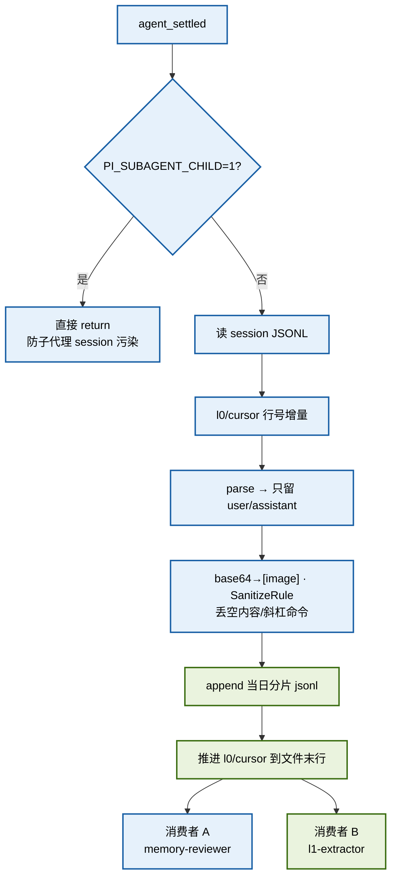
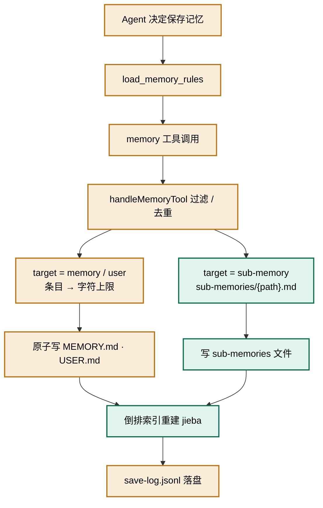
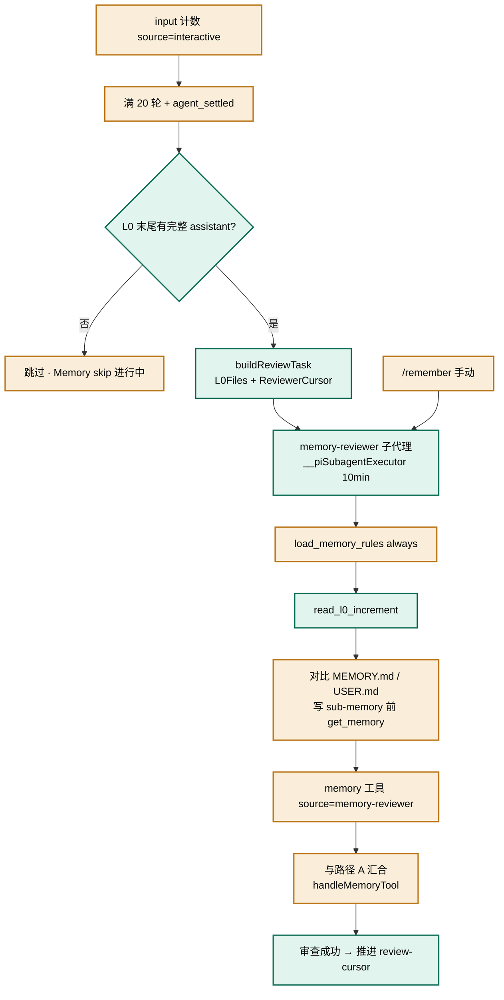
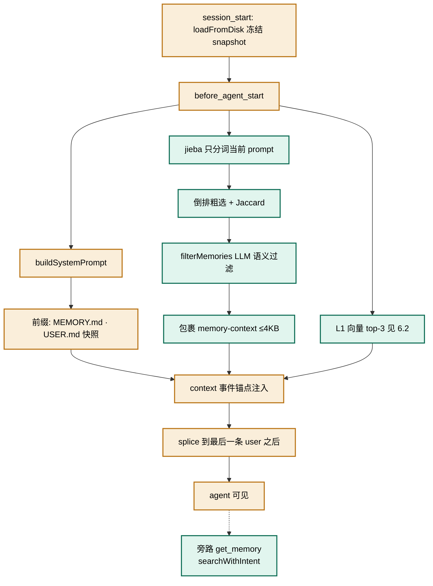
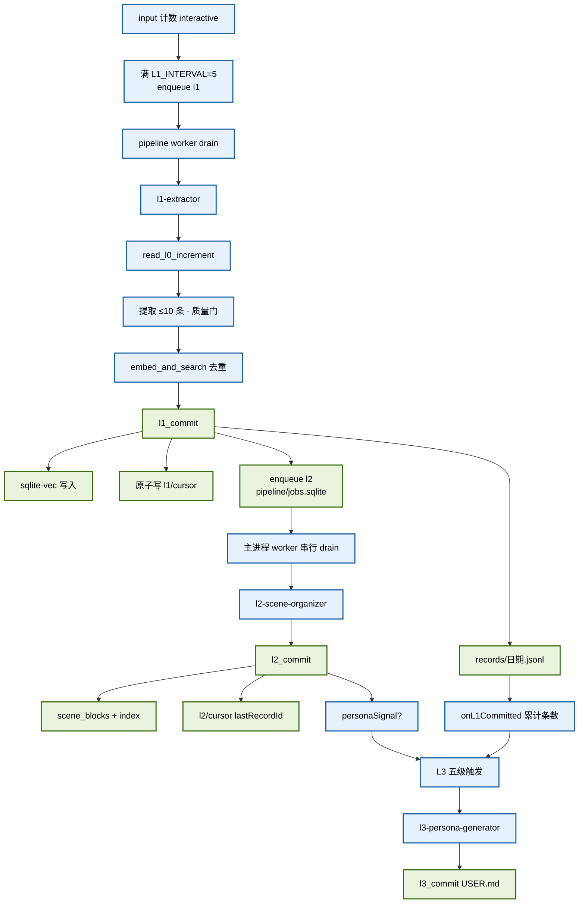
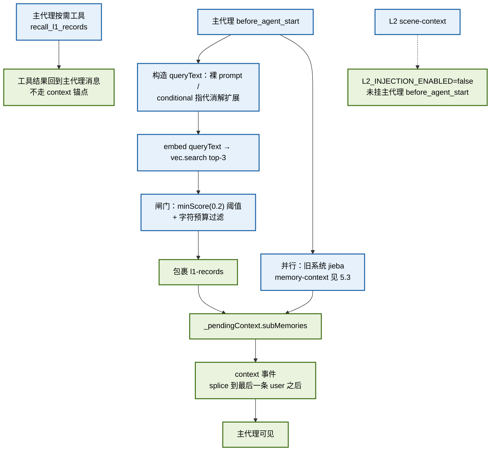
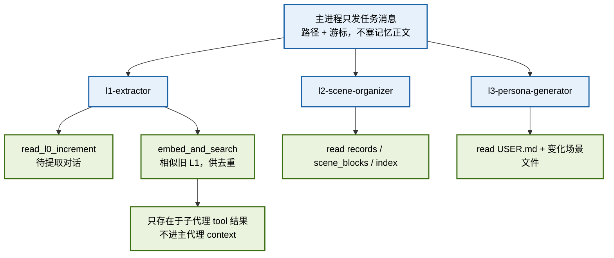

# memory-system 扩展 · 两套记忆系统架构说明

> 最近更新：2026-09-12（**旧记忆系统写链与检索链退役**；提示词收束到 `prompts/registry.ts` 单源。详见文末「近况变更」）

> ⚠️ **文档状态说明（2026-09-12）**：本文档 §5 旧记忆系统、§7 汇合点、§8 耦合风险等章节描述的是**历史形态**。
> 旧记忆系统的**写链**（`memory` 工具 / `memory-reviewer` / `sub-memories` 写入）已于 2026-09-11 随 `fad0380` 退役；
> **检索链**（`searcher` 关键词设计 / `jieba` 倒排索引 / 语义去重 / `get_memory`）已于 2026-09-12 退役并删除代码。
> 旧系统现仅存**注入侧**：`MEMORY.md` / `USER.md` 冻结快照（§5.3 琥珀色）+ `load_memory_rules`（O2）。
> 阅读本文时请以文末「近况变更」为准；文中「活跃链路」表述对旧系统部分均已失效，保留原文仅为回溯设计演进。
> 提示词相关实现已迁至 `prompts/`（单一加载中心 `prompts/registry.ts`）。

> 最近更新（原始）：2026-09-02（L1 召回闸门/引导/来源埋点、条件式 query 扩展、store 空转修复、配置收束到 `application-propertis.json`；对应 PLAN：`~/.pi/plan/memory-system/completed/L1-召回闸门与引导/L1-召回闸门与引导-计划.md`）

本文档说明 `C:\Users\leaf\.pi\agent\extensions\memory-system` 扩展中并存的两套记忆系统——**旧记忆系统**（文件即记忆）与**新记忆系统**（L0–L3 子代理管线 + 向量库）——在「提取/保存」与「注入」两条主链路上的实现，并指出两系统汇合与耦合的位置。

两套系统共用 **L0 净化归档** 作为对话增量数据源：旧系统的 `memory-reviewer` 和新系统的 `l1-extractor` 都从 L0 分片读增量，产物不同、写入通道不同。

> 架构图为内联 mermaid，本文档自包含。同一目录下的 `old-save.svg` / `old-inject.svg` / `new-save.svg` / `new-inject.svg` 为较早的独立副本，未随本次补全更新。

---

## 1. 图例与配色

| 色系            | 含义                                          | 出现的图                   |
| ------------- | ------------------------------------------- | ---------------------- |
| 琥珀色 `#FAEEDA` | 旧系统：文件落盘主链路（MEMORY.md / USER.md / save-log） | 旧·显式保存、旧·reviewer、旧·注入 |
| 蓝绿色 `#E1F5EE` | 旧系统：sub-memory 分支、检索/召回、L0 增量读取             | 旧·显式保存、旧·reviewer、旧·注入 |
| 蓝色 `#E6F1FB`  | 新系统：处理/调度/子代理轨道                             | L0、新·提取、新·注入           |
| 绿色 `#EAF3DE`  | 新系统：落盘提交节点（l1/l2/l3_commit）与注入汇聚节点          | L0、新·提取、新·注入           |

> 设计约束：单张图最多使用 2 个色系，并通过分支/并行/锯齿布局避免把所有节点串成一条直线。

---

## 2. 两套系统的本质区别

| 维度   | 旧记忆系统（MemoryStore）                                                    | 新记忆系统（L0–L3 管线）                                                                     |
| ---- | --------------------------------------------------------------------- | ----------------------------------------------------------------------------------- |
| 存储介质 | profile 根下 `MEMORY.md` / `USER.md`（`sub-memories/*.md` 已无写入者）           | `{profile}/memoryDB/`：`l0/conversations/`、`l1/records/`、`l2/scene-blocks/`、`search/vectors/`、游标与配置 |
| 保存方式 | ~~双入口：主代理显式调 `memory`；`memory-reviewer` 后台提取~~ **已退役（2026-09-11 fad0380）**——主代理改经 `l1_commit(source=main-agent)` 写 L1 | **隐式/异步**：`L1_INTERVAL` 轮入队 L1；`l1_commit` 入队 L2（`pipeline/jobs.sqlite` 串行消费）；L3 五级触发 |
| 检索方式 | ~~jieba 倒排 + Jaccard + LLM 语义过滤（`get_memory` / `<memory-context>`）~~ **已退役并删码（2026-09-12）** | embedding 余弦（sqlite-vec）；**不是**与 jieba 做 RRF 融合                                     |
| 写入者  | ~~主代理或 `memory-reviewer` 经 `memory` 工具~~ **已退役**；旧系统仅剩 `MEMORY.md`/`USER.md` 快照注入（L3 仍写 USER.md） | `l1-extractor` / `l2-scene-organizer` / `l3-persona-generator` / **主代理** 经 `*_commit` 工具 |
| 数据源  | ~~reviewer 路径读 L0 分片~~；旧系统已无写入链                                       | 同一 L0 分片 → L1 records → L2 场景 → L3 USER.md                                          |
| 参数契约 | 合规 `{type:"object", properties}`（TypeBox）                             | 早期 `embed_and_search` / `recall_l1_records` 用过扁平 map（已在 `index.ts` 包装器修复）           |

---

## 3. L0 共享净化归档层

L0 把 pi 宿主 session JSONL 转成干净、按天分片、生命周期独立的长期资产。它**不属于旧系统专有**，而是两套提取管线的共同输入。

数据目录：`{profile}/memoryDB/l0/conversations/{YYYY-MM-DD}.jsonl`  
游标文件：`{profile}/memoryDB/l0/cursor.json`



流程：

1. **触发**：主进程 `agent_settled`。子代理进程设了 `PI_SUBAGENT_CHILD=1` 时直接跳过——否则子代理自己的 `.../run-0/session.jsonl` 会被当成主会话归档，L0 会被 thinking / tool_call / commit 响应污染。
2. **增量键**：`l0/cursor.json` 以 **session 绝对路径 → 行号** 记录水位。session JSONL 是 append-only，行号即去重键。只解析 `cursor+1` 之后的行；写成功（或本轮无记录）才把游标推到文件末行，失败不推进以便重试。
3. **净化**：角色过滤（只留 user/assistant）→ 图片 base64 换成 `[image]` → `SanitizeRule`（内置 generic/memory/framework + 可选 `l0-sanitize-rules.json`）→ `shouldCaptureL0` 丢掉空内容、斜杠命令、纯 `[image]`。
4. **落盘**：按**本地日期**追加到当日分片，跨 session 混排。每行含 `sessionKey / recordedAt / id / role / content / timestamp / cwd`。`cwd` 优先 `ctx.cwd`，否则从 session 目录名启发式解码。
5. **消费**：`memory-reviewer` 与 `l1-extractor` 都不直接啃原始 session，而是调 `read_l0_increment(l0Files, cursor)` 一次拿游标后增量。

`read_l0_increment` 返回约定：

| 字段           | 含义                                               |
| ------------ | ------------------------------------------------ |
| `messages`   | `recordedAt > cursor` 的新消息，时间升序；超 200 条截断为最近 200 |
| `background` | 游标**之前**最近 5 条，只供理解语境，**禁止提取**                   |
| `nextCursor` | 本批最后一条的 `recordedAt`（子代理提交时作为新游标）                |
| `truncated`  | 是否因 200 条上限截断（剩余留给下轮）                            |

### 3.1 为什么 2-role 净化不损失 L1 提取信息（2026-08-23 验证）

L0 只保留 user/assistant、丢弃 tool_call/tool_result，是有意为之的抽象：**L1 提取的是结论而非过程**。依据：

- **意图在调用前**：tool_call 之前，user 消息携带问题/需求，assistant 消息携带调用意图（如"先读 http-dispatcher.js 确认"），这些都在 L0 中保留。
- **结论在调用后**：tool_result 被 assistant 消化后，以分析、根因判断、行动结论的形式出现在后续 assistant 消息中——这正是记忆提取需要的形态。原始工具输出（源码快照、命令 stdout）对 L1 是噪音。
- **实测对照**（skill-feed 5-role vs L0 2-role，2026-08-19 排查链）：`user: SyntaxError → read ×2（工具链，L0 丢弃）→ assistant: "Node 版本太旧不支持可选链"`。L0 丢失的只是中间文件内容，根因结论完整保留。
- **与腾讯原版一致**：原版 L1 同样从对话消息提取，不吃工具原始输出。

**两个已知盲区（不改变上述设计）**：

1. **thinking 块被剥**：若 pi 的调用前推理存在 thinking 块中，L0 不保留（角色过滤只放行 user/assistant）。丢的是"推理过程"，结论仍在 assistant 正文，对 L1 影响有限。
2. **assistant"只给行动不给结论"**：tool_result 为错误信息、assistant 仅回复"重试"时，错误详情（只在 tool_result 中）会丢失——排障类 work_method 的原料缺口。比例低，接受或按下方增强处理。

**可选增强（未实施）**：在 `archiveSessionIncrement` 的角色过滤处对 tool_result 做截断摘要，标为 assistant 写入，仅保留 `tool_name + 结果前 200 字 + 错误标志`（如 `[tool:read] 返回 http-dispatcher.js 源码片段…`），避免排障细节彻底消失，同时不引入原始输出噪音。

---

## 4. 游标机制

各层消费者推进节奏不同，所以游标文件拆开，互不覆盖。

| 文件                   | 位置                              | 结构                                                                 | 语义                                                                            | 推进者                                        |
| -------------------- | ------------------------------- | ------------------------------------------------------------------ | ----------------------------------------------------------------------------- | ------------------------------------------ |
| `l0/cursor.json`     | `{profile}/memoryDB/l0/`        | `{ [sessionPath]: { sessionPath, line } }`                         | 该 session JSONL 已归档到第几行                                                       | 主进程 `archiveSessionIncrement`              |
| `review-cursor.json` | **`{profile}/state/`**（不进 memoryDB；2026-09-14 由 profile 根移入） | `{ memoryReviewer: { sessionPath, line }, skillReviewer: ... }`    | 审查水位（按 key 分桶）。**现行代码把 ISO 时间戳写进 `sessionPath` 字段**，`line` 写 `Date.now()`（字段名是行号时代的遗留） | `skill-reviewer` 审查成功后（memory-reviewer 已停用）                |
| `l1/cursor.json`     | `{profile}/memoryDB/l1/`        | `{ lastRecordedAt }`                                               | L0 行 `recordedAt` 水位；同时其 **mtime** 是 L2 的跨进程触发信号                              | `l1_commit`                                |
| `l2/cursor.json`     | `{profile}/memoryDB/l2/`        | `{ lastRecordId }`                                                 | 已组织到的 L1 record id                                                            | `l2_commit`                                |
| `l3/cursor.json`     | `{profile}/memoryDB/l3/`        | `{ lastPersonaUpdate, memoriesSinceLastPersona, lastTriggeredAt }` | 上次画像对应的场景 `updated`；L1 提交条数累计（P4 阈值）                                          | `l3_commit` 清零累计；L1 提交时 `onL1Committed` 累加 |

读取增量时的过滤分层：

1. **分片级**：`listL0Files(profile, lastRecordedAt)` 只列出文件名日期 ≥ 游标日期的 `YYYY-MM-DD.jsonl`。
2. **行级**：`read_l0_increment` 再按 `recordedAt > cursor` 过滤。
3. **质量级**：L1 子代理另有 shouldExtract 规则，且本批只提取增量中最近 ≤10 条（对齐腾讯 `maxNewMessages`）。

原子写惯例：tmp 文件 + `rename`（Windows 上目标已存在则先删后写）。

**⚠️ L1 record id 格式是 L2 水位的隐式依赖（架构约束）**：`l2/cursor.json.lastRecordId` 经 `memory/l2/config.ts` 的 `recordEpochMs()` 解析出 epoch，`read_l1_increment` 再按该 epoch 过滤增量。若 L1 侧改动 id 格式（现为 `l1_{epochMs}_{random}`），`recordEpochMs` 会**静默返回 `0`** → 水位失效 → **L2 永久漏处理新记录**（无报错、无告警）。**改 id 格式必须同步 `recordEpochMs`。**

---

## 5. 旧记忆系统

### 5.1 保存记忆 · 路径 A：主代理显式写入

主代理在对话中决定「这条该记住」时走这条路。



流程：

1. Agent 决定保存 → `load_memory_rules` → 调用 `memory` 工具。
2. `handleMemoryTool` 做内容过滤与语义去重（jieba 倒排索引）。
3. 按 `target` 分两路：
   - **memory / user**（琥珀色）：条目受字符上限约束，原子写入 `MEMORY.md` / `USER.md`。
   - **sub-memory**（蓝绿色）：写入 `sub-memories/{path}.md`。
4. 两路合并，重建倒排索引，并落 `save-log.jsonl`。

### 5.2 保存记忆 · 路径 B：memory-reviewer 从 L0 提取

这是旧系统的**后台提取**入口，也是文档原先缺失的链路。主代理不参与决策；审查子代理读 L0 增量，再经同一套 `memory` 工具落盘。写入的文件要等到下一轮（或 L3 刷新 USER 快照后）才进入注入通道。



调度（`memory/review/reviewer.ts`）：

1. `input`（`source=interactive`）计数；满 `REVIEW_INTERVAL=20` 且无进行中任务，在 `agent_settled` 启动。用 input 而不用 settled 计数，是为了避免子代理完成通知误推阈值。
2. **未完成检测**：读最后一个 L0 分片末尾 50 行，若最后一条 user 尚无非空 assistant 文本，跳过本次（避免学到半截工具调用）。
3. 任务消息直传路径（子代理无主会话上下文）：`L0Files` / `CursorPath` / `ReviewerCursor` / `ProfilePath`。`L0Files` 复用 `listL0Files`，按 **L1 游标日期**筛分片（与 L1 共享分片枚举，但审查水位用 `review-cursor.json`）。
4. 经 `globalThis.__piSubagentExecutor` 拉起 `memory-reviewer`（`async: true`，超时 10 分钟）。Agent 定义见 `~/.pi/agent/agents/memory-reviewer.md`。
5. 审查成功后 `saveCursor(..., ISO时间戳, Date.now())`。`/remember` 可手动触发；若 `buildReviewTask` 失败（例如未完成），会用空 `ReviewerCursor` 做一次全量兜底。

子代理步骤：

1. `load_memory_rules("always")`：把 `记忆保存信号.md` + `记忆分类框架.md` 注入本子代理上下文。**（已停用）** memory-reviewer 于 2026-09-11 停用；`load_memory_rules` 现改载扩展内置的 `prompts/injection/l1-contract.md`，两份旧规则文件于 2026-09-14 归档到 `{profile}/deprecated/`。
2. `read_l0_increment(l0Files, ReviewerCursor)`：只分析 `messages`，`background` 禁提取。
3. 读现有 `MEMORY.md` / `USER.md`；写 sub-memory 前必须 `get_memory` 查重，优先 `replace` 合并。
4. **Memory vs Skill**：偏好/风格/长期指令/项目事实走 `memory`；有界可执行 SOP 留给 `skill-reviewer`，本代理不写 skill。
5. 调用 `memory`（`source=memory-reviewer`）后与路径 A 汇合进 `handleMemoryTool`。

兄弟调度：`skill-reviewer` 用同一套 L0 + `read_l0_increment` + `review-cursor.json` 的 `skillReviewer` 键，产物是 skill 库而不是 MEMORY.md。

### 5.3 注入记忆

旧系统注入发生在**主代理**每轮用户 turn 的 `before_agent_start` + `context` 事件。新系统给主代理的 L1 自动召回也挂在同一事件上（独立块），见 §6.2.1。子代理不走本节。



流程：

- **琥珀色 · 系统提示前缀（固定，打 prefix cache）**  
  `session_start` 时 `loadFromDisk()` 冻结 MEMORY.md / USER.md 快照。`buildSystemPrompt()` 每轮把快照拼进 `event.systemPrompt`。快照默认整 session 不变；L3 `l3_commit` 会 `refreshUserSnapshot()` 刷新 user 一侧，便于本 session 后续轮次用上新画像。

- **蓝绿色 · 按需召回（每轮变化，不进前缀）**  
  
  1. `searchSectionCandidates(event.prompt)`：jieba **只分词当前 prompt**（历史消息不直接分词，避免旧话题污染）；LLM 关键词缓存仍基于「prompt + 近 10 条历史」的 `queryText`。  
  2. 倒排粗选 → 切章节 → Jaccard 评分 → `filterMemories`（每 turn 一次 LLM）→ 相关章节 ≤5 章 / **≤4KB**。  
  3. 包裹 `<memory-context>`，带「非用户输入」声明，**不带文件路径**。  
  4. 并行做 L1 向量 top-3（§6.2），拼成 `<l1-records>`。

- **锚点注入（`context` 事件）**  
  `context` 改的是 `structuredClone` 副本，**不写回 session JSONL**。注入块 splice 到**最后一条 role=user 消息之后**，而不是 push 到消息列表末尾——避免工具轮次里记忆块贴着 toolResult 被当成「最新输入」反复评估。无 user 消息时（followUp 等）才追加末尾。  
  同一事件还会在记忆块**之后**注入 `load_memory_rules` 的规则（行动指令靠近生成点）。

- **旁路**：`get_memory` → `searchWithIntent` → `prefetchAll`，供 agent 主动检索，不走自动注入。

**实现缺口（源码现状）**：`before_agent_start` 先把 `_pendingContext.subMemories` 赋成空字符串，仅当 L1 向量召回命中时才写回拼接后的块。因此 **L1 无 hit 时，本轮算出来的 `<memory-context>` 不会进入 `context` 事件**。文档按代码记录，未在本轮修复。

---

## 6. 新记忆系统

### 6.1 提取 / 保存记忆

蓝色处理轨与绿色提交轨锯齿交替。L0 已在 §3；这里从 L1 触发写到 L3 汇合。



#### L1 原子记忆（`L1_INTERVAL=5`）

1. `setupL1Extractor` 对 `input`（interactive）计数；达阈值且无进行中 L1 job，在 `agent_settled` **入队** `l1`（不直接 spawn）。无 L0 分片则重置计数，避免空转。手动：`/my-memory:l1-trigger`。模式：`/my-memory:l1-mode [code|chat]`（默认 code）。
2. `buildL1Task` 读 `l1/cursor.json` 的 `lastRecordedAt`，列出游标日期及之后的 L0 分片，把 L0Files、CursorPath、RecordsDir、PromptDir、Mode、KnownProjects、**ScenePool** 写进任务消息。ScenePool = **工作场景池清单**（每行 `- {scene_id} | {稳定标签}`）：取池内「未合并 + `lastUsedAt` 在 60 天窗口内」的条目，**同项目 cwd 优先 → 近期优先**，上限 40 条（`SCENE_POOL_INJECT_LIMIT`；实测单个项目最多 34 条线程）；空池输出 `ScenePool: (无)`。本批 cwd 由 `detectBatchCwd` 从最新 L0 分片尾部 50 行的 `cwd` 众数得出（**不用 `process.cwd()`**——那是主进程 cwd，而本批要提取的可能是另一个项目，这正是 2026-09-10 那版锚点机制失效的结构性原因之一）；取不到时退化为纯 `lastUsedAt` 排序。详见「§6.2 工作场景池」。
3. 子代理（`agents/l1-extractor.md`）步骤：
   - 读游标 + `extract-{mode}.md` + `dedup.md`
   - **一次** `read_l0_increment`（禁止逐段 `read`：实测 2860 行要 38 次 LLM 往返、约 12 分钟）
   - 质量门过滤（空/斜杠命令/提示注入/框架噪音）
   - 只提取增量中最近 ≤10 条；更早的仅作背景
   - **去重**：对每条新记忆 `embed_and_search(content, topK=5)` 召回候选，LLM 判定 `store / update / merge / skip`。工具失败或空结果则回退 **read 最近 30 天 records**
   - 调 `l1_commit`，禁止自己 `write` 文件（Plan Enforcer 会拦）
4. `l1_commit`（主进程落盘）：
   - 追加 `memoryDB/l1/records/{本地日期}.jsonl`（append-only；update/merge 的旧行带 `deleted: true` 再追加，不物理删）
   - 若 `vectorization.enabled=true`（`application-propertis.json` 的 `vectorization` 节，2026-09-02 起收束，原 `config/vectorization.json`）且 embedding 配置可读（同文件 `model.embedding` 节）：对非 deleted 做 embed + `insertBatch`，对 deleted 做 `deleteBatch`。向量失败**不回滚** records
   - 原子写 `l1/cursor.json`
   - 完成 running 的 l1 job；`written > 0` 时入队 `l2`（`pipeline/jobs.sqlite`）
   - `onCommitted(written)` 只通知 **L3 计数**；**不再**回调 L2（见下）

#### L2 场景组织（sqlite 队列）

不能用 `l1_commit` 的 JS 回调通知主进程里的 L2 调度：`l1-extractor` 是独立子进程，回调闭包里的 `l2Controls` 是子进程扩展实例上的 `undefined`。改为子进程写同一份 sqlite 队列：

1. `l1_commit` 成功且 `written > 0` → `enqueue(l2, source=l1_commit)` 到 `{profile}/memoryDB/pipeline/jobs.sqlite`。
2. 主进程 `setupPipelineWorker` 每 2s 轮询 + `agent_settled` kick，**同时只跑 1 个 job**；L1 job 未完成（仍 `running`）时不会 claim L2。
3. L1 完成信号是 `l1_commit` 把 running l1 标 `done`，**不是** `await runPiSubagent` 返回（`async: true` 可能提前 resolve）。
4. 已删除 `fs.watchFile(l1/cursor.json)` 以及 L1 `await` 之后的 `triggerManual(L2)`。手动：`/my-memory:l2-trigger` 入队。
5. **子进程禁止跑流水线调度**：`PI_SUBAGENT_CHILD=1` 时 `session_start` 只设 `PI_PROFILE_PATH` 后返回，不 `recoverStuckRunning`、不 `setupPipelineWorker`、不 kick。`recoverStuckRunning` 仅回收 `started_at` 超过 **10 分钟** 的 running（防子进程 boot 误杀刚 spawn 的 job）。L1 `executeJob` 在 job 非 done 离开 running 时 abort spawn。

`l2_commit`：

- `sceneWrites[]`：`create | update | merge | delete | consolidate`；文件名须匹配 `^[\w\u4e00-\u9fff-]+\.md$`
- 场景文件 = `-----META-START-----`（created/updated/summary/heat）+ 正文（9 节：工作场景 / 适用条件 / 核心 SOP / 判断逻辑 / 禁忌与反模式 / 关键事实依据 / 相关任务与资产 / 演化记录 / 待确认问题）
- **成员清单**：写入可带 `members`（该块收录的 L1 record id）。权威载体是 sidecar `memoryDB/l2/index/scene_members.json`，`syncSceneIndex()` 读它并并入索引条目——因为索引是**派生物**（每次提交后从块文件全量重建），成员只放索引会被冲掉。
- 扫描 `l2/scene-blocks/` **全量重建** `memoryDB/l2/index/scene_index.json`（按 heat 降序）
- 推进 `l2/cursor.json` 的 `lastRecordId`
- 可选 `personaSignal` + `personaReason` → L3 P1

**`consolidate`（合并场景的原子动作，2026-09-10 新增）**：`{action:"consolidate", filename:<目标>, sources:[…], content}` —— 主进程原子完成「备份源块 → 完整性校验 → 写目标 → 删源 → 成员并集 → 重建索引」。

- **执行顺序是不变量**：**先写目标、再删源**——反过来的话，中途失败会得到「源已删、目标未建」= 内容真丢失；当前顺序最坏只是暂时多出一个块。完整性校验在**落盘之前**（失败整批拒绝、源块分毫不动）。
- **完整性校验**（`checkConsolidation()`，纯函数）：① 成员覆盖 —— 显式传 `members` 时漏源成员即**拒绝**；② 行数比 —— 目标正文不足源合计 **50%** 且源 ≥3 即**拒绝**，<80% 只警告；③ id 引用覆盖 —— 源正文的 record id 未出现在目标正文则警告。
- **`created` / `heat` 由代码计算**（created 取源最早、heat 取最大），不再依赖提示词守则——历史上曾发生 heat 被重置（32→0）、`created` 被改写。
- 源块备份到 `{profile}/memoryDB/backups/l2-consolidate-<tag>/`（含 `_manifest.json`，保留最近 5 份）。**禁用 `git stash` 做备份**（08-18 有 stash 丢密钥事故）。
- 旧 `merge` 动作保留兼容但**不再推荐**：它等于「写目标 + 另发 `delete`」两个独立步骤、中间无校验，历史上 3 次静默丢内容（-42.8% / -41.7%）即由此产生。

**场景数硬上限**：配置中心 `memoryDB/config/application-propertis.json` 的 `l2.maxScenes`（默认 15），由 `buildL2Task` 注入任务消息的 `MaxScenes` 行。**由代码强制**：`checkSceneLimit()` 按提交顺序**预演**这批写入，任一刻超过上限即**整批拒绝**并指引"先执行合并评估"；**净收缩（delete / consolidate）一律放行**——否则已达上限时无法靠自我整理脱离该状态（死锁）。

L1 record 的 `scene_name` 只是 L1→L2 的语义提示（L2 组织场景时将其作为强提示用于匹配已有场景），**不是 L2 场景文件的路径映射**——L1 的 `scene_name` 是「稳定标签 `{项目}｜{议题}`」（2026-09-15 起；此前为长句），L2 场景文件名是 slug，二者不是同一体系（`l2/config.ts` 的 `buildL2Task` 也不传 L1 情境名）。

#### 6.2 工作场景池（L1 场景归属的唯一真源）

`{profile}/memoryDB/l1/scenes.json`（路径常量 `paths.ts` 的 `L1_SCENES_FILE`）。**记录里的 `scene_name` 只是落盘当时的历史快照，池才是归属真源。**

- **条目**：`{ id（`sc0001`，永不复用）, name（稳定标签 `{项目}｜{议题}`，池内唯一）, cwds[], aliases[], mergedInto, origin（seed|extract|main-agent）, createdAt, lastUsedAt, useCount, newSceneReason? }`
- **写入者只有 `l1_commit`**，且在 **L1 跨进程写锁内**（锁在记录落盘之前获取）；顺序为「锁内解析内存态 → 追加记录 → 写回池」。池写失败只 `console.warn`：记录已带正确名字，池缺条目下批会重建（幂等）。
- **子代理契约**（`extract-{code-personal,chat}.md` 任务一 / `l1-extractor.md` 第四步）：每个情境**二选一**——复用只回传 `scene_id`（逐字取自清单，禁自造 id、禁手抄名字），新建给 `new_scene_name`（稳定标签）+ `new_scene_reason`。**canonical 名字由代码从池取值**写进记录的 `scene_name`；`new_scene_name` / `new_scene_reason` 是中间字段，落盘前被剥离。
- **为什么这么改**（2026-09-15）：此前 `scene_name` 由子代理自由造句、服务端零校验，「逐字复制」是不可执行的软约束；实测碎片化到 248 条记录裂成 100 个名字、锚点复用率 15.5%、命中 `PreviousScene` 仅 0.6%（连续三天为 0）。改成 id 机制后，抄错/改写/同义替换这一类失败模式从机制上消失。
- **稳定性设计**：新建名必须是稳定标签，**禁止把瞬时活动写进名字**（活动一变名字就"不该"同名，这是碎片化的主因）；判据是「同一议题下活动变化（排查→实现→验证）→ 复用；议题换了 → 新建」。
- **主代理路径**：显式 `scene_name` 按名字/别名在池内匹配（命中用 canonical），**未命中不登记进池**（主代理看不到清单，自由文本不该污染候选集）；未给则取同 cwd 最近条目，池空则占位 `main-agent-live` 并标 `sceneNameFallback`。
- **不重写历史**：`aliases` / `mergedInto` 只在读取期解析，历史 248 条记录的 `scene_name` 一律不动（改记录要全量重嵌向量库）。
- **运维工具**：`scripts/l1-admin/scene-pool.mjs` 的 `report` / `cluster` / `seed` / `merge-report`（除 `seed --apply` 外全只读；本轮不含自动合并）。
- **回归基线**：`tsx scripts/verify-l1-scene-pool.ts`（89 项断言，含用 mock pi API 直调 `l1_commit` 的端到端）。
- **指标**：批边界 = 同一 commit 的记录共享同一 `createdAt`（`l1_commit` 用单个 `nowStamp` 落盘）；`reused` = 记录 `scene_id` 指向 `createdAt` 早于本批的条目。分母不再需要 `anchor-log.jsonl`（该日志已停止写入，文件保留作历史基线）。

#### 6.1.1 提取失败处理与游标推进（L1 / L2）

L1 与 L2 的游标都**只在各自成功提交工具（`l1_commit` / `l2_commit`）时由主进程回写**；子代理只要没成功走到 commit，游标就不推进。两层的失败都只做 `console.warn` 落日志，**没有重试、死信队列、持久失败计数，也不弹用户通知**——失败在宿主日志里是静默的，用户侧看不出「失败」与「没跑」的区别，只能看到状态栏 `Memory ⚙L1...` / `⚙L2...` 在 `finally` 里照常清除。

**统一失败处理机制**

| 环节    | 代码位置                                      | 行为                                                                                          |
| ----- | ----------------------------------------- | ------------------------------------------------------------------------------------------- |
| 子代理执行 | `util/subagent.ts` `runPiSubagent`        | `executor` 不存在 → throw；与 L1/L2 超时（180_000ms）赛跑，超时 abort + reject                           |
| 队列锁   | `memory/pipeline/worker.ts`               | 同时只 claim 1 个 job；L1 占用未结束不跑 L2                                                             |
| 残留回收 | `jobs-db.recoverStuckRunning`             | 只回收 `started_at` >10min 的 running；子进程 session_start 不调用                                      |
| L1 完成 | `l1_commit` → `completeRunningL1`         | 未 commit 则 job 保持 running 直到超时标 failed，不入队 L2；非 done 结束会 abort spawn                     |

`pipeline-jobs` 的 `running` 是互斥阀：失败会标 `failed` 并允许下一轮入队，当轮不自动重试。

**Q1 · L1 提取失败时**

- **游标推进**：不推进。`l1/cursor.json` 的唯一写点在 `commit-tool.ts` 的 `saveCursor`，由 `l1_commit` 调用。失败走不到 commit，游标停在旧值，也不会入队 L2。
- **失败机制**：见上表；interval 入队时 `turnCount` 已清零，失败后需再累计 `L1_INTERVAL=5` 轮。
- **对下一次 L1 的影响**：`buildL1Task` 读仍为旧值的 `loadL1Cursor` → 同一批 L0 分片会被重新提取（幂等重试，不丢数据）。

**Q2 · L2 提取失败时**

- **游标推进**：不推进。`l2/cursor.json` 唯一写点在 `l2_commit`。
- **触发**：只由下一次成功的 `l1_commit`（`written > 0`）再入队，或 `/l2-trigger`。不再看 `l1/cursor.json` mtime。
- **工作集**：`read_l1_increment` 按 `l2/cursor` 的 `lastProcessedAt` 增量过滤（不是全量重扫 staging）。
- **连锁停滞**：L2 持续失败则场景陈旧，L3 也跟着停；L1 仍可继续入队、commit。

**Q3 · 当前 L2 提取是串行的吗**

**是。** 全局只有一个 pipeline worker，同时只跑一个 L1 或 L2 子代理。L2 自身也是单次 `l2-scene-organizer`（增量工具拉 records，不再按文件拆多子代理并行）。

#### L3 人格（写回旧系统 USER.md）

`setupL3Persona` 在 L1 提交时累加 `memoriesSinceLastPersona`，在 L2 提交后（或 P1 信号）做五级判断（`memory/l3/trigger.ts`）：

| 优先级  | 条件                                            |
| ---- | --------------------------------------------- |
| P1   | `personaSignal` 或 `/my-memory:persona`（force） |
| P2   | 有场景、从未生成过 persona                             |
| P2.5 | 曾生成但 USER.md 正文丢失                             |
| P3   | 索引恰好 1 条场景且已有 L1 计数、尚无正文                      |
| P4   | `memoriesSinceLastPersona >= L3_INTERVAL`（30） |

已有 persona 且无 `updated` 晚于 `lastPersonaUpdate` 的场景 → 增量跳过。

`l3_commit`：XML 转义 → 字符硬限额 1375（code 模式软限额 1200）→ 若 USER.md 已存在则必须保留 `Archetype` / `Chapter 1` / `Chapter 3` 结构标记 → 原子写 USER.md → 重置 L3 游标累计 → `refreshUserSnapshot()`。这是与旧系统注入通道的**写入汇合**。

子代理超时一律 10 分钟（L1/L2/L3/reviewer 相同量级）。

### 6.2 注入记忆（主代理与子代理不是同一条路）

先分清**被注入的是谁**。主代理跑在前台会话进程；L1/L2/L3 子代理是 `pi-subagents` 拉起的**独立进程**（`systemPromptMode: replace`），看不到主代理的 `_pendingContext`，也吃不到主代理 `context` 事件里 splice 的块。

「混合召回」在向量化计划里曾指 jieba + embedding 做 RRF。实现上两者是不同实体，**主代理侧改为两块独立注入**；文件 `hybrid-recall.ts` 只服务主代理的 L1 余弦，不是子代理去重工具。

| 进程      | 目的                  | 记忆如何进入该进程的上下文                                                                                    |
| ------- | ------------------- | ------------------------------------------------------------------------------------------------ |
| **主代理** | 回答用户时带上相关 L1 / 旧文件库 | **注入通道**：`before_agent_start` → `context` 锚点；另可主动调 `recall_l1_records`                           |
| **子代理** | 提取 / 组织 / 生成画像      | **不走注入通道**。任务消息给出路径，子代理自己 `read` / `read_l0_increment` / `embed_and_search` 把数据拉进**自己的** tool 结果 |

`embed_and_search` 不是主代理注入的一条支路；`recall_l1_records` 也不是子代理去重工具。

#### 6.2.1 主代理注入

只发生在**前台会话进程**。向量库：`memoryDB/search/vectors/l1-vectors.sqlite`（qwen3.7-text-embedding / 1024 维）。



| 入口    | 触发                               | topK | 进入主代理上下文的方式                                       |
| ----- | -------------------------------- | ---- | ------------------------------------------------- |
| 自动注入  | 每轮用户 turn 的 `before_agent_start`（2026-09-15 起经**召回调度闸门**，默认 `blocking` 等 ≤1s、`async` 则不等） | 3（经 minScore 0.2 过滤后可能 <3 或 0） | `<l1-records>`，**就绪后**写入 `_pendingContext`、由 `context` 锚到最后一条 user 消息之后（因此本轮首次调用可能尚无该块） |
| 按需拉取  | 主代理自己调 `recall_l1_records`       | 默认 5 | **工具返回 JSON**，不经 `context` 事件                     |
| 旧文件库  | 同一 `before_agent_start`          | ≤4KB | `<memory-context>`（jieba），与 L1 块独立拼接              |
| L2 导航 | `buildL2Injection`               | —    | 未启用                                               |

自动注入前置：`getVectorStore().isAvailable()` 且 `count()>0`。失败静默降级。向量库未就绪时主代理只有旧系统注入，新系统「只存不取」。（2026-09-02 修复：`count()` 改为查 vec0 真实向量行数——此前映射表残留会误报"有向量"，实际 `search()` 恒空，导致每轮白调 embedding API 且从不注入。）

实现（2026-09-02 更新）：两条路径统一走 `recallL1Records()`——

- **query 构造**：默认裸 `event.prompt`（本轮意图信号）。仅当 `contextExpansion=conditional`（recall 节默认）且命中指代消解（prompt 含指代词 / 长度 <12）时，追加最近 2 条 **role=user** 消息（排除 assistant/toolResult，200 字上限）；`always` 仅作 A/B 对照组。
- **闸门（2026-09-02 新增）**：召回 top-K 后按 `minScore`（0.2，40 条真实消息采样标定：top-1 P25=0.058 / P50=0.254）做相似度阈值过滤——低于阈值不注入，宁缺毋滥（可能注入 0 条）；再加字符预算（单条 300 / 总量 2000）截断。观测日志 `[l1-recall] recall=N filtered=M kept=K`。
- 自动注入传 `source:"inject"`（top-3），`recall_l1_records` 由模型按需调用（默认 top-5，`source:"tool"`）、结果留在 tool 消息里。命中计数按 turn 去重（同一 turn 内注入 + 工具召回同一条只计 1 次），见 §6.2.3。
- **召回调度闸门（2026-09-15 新增，§11.5）**：会话级串行（任一时刻至多一个召回活动）、闸门释放绑定底层 settle、底层不结束时由 `maxHoldMs` 强制释放；自动注入为 `inject` 类（可丢弃、单槽 latest-wins），`recall_l1_records` 为 `demand` 类（**必 settle**，否则挂死 agent loop 工具阶段）。
- 参数集中在 `{profile}/memoryDB/config/application-propertis.json` 的 `recall` 节（见 §9）。

**召回引导（2026-09-02 新增；2026-09-12 路径更新）**：`prompts/backends/tool-reminder.md`（经 registry 渲染，原 `memory/prompts/tool-reminder.md`）的 `[Memory Recall]` 段每轮随 system prompt 注入——告知已有 `<l1-records>` 自动注入、不够时主动调 `recall_l1_records`（自定 queryText）、判无用调 `clear_invalid_l1_records`、**每轮合计上限 3 次**（3 次无果即记忆中没有，直接继续）。这是 `recall_l1_records` 工具从"注册但从不被调用"（`invalid_hits` 恒 0）走向可用的引导开关。**2026-09-15 同步改写文案**：原句断言「每轮已在上方注入」，而就绪式注入下本轮首次调用可能尚无该块（单次答完的 turn 更是整轮没有）——改为「块就绪即注入、缺席不等于没有该记忆」。

与 jieba 块：设计上应拼成 `<memory-context> + <l1-records>` 再写入 `_pendingContext`；因 §5.3 空占位，无 L1 hit 时 jieba 块也可能没注入。

运维命令只动向量库，不参与每轮注入：`/my-memory:l1:embedding:list` / `backfill` / `rebuild`。

#### 6.2.2 子代理如何读到记忆（不是注入通道）

子代理 frontmatter 均为 `systemPromptMode: replace` + `subagentOnlyExtensions: memory-system`。主代理那份系统提示前缀、`<l1-records>`、`<memory-context>` **不会作为「主会话注入结果」传给子代理**。子代理要工作数据，只能：

1. 读任务消息里的绝对路径（L0Files / RecordsDir / SceneDir / …）
2. 调**自己白名单里的工具**，结果出现在**子代理自己的**消息列表



| 子代理                    | 白名单工具                                                        | 读入的是什么                  | 去哪                      |
| ---------------------- | ------------------------------------------------------------ | ----------------------- | ----------------------- |
| `l1-extractor`         | `read`, `read_l0_increment`, `embed_and_search`, `l1_commit` | L0 增量 + 向量相似的旧 L1（去重候选） | 子代理对话；再经 `l1_commit` 写盘 |
| `l2-scene-organizer`   | `read`, `l2_commit`, `read_l1_increment`                      | L1 增量（按游标）+ 已有场景    | 同上，`l2_commit`          |
| `l3-persona-generator` | `read`, `l3_commit`                                          | USER.md + 场景文件          | 同上，`l3_commit`          |

因此：`embed_and_search` 与主代理 `before_agent_start` **同库不同消费者**——前者把候选喂给 l1-extractor 做 store/update/merge/skip；后者把 top-3 喂给前台用户对话。失败时子代理降级为 read 最近 30 天 records，仍然只发生在子代理进程。

**实现耦合（不是设计上的子代理注入）**：子代理进程会加载同一份 `index.ts`，`before_agent_start` **没有** `PI_SUBAGENT_CHILD` 守卫（L0 归档有）。子代理 turn 上仍可能按**任务消息**跑一遍主代理注入逻辑。那是钩子误伤，不要画成「子代理注入路径」。

#### 6.2.3 L1 命中统计（记忆评估指标）

新系统此前没有任何「记忆被使用 / 被召回」的评估字段（L2 的 `heat` 仅度量整理维护频次，非命中次数）。新增 `l1_hit_stats` 表记录每条 L1 原子记忆的召回质量：

| 字段 | 含义 |
| --- | --- |
| `record_id` | L1 record id（`l1_{epoch}_{random}`），主键 |
| `hits` | 命中次数 = `inject_hits + tool_hits`（被 agent 面向召回的次数） |
| `inject_hits` | 自动注入路径命中次数（2026-09-02 起区分两条召回路径） |
| `tool_hits` | 工具召回路径命中次数（`recall_l1_records`） |
| `invalid_hits` | 无效命中次数：被召回后，LLM 判定无参考价值、由「清除记忆」工具从上下文移除 |
| `effective_hits` | 有效命中次数 = `hits - invalid_hits`（同事务维护，永不为负；`invalid_hits` 钳制到 `hits`） |
| `last_hit_at` / `last_invalid_at` | 最近一次召回 / 无效命中时间（ISO8601） |
| `created_at` / `updated_at` | 行生命周期 |

存储：`{profile}/memoryDB/l1/hit-stats.sqlite`（node:sqlite，与向量库 `l1-vectors.sqlite` 物理隔离）。2026-09-02 加列迁移：构造函数 `PRAGMA table_info` 检测 + `ALTER TABLE ADD COLUMN`（存量库免重建，幂等）。

**计数契约**：
- 命中：**两条召回路径都走 `recallL1Records()`**——loop-start 自动注入（`before_agent_start`，top-3，`source:"inject"`）与 `recall_l1_records` 工具（默认 top-5，`source:"tool"`）。
- **计数点（2026-09-15 变更）**：工具路径仍在 `recallL1Records()` 返回时计数；**自动注入路径改为在 `context` 事件把块真正入列的那一次计数**（`countHits:false` + `_pendingContext.hitsCounted` 一次性）——因为「召回返回」≠「真的注入」，单次答完的 turn 里块可能从未被读出。口径变更时点：2026-09-15。
- **turn 级去重**：`index.ts` 维护模块级 `currentTurnHitSet`（`before_agent_start` 每 turn 开头 `clear()`），自动注入与工具共用同一引用；`recallL1Records` 的 `hitDedupSet` 选项保证同一 turn 内同一条记忆（注入 top-3 与工具 top-5 语义重叠）只计 1 次命中。retry / compaction / followUp 不重触发 `before_agent_start`，Set 保留 → 同一 turn 续跑仍去重。
- 无效命中：`clear_invalid_l1_records` 工具（已实现）在把某 record 从上下文移除时，调 `recordInvalid(record_id)`（+1，`invalid_hits` 钳制到 `hits`）。约定每次清除调用一次，使 `invalid_hits` 与一次 prior hits 对应。
- `embed_and_search`（l1-extractor 去重）不调用 `recallL1Records`，不计数。

`effective_hits` 可用于冷记忆降权 / 淘汰、重要性排序（见 `getTopEffective(limit)`）。

#### 6.2.4 L1 质量分：活跃会话日时钟 + 淘汰保护带（2026-09-01 定版）

质量分在**读侧实时计算**，不持久化（`memory/l1/quality.ts`）：

```
effective = hits - invalid
days      = 自 last_hit_at（无命中则 createdAt）以来的【活跃会话日】数
decay     = exp(-days / 14)
penalty   = hits>0 ? (1 - min(invalid/hits, 0.8)) : 1
quality   = 新记录保护 ? max(priority/100, 0.3) : effective * decay * penalty
```

**两个时间量必须区分**（混用会出事）：

| 量 | 定义 | 用途 |
| --- | --- | --- |
| `days` | **活跃会话日**（有 L0 归档 = 当天开过 pi） | 喂 `decay`、判「冷 / 待观察」 |
| `ageDays` | 日历天真实年龄 | 只用于新记录保护与「新」标签 |

活跃日来源：`memoryDB/l0/conversations/YYYY-MM-DD.jsonl` 的**文件名**（零新增写入），见 `memory/l1/active-days.ts`。

**改动一：衰减时钟从墙上时钟改为活跃会话日**

原实现 `days = now - last_hit_at`（日历天），decay 度量的是「用户多久没开工」，而非「记忆是否过时」——两个完全不同的量。典型失效：用户停工 60 天，一条 18 次命中的高价值记忆 quality 跌到 0.25，与废记忆同分；事实上它从未获得过被重新验证的机会。改为活跃日后，停工期间 `days` 不增长、decay 冻结，复工后按实际工作节奏继续衰减。

实测（213 条记录，活跃日 11 个 / 跨度 16 日历天）：decay 均值 0.479 → 0.666；`冷` 从 23 条归 0（活跃日尚未累积到 14）。

> 已知局限：活跃日是全局的，不区分项目。个人开发者单线工作成立；长期并行多项目时，某项目休眠而全局活跃，该项目记忆仍会衰减。

> 坑：新记录保护若误用 `days < 7`，停工用户的老记忆会因活跃日少被判为新记录、拿回 `priority/100` 保底分（实测「新」标签从 7 条暴涨到 83 条）。故保护期只认 `ageDays`。

**改动二：quality（热度）与淘汰权（删除资格）分离**

`quality` 长期不被命中就趋近 0 —— 这符合人类记忆的遗忘曲线，是对的。**但人类遗忘表现为「提取变难」，不是「信息被删除」**。因此删除资格不由 quality 单独决定，交给 `judgePrune()`：

| 判定 | 条件 | 语义 |
| --- | --- | --- |
| 可淘汰 · 被证伪 | `hits ≥ 3` 且 `invalid/hits > 0.5` | 真实负反馈，优先淘汰 |
| 可淘汰 · 长期闲置 | `effective == 0` 且 `days ≥ 30` | 对应人类记忆中真正被清理的部分 |
| 保护 · 内在价值 | `priority ≥ 动态阈值` | 提取时判定为高价值，不因曝光量少而删 |
| 保护 · 类型 | `type == work_method` | 编码方法类记忆低曝光是常态 |
| 保护 · 已验证 | `effective > 0` | 被有效用过的记忆不因闲置淘汰 |

实测（模拟活跃日累积到 36 天）：无保护带按 `quality == 0` 直接砍 **165/213** 条；加保护带后仅 **47** 条进入候选（priority 保护 94、work_method 保护 12、有效命中过 21）。

> **保护阈值必须动态取分位**：实测 L1 提取的 priority 存在通胀（全库最低 65、中位 85），固定阈值 60 会保护 100% 记录使淘汰彻底失效。现按 `priority` 分布 **P75** 取阈值（当前实测 85），以 `PRUNE_RULES.protectedPriority = 60` 为下限。

**配套：JSON 侧车契约变更**

`l1/hit-stats.json` 从裸数组改为对象，供 `records-viewer.html`（跑在 `file://` 下列不了 l0 目录）使用同一套时钟：

```json
{ "generatedAt": "...", "activeDays": ["2026-08-17", "..."], "stats": [ ...原数组... ] }
```

viewer 已兼容新旧两种格式；无 `activeDays` 时退化为日历天并在页面上标注。侧车在 DB 实例化（每会话至少一次）与每次 `recordHits` / `recordInvalid` 后重写，保证活跃日不滞后。

**遗留问题（未修）**

1. 命中统计自 2026-08-22 起停更（l1/records 提取持续到 8/27，hit-stats 停在 61 行），疑似 `vecStore.search()` 异常被 `recallL1Records` 的 catch 吞掉，或 `recordHits` 写锁超时。
2. L1 提取的 `priority` 打分通胀（65–92，中位 85），区分度不足，是提取 prompt 打分表的问题。

---

## 7. 两套系统的边界与汇合点

两套系统并非完全独立：

1. **L0 输入汇合**：session → L0 分片是唯一净化对话源；`memory-reviewer` 与 `l1-extractor` 并行消费，产物分别进 markdown 文件库与 records/向量库。
2. **写入通道汇合**：`l3_commit` 把人格写回 `USER.md`（旧系统注入通道），并 `refreshUserSnapshot()` 刷新冻结快照。
3. **主代理注入通道汇合**：仅前台进程把 `<memory-context>`（快照，`before_agent_start` 内即就绪）与 `<l1-records>`（**召回就绪后**才写入 `_pendingContext`）经 `context` 事件锚到最后一条 user 消息之后。子代理不走这条汇合。
4. **主代理主动拉取并存**：`get_memory`（旧，jieba + LLM）与 `recall_l1_records`（新，向量）都是**主代理**工具，互不调用。子代理去重用 `embed_and_search`，不要与这两项并列。
5. **工具桥接同构**：旧 reviewer 用 `memory` 绕过 Plan Enforcer；新管线用 `l1_commit` / `l2_commit` / `l3_commit` / `read_l0_increment` 同一模式。

一句话：**旧系统是「人写人读的文件库」，新系统是「机器提炼的分层库」，二者在 L0 数据源、`USER.md`、以及 `before_agent_start` 的注入合并处被缝成同一份上下文。**

---

## 8. 耦合风险

- **`USER.md` 双重写入**：旧系统允许主代理 / reviewer 直接写 `USER.md`；L3 也会写回（结构标记硬保护）。两边体例不同（条目列表 vs Archetype/Chapter 模板），存在互相覆盖或风格撕裂。
- **主/子代理注入钩子共用一份 `index.ts`**：`before_agent_start` 已加 `PI_SUBAGENT_CHILD` 守卫（与 L0 归档同款判断），子代理 turn 直接返回、不再跑主代理注入 / 建 `_pendingContext` / 计 L1 命中。不要把 `embed_and_search` 画进主代理注入图。
- **子进程误跑 pipeline recover**：`session_start` 在子进程里曾把父进程刚 claim 的 running l1 标 `failed`（TUI 假「未 commit 就 end」）。现子进程跳过调度；recover 有 10 分钟宽限期。
- **L2 触发跨进程**：进程内 `onCommitted` 通知 L2 会丢；现由 `l1_commit` 写入 `pipeline/jobs.sqlite`，主进程 worker 消费。不要再画 watchFile，也不要再画 L1 `await` 之后 triggerManual L2。
- **`review-cursor.json` 字段复用**：现行 reviewer 把 ISO 时间戳塞进 `sessionPath`，与模块注释里的「行号游标」不一致；读侧用 `cursor.sessionPath` 当 `ReviewerCursor`。改结构需 reviewer 与 `saveCursor` 一起迁。
- **`_pendingContext` 空占位**：无 L1 hit 时 `<memory-context>` 可能未注入（§5.3）。
- **L0 子代理污染**：无 `PI_SUBAGENT_CHILD` 守卫时，子代理 session 会进 `conversations/`，下一轮 L1 会把提取过程本身当成对话记忆。
- **历史工具契约**：`embed_and_search` / `recall_l1_records` 曾用扁平 map 参数 + 非标准返回值，导致 schema 400 与 `getTextOutput` 的 `filter` 崩溃；已在 `index.ts` 的 `registerTool` 包装器统一升级。
- **文件名误导**：`hybrid-recall.ts` 不做 jieba+向量混合，只召回 L1 records。

---

## 9. 关键文件索引

| 文件                                                                      | 职责                                                                              |
| ----------------------------------------------------------------------- | ------------------------------------------------------------------------------- |
| `index.ts`                                                              | 扩展入口；`registerTool` 包装；L0 归档；`before_agent_start` / `context` 注入；turn 级去重 Set；注册 commit/召回工具 |
| `memory/paths.ts`                                                       | memoryDB 路径常量；标明 `review-cursor.json` 不归 memoryDB                               |
| `memory/l0/index.ts` · `sanitize.ts` · `session-parser.ts`              | L0 行号游标、净化、按日分片                                                                 |
| `memory/review/reviewer.ts` · `review-cursor.ts`                        | memory-reviewer 调度与审查游标                                                         |
| `memory/core/store.ts` · `tool.ts` · `manager.ts`                       | MemoryStore 快照、`handleMemoryTool`、`refreshUserSnapshot`                         |
| ~~`memory/search/searcher.ts` · `inverted-index.ts`~~ | **已删除（2026-09-12）**：jieba 倒排 + Jaccard + LLM 语义过滤（旧检索链，无活跃消费者） |
| `memory/l1/index.ts` · `config.ts` · `read-tool.ts` · `commit-tool.ts`  | L1 调度、分片清单、`read_l0_increment`、`l1_commit`                                      |
| `memory/l2/index.ts` · `config.ts` · `commit-tool.ts` · `navigation.ts` | L2 入队执行、场景提交、未启用的导航注入 |
| `memory/pipeline/jobs-db.ts` · `worker.ts` | L1/L2 流水线 sqlite 队列与主进程串行 worker |
| `memory/l3/index.ts` · `trigger.ts` · `commit-tool.ts`                  | L3 五级触发、USER.md 提交                                                              |
| `memory/search/hybrid-recall.ts`                                        | `recallL1Records`：L1 向量余弦召回 + minScore 阈值/字符预算闸门 + source 埋点 + turn 级去重（`hitDedupSet`）；观测日志 `[l1-recall]` |
| `memory/search/recall-config.ts` · `config/app-config.ts`               | `recall` 节类型化合并；`application-propertis.json` 统一配置中心读写底层（`loadAppProps`/`saveAppSection` 合并写） |
| `util/jsonc.ts`                                                         | JSONC 解析（配置中心文件支持注释；字符串内 `//` 不误剥）                                      |
| `memory/search/embedding/tool.ts`                                       | `embed_and_search`（子代理去重）                                                       |
| `memory/search/recall-l1-records-tool.ts`                               | `recall_l1_records`（主代理主动，`source:"tool"`；场景化 description）                  |
| `memory/search/vector-store/store.ts`                                   | sqlite-vec；`db.exec` + `vec_f32`（不支持 prepared statement）；`count()`/`getAllVectorizedRecordIds()` 查 vec0 真实行数（2026-09-02 修复空转误判） |
| `memory/stats/l1-hit-stats-db.ts`                                       | L1 命中统计库（node:sqlite）：hits / inject_hits / tool_hits / invalid_hits / effective_hits |
| `~/.pi/agent/agents/memory-reviewer.md`                                 | 旧系统后台提取 agent 定义                                                                |
| `~/.pi/agent/agents/l1-extractor.md`                                    | L1 提取 agent 定义（含去重四动作）                                                          |

运行时数据（相对 `{profile}/memoryDB/`，除注明外）：

| 路径                                              | 内容                                     |
| ----------------------------------------------- | -------------------------------------- |
| `l0/conversations/*.jsonl`                      | L0 净化对话                                |
| `l1/records/*.jsonl`                            | L1 原子记忆                                |
| `l2/scene-blocks/*.md`                          | L2 场景                                  |
| `l2/index/scene_index.json`                    | 场景索引（heat 排序）                          |
| `search/vectors/l1-vectors.sqlite`                    | L1 向量                                  |
| `l1/hit-stats.sqlite`                          | L1 命中/有效命中统计（评估指标）                |
| `pipeline/jobs.sqlite`                         | L1/L2 流水线 job 队列                         |
| `config/application-propertis.json`             | **统一配置中心（JSONC，2026-09-02 收束）**：`recall`（minScore 0.2/字符预算/contextExpansion）· `vectorization`（enabled/threshold）· `l1`（mode）· `model`（llm/embedding，含 apiKey）。读取走 `parseJsonc`/`app-config.ts`，勿用裸 `JSON.parse` |
| `config/*.legacy-20260902`                      | 收束前旧配置文件备份（`memory-system-model.json`/`vectorization.json`，代码仍读兜底，稳定后清理） |
| `l0/cursor.json` … `l3/cursor.json`             | 各层游标                                   |
| `{profile}/state/review-cursor.json`             | reviewer 游标（**2026-09-14 由 profile 根移入 `state/`**）                 |
| `{profile}/MEMORY.md` `USER.md` `sub-memories/` | 旧系统文件库                                 |

---

## 10. 配图说明

文档内 mermaid 覆盖：L0 共享层、旧系统显式保存、旧系统 reviewer 提取、旧系统注入、新系统 L1–L3 提取、**主代理注入**、**子代理工具拉入**（两张图，不要画成一条注入链）。同一目录下的四张 SVG 为较早副本，可忽略。

---

## 11. 近况变更（2026-09-11 / 09-12）

> 本节为**权威现状**，与上文历史描述冲突时以本节为准。

### 11.1 旧记忆系统写链退役（2026-09-11，提交 `fad0380`）

- `memory` 工具退役（块注释）；`memory-reviewer` / `memory-organizer` 停用；`/remember` 随之消失。
- 主代理主动记录改道 **`l1_commit(source="main-agent")`**：服务端补齐 id/时间/会话/cwd、写 `metadata.origin="main-agent"`、不推进 L1 游标、不入队 L2（L2 入队条件改为「游标后有存活记录」）。
- `load_memory_rules` 载荷从 profile 散落文件换为扩展内置 `prompts/injection/l1-contract.md`；once 清除时机改挂 `l1_commit`。
- 旧规则文件 `记忆保存信号.md` / `记忆分类框架.md` 加停用横幅，代码不再读取。
- 详见 `~/.pi/plan/memory-system/MAIN_AGENT_L1_RECORDING/`。

### 11.2 旧检索链退役并删码（2026-09-12）

- **首要动因**：三处钩子（session_start / agent_settled 每 8 轮 / before_agent_start 话题切换）调用 `searcher.refreshKeywords`，把**最近 20 条对话全文**发往配置模型（默认第三方），产出 `cachedKeywords` 却只被已注释的 `get_memory` / sub-memory 注入路径消费——一条无用途的对话外发通道。
- 已删除：`memory/search/searcher.ts`、`memory/search/inverted-index.ts`、`memory/search/sections.ts`、`memory/core/duplicate-check.ts`、`memory/core/tool.ts`；`MemoryManager` 清理 `invertedIndex`/`externalProvider` 及 5 个引用方法；`memory/index.ts` 导出裁剪；`/my-memory:rebuild-index` 命令删除；`_pendingContext` 的 `queryText`/`cwd` 冗余字段清理。
- **保留** `memory/core/content-filter.ts`（孤儿但有预定归宿：注入点分析 §7 P1-1 拟接入 `l1_commit`/`l1_fix`）。
- **零行为变化验证**：O1（`buildSystemPrompt` 输出）与改动前**逐字节一致**（jiti harness A/B）。
- 详见 `~/.pi/plan/memory-system/LEGACY_RETRIEVAL_RETIREMENT/`（含 R1/R2 审查报告）。

### 11.3 提示词收束到单一加载中心（2026-09-12）

- 新增 `prompts/registry.ts`：扩展内提示词的**唯一加载中心**——内置默认 + md 覆盖 + 进程内缓存 + 占位符强契约（缺/多变量即 throw）+ `{{>partial}}` 共享片段 + `checkPromptAssets()` 启动自检。
- 迁移：任务消息 ×5、注入块 ×5、工具 description ×13、`l1-contract`、`tool-reminder`（`prompts/backends/`）全部改由 registry 渲染。
- Protected Files 清单改为保护整个 `prompts\` 目录树（原指向 `memory\prompts\*.md`，迁移后已失效）。
- 旧加载器 `memory/prompts.ts` 删除；4 个无消费方的旧模板归档至 `prompts/retired/`（附 README）。
- 离线校验：`node --experimental-strip-types scripts/verify-prompt-contracts.mjs`（逐字节等价 + agent md 字段漂移 + 强契约冒烟）。
- Phase 3（目录归拢/加载器合一）已做；提取规则搬迁**未做**（拍板取消原任务 11、12 降级）。详见 `~/.pi/plan/memory-system/PROMPT_REGISTRY/`、`PROMPT_REGISTRY_PHASE3/`。

### 11.4 现存活链路速查

| 链路 | 状态 |
| --- | --- |
| L0 净化归档 | 活（两系统共用数据源） |
| L1 提取（子代理）/ L2 场景 / L3 画像 | 活 |
| 主代理主动记录 `l1_commit(main-agent)` | 活（2026-09-11 起） |
| `<l1-records>` 就绪式自动注入（串行闸门 + blocking/async）/ `recall_l1_records` / `l1_fix` / `clear_invalid_l1_records` | 活 |
| `MEMORY.md`/`USER.md` 快照注入（O1）+ `load_memory_rules`（O2）+ token 提醒（O3） | 活（旧系统仅存注入侧） |
| skill-reviewer / skill-feed（5-role） | 活 |
| jieba 倒排检索 / `get_memory` / `memory` 工具 / `memory-reviewer` | **已退役** |
| workflow 保存系统 | 休眠（入口注释） |
| 提示词来源 | **`prompts/`（registry 单源）** |

### 11.5 L1 召回改为「串行闸门 + 就绪式注入」（2026-09-15）

> 计划：`~/.pi/plan/memory-system/L1_RECALL_ASYNC/`（经 R1/R2/R3 三份审查修订）。

**动机与实测**：`before_agent_start` 原先 `await` 一次远程 embedding（召回链净成本 p50 457ms / p90 1326ms），把「请求发出」推迟；
但同期**单次 LLM 调用墙钟中位 9.3s**，故召回不足典型等待的 5%——真正值得修的是**极端暴露**（`timeoutMs` 原是死配置，
真兜底是 embedding 自带的 30s；单次 embed 最坏 ≈121s = QPM 排队 ≤60s + fetch 30s + 重试）。

**改动**：

| 项 | 内容 |
| --- | --- |
| 召回调度闸门 | 新增 `memory/search/recall-scheduler.ts`：会话级串行（至多一个召回活动）；**闸门释放绑定底层 settle**（不用 race，否则会与队列下一项并发）；`maxHoldMs` 兜底强制释放 |
| 请求分层 | 自动注入 = `inject`（可丢弃，单槽 latest-wins）；`recall_l1_records` = `demand`（**必 settle**，否则工具 promise 永悬、agent loop 工具阶段挂死） |
| 注入模式 | `recall.injectMode`：`blocking`（默认，等 ≤`injectTimeoutMs`=1s，实测覆盖约 80–85% turn 首跳即有记忆）/ `async`（不等，就绪后补注入；单次答完的 turn 无记忆） |
| 硬超时 | `recall.injectTimeoutMs`（自动注入等待/结果预算）、`recall.timeoutMs`（工具路径）；超时即 abort 底层 HTTP（`embed(text, {signal})`，含 429/5xx 重试透传与 QPM sleep 可中断） |
| 启动预热 | `recall.prewarm`：session_start 后台开向量库 + 建 embedding 客户端（**不发 embedding 请求**，零 API 成本） |
| 命中计数 | 自动注入路径的计数从「召回返回时」移到「`context` 真入列时」（一次性）——修复单次答完 turn 的命中虚增 |
| 提示词同步 | `prompts/backends/tool-reminder.md` 的 `[Memory Recall]` 段与 `prompts/tools.md` 的 `recall_l1_records` 描述改写（原断言「每轮已注入」）；`.golden/tools.json` 与 verify 内联基线同步更新 |

**取舍（明示）**：①`blocking` 下 15–20% 的 turn 会多等最多 1s；②`async` 下本轮首次调用必无记忆、单次答完（实测 12.8%–14.6%）整轮无记忆；
③「切回 `blocking`」**不完全等于**改造前行为（工具路径并入闸门、计数口径、预热、超时上界四处不同），完全回退须 `git revert`。
**另案观察**：`_checkCompaction` 在 user 消息打点**之前**执行、可触发数秒级 LLM 摘要调用，不在本次测量窗内，是「感觉卡」更可疑的候选；召回非空注入率（`inject_hits` 曾长期停滞）也待跟踪。
