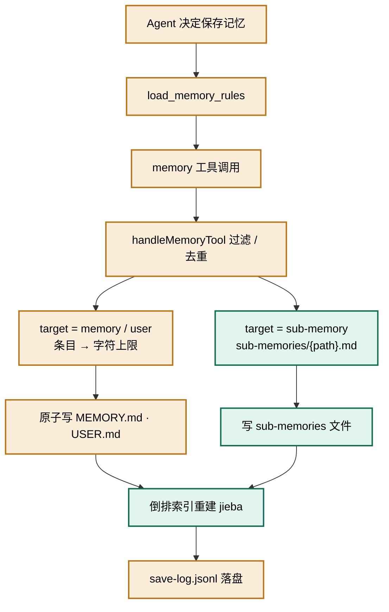
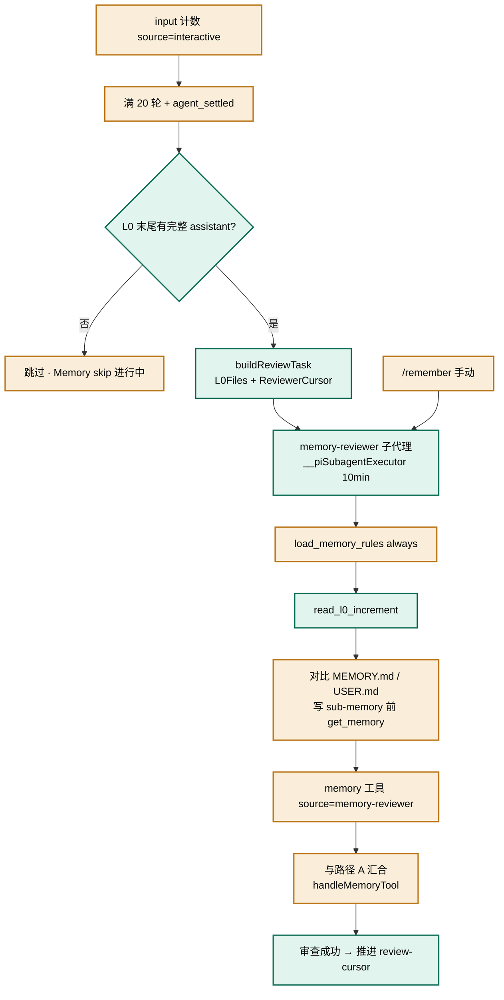
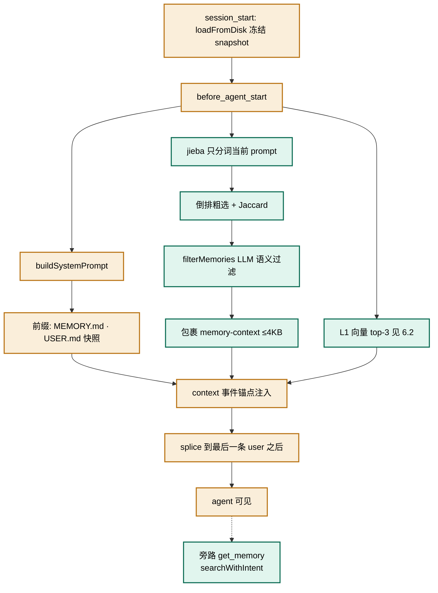
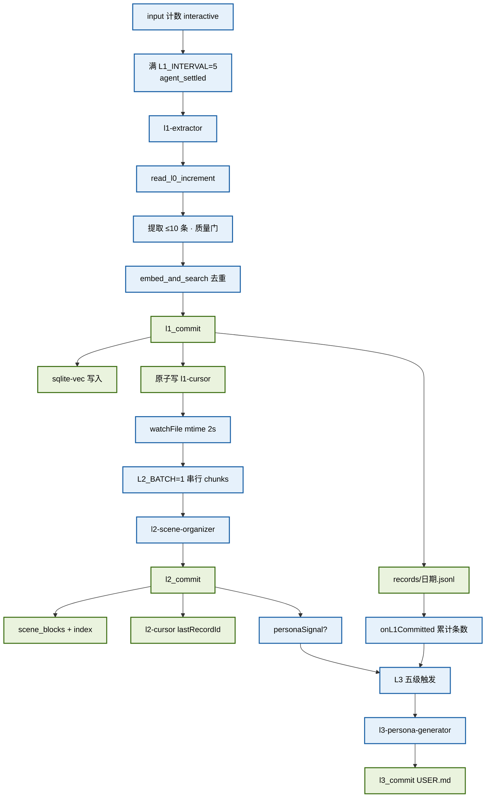
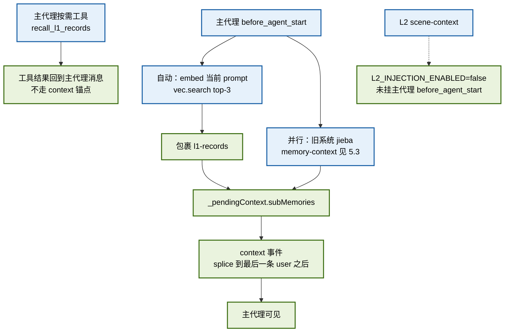
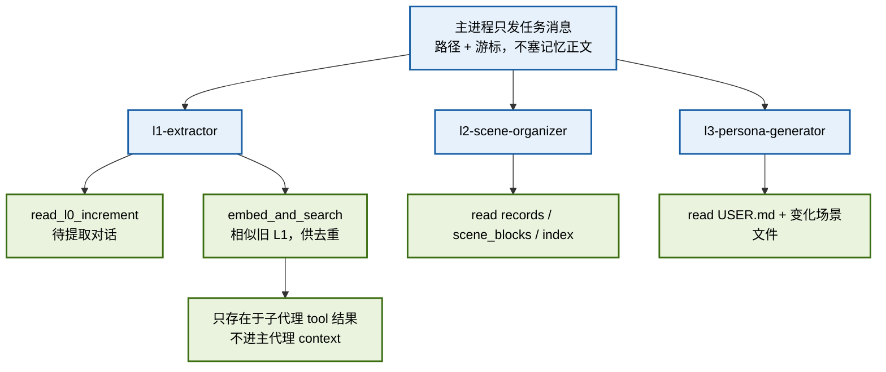

# memory-system 扩展 · 两套记忆系统架构说明

本文档说明 `C:\Users\leaf\.pi\agent\extensions\memory-system` 扩展中并存的两套记忆系统——**旧记忆系统**（文件即记忆）与**新记忆系统**（L0–L3 子代理管线 + 向量库）——在「提取/保存」与「注入」两条主链路上的实现，并指出两系统汇合与耦合的位置。

两套系统共用 **L0 净化归档** 作为对话增量数据源：旧系统的 `memory-reviewer` 和新系统的 `l1-extractor` 都从 L0 分片读增量，产物不同、写入通道不同。

> 架构图为内联 mermaid，本文档自包含。同一目录下的 `old-save.svg` / `old-inject.svg` / `new-save.svg` / `new-inject.svg` 为较早的独立副本，未随本次补全更新。

---

## 1. 图例与配色

| 色系            | 含义                                          | 出现的图                   |
| ------------- | ------------------------------------------- | ---------------------- |
| 琥珀色 `#FAEEDA` | 旧系统：文件落盘主链路（MEMORY.md / USER.md / save-log） | 旧·显式保存、旧·reviewer、旧·注入 |
| 蓝绿色 `#E1F5EE` | 旧系统：sub-memory 分支、检索/召回、L0 增量读取             | 旧·显式保存、旧·reviewer、旧·注入 |
| 蓝色 `#E6F1FB`  | 新系统：处理/调度/子代理轨道                             | L0、新·提取、新·注入           |
| 绿色 `#EAF3DE`  | 新系统：落盘提交节点（l1/l2/l3_commit）与注入汇聚节点          | L0、新·提取、新·注入           |

> 设计约束：单张图最多使用 2 个色系，并通过分支/并行/锯齿布局避免把所有节点串成一条直线。

---

## 2. 两套系统的本质区别

| 维度   | 旧记忆系统（MemoryStore）                                                    | 新记忆系统（L0–L3 管线）                                                                     |
| ---- | --------------------------------------------------------------------- | ----------------------------------------------------------------------------------- |
| 存储介质 | profile 根下 `MEMORY.md` / `USER.md` / `sub-memories/*.md`              | `{profile}/memoryDB/`：`conversations/`、`records/`、`scene_blocks/`、`.vectors/`、游标与配置 |
| 保存方式 | **双入口**：主代理显式调 `memory`；后台 `memory-reviewer` 每 20 轮从 L0 提取后调 `memory` | **隐式/异步**：`L1_INTERVAL=5` 轮触发 L1；`l1-cursor.json` mtime 触发 L2（`L2_BATCH=1`）；L3 五级触发 |
| 检索方式 | jieba 倒排 + Jaccard + LLM 语义过滤（`get_memory` / `<memory-context>`）      | embedding 余弦（sqlite-vec）；**不是**与 jieba 做 RRF 融合                                     |
| 写入者  | 主代理或 `memory-reviewer` 经 `memory` 工具                                  | `l1-extractor` / `l2-scene-organizer` / `l3-persona-generator` 经 `*_commit` 工具      |
| 数据源  | reviewer 路径读 L0 分片；显式路径由 agent 当场决定写什么                                | 同一 L0 分片 → L1 records → L2 场景 → L3 USER.md                                          |
| 参数契约 | 合规 `{type:"object", properties}`（TypeBox）                             | 早期 `embed_and_search` / `recall_l1_records` 用过扁平 map（已在 `index.ts` 包装器修复）           |

---

## 3. L0 共享净化归档层

L0 把 pi 宿主 session JSONL 转成干净、按天分片、生命周期独立的长期资产。它**不属于旧系统专有**，而是两套提取管线的共同输入。

数据目录：`{profile}/memoryDB/conversations/{YYYY-MM-DD}.jsonl`  
游标文件：`{profile}/memoryDB/l0-cursor.json`


流程：

1. **触发**：主进程 `agent_settled`。子代理进程设了 `PI_SUBAGENT_CHILD=1` 时直接跳过——否则子代理自己的 `.../run-0/session.jsonl` 会被当成主会话归档，L0 会被 thinking / tool_call / commit 响应污染。
2. **增量键**：`l0-cursor.json` 以 **session 绝对路径 → 行号** 记录水位。session JSONL 是 append-only，行号即去重键。只解析 `cursor+1` 之后的行；写成功（或本轮无记录）才把游标推到文件末行，失败不推进以便重试。
3. **净化**：角色过滤（只留 user/assistant）→ 图片 base64 换成 `[image]` → `SanitizeRule`（内置 generic/memory/framework + 可选 `l0-sanitize-rules.json`）→ `shouldCaptureL0` 丢掉空内容、斜杠命令、纯 `[image]`。
4. **落盘**：按**本地日期**追加到当日分片，跨 session 混排。每行含 `sessionKey / recordedAt / id / role / content / timestamp / cwd`。`cwd` 优先 `ctx.cwd`，否则从 session 目录名启发式解码。
5. **消费**：`memory-reviewer` 与 `l1-extractor` 都不直接啃原始 session，而是调 `read_l0_increment(l0Files, cursor)` 一次拿游标后增量。

`read_l0_increment` 返回约定：

| 字段           | 含义                                               |
| ------------ | ------------------------------------------------ |
| `messages`   | `recordedAt > cursor` 的新消息，时间升序；超 200 条截断为最近 200 |
| `background` | 游标**之前**最近 5 条，只供理解语境，**禁止提取**                   |
| `nextCursor` | 本批最后一条的 `recordedAt`（子代理提交时作为新游标）                |
| `truncated`  | 是否因 200 条上限截断（剩余留给下轮）                            |

---

## 4. 游标机制

各层消费者推进节奏不同，所以游标文件拆开，互不覆盖。

| 文件                   | 位置                              | 结构                                                                 | 语义                                                                            | 推进者                                        |
| -------------------- | ------------------------------- | ------------------------------------------------------------------ | ----------------------------------------------------------------------------- | ------------------------------------------ |
| `l0-cursor.json`     | `{profile}/memoryDB/`           | `{ [sessionPath]: { sessionPath, line } }`                         | 该 session JSONL 已归档到第几行                                                       | 主进程 `archiveSessionIncrement`              |
| `review-cursor.json` | **`{profile}/` 根**（不进 memoryDB） | `{ memoryReviewer: { sessionPath, line }, skillReviewer: ... }`    | 旧审查水位。**现行代码把 ISO 时间戳写进 `sessionPath` 字段**，`line` 写 `Date.now()`（字段名是行号时代的遗留） | `setupMemoryReviewer` 审查成功后                |
| `l1-cursor.json`     | `{profile}/memoryDB/`           | `{ lastRecordedAt }`                                               | L0 行 `recordedAt` 水位；同时其 **mtime** 是 L2 的跨进程触发信号                              | `l1_commit`                                |
| `l2-cursor.json`     | `{profile}/memoryDB/`           | `{ lastRecordId }`                                                 | 已组织到的 L1 record id                                                            | `l2_commit`                                |
| `l3-cursor.json`     | `{profile}/memoryDB/`           | `{ lastPersonaUpdate, memoriesSinceLastPersona, lastTriggeredAt }` | 上次画像对应的场景 `updated`；L1 提交条数累计（P4 阈值）                                          | `l3_commit` 清零累计；L1 提交时 `onL1Committed` 累加 |

读取增量时的过滤分层：

1. **分片级**：`listL0Files(profile, lastRecordedAt)` 只列出文件名日期 ≥ 游标日期的 `YYYY-MM-DD.jsonl`。
2. **行级**：`read_l0_increment` 再按 `recordedAt > cursor` 过滤。
3. **质量级**：L1 子代理另有 shouldExtract 规则，且本批只提取增量中最近 ≤10 条（对齐腾讯 `maxNewMessages`）。

原子写惯例：tmp 文件 + `rename`（Windows 上目标已存在则先删后写）。

---

## 5. 旧记忆系统

### 5.1 保存记忆 · 路径 A：主代理显式写入

主代理在对话中决定「这条该记住」时走这条路。



流程：

1. Agent 决定保存 → `load_memory_rules` → 调用 `memory` 工具。
2. `handleMemoryTool` 做内容过滤与语义去重（jieba 倒排索引）。
3. 按 `target` 分两路：
   - **memory / user**（琥珀色）：条目受字符上限约束，原子写入 `MEMORY.md` / `USER.md`。
   - **sub-memory**（蓝绿色）：写入 `sub-memories/{path}.md`。
4. 两路合并，重建倒排索引，并落 `save-log.jsonl`。

### 5.2 保存记忆 · 路径 B：memory-reviewer 从 L0 提取

这是旧系统的**后台提取**入口，也是文档原先缺失的链路。主代理不参与决策；审查子代理读 L0 增量，再经同一套 `memory` 工具落盘。写入的文件要等到下一轮（或 L3 刷新 USER 快照后）才进入注入通道。



调度（`memory/review/reviewer.ts`）：

1. `input`（`source=interactive`）计数；满 `REVIEW_INTERVAL=20` 且无进行中任务，在 `agent_settled` 启动。用 input 而不用 settled 计数，是为了避免子代理完成通知误推阈值。
2. **未完成检测**：读最后一个 L0 分片末尾 50 行，若最后一条 user 尚无非空 assistant 文本，跳过本次（避免学到半截工具调用）。
3. 任务消息直传路径（子代理无主会话上下文）：`L0Files` / `CursorPath` / `ReviewerCursor` / `ProfilePath`。`L0Files` 复用 `listL0Files`，按 **L1 游标日期**筛分片（与 L1 共享分片枚举，但审查水位用 `review-cursor.json`）。
4. 经 `globalThis.__piSubagentExecutor` 拉起 `memory-reviewer`（`async: true`，超时 10 分钟）。Agent 定义见 `~/.pi/agent/agents/memory-reviewer.md`。
5. 审查成功后 `saveCursor(..., ISO时间戳, Date.now())`。`/remember` 可手动触发；若 `buildReviewTask` 失败（例如未完成），会用空 `ReviewerCursor` 做一次全量兜底。

子代理步骤：

1. `load_memory_rules("always")`：把 `记忆保存信号.md` + `记忆分类框架.md` 注入本子代理上下文。
2. `read_l0_increment(l0Files, ReviewerCursor)`：只分析 `messages`，`background` 禁提取。
3. 读现有 `MEMORY.md` / `USER.md`；写 sub-memory 前必须 `get_memory` 查重，优先 `replace` 合并。
4. **Memory vs Skill**：偏好/风格/长期指令/项目事实走 `memory`；有界可执行 SOP 留给 `skill-reviewer`，本代理不写 skill。
5. 调用 `memory`（`source=memory-reviewer`）后与路径 A 汇合进 `handleMemoryTool`。

兄弟调度：`skill-reviewer` 用同一套 L0 + `read_l0_increment` + `review-cursor.json` 的 `skillReviewer` 键，产物是 skill 库而不是 MEMORY.md。

### 5.3 注入记忆

旧系统注入发生在**主代理**每轮用户 turn 的 `before_agent_start` + `context` 事件。新系统给主代理的 L1 自动召回也挂在同一事件上（独立块），见 §6.2.1。子代理不走本节。



流程：

- **琥珀色 · 系统提示前缀（固定，打 prefix cache）**  
  `session_start` 时 `loadFromDisk()` 冻结 MEMORY.md / USER.md 快照。`buildSystemPrompt()` 每轮把快照拼进 `event.systemPrompt`。快照默认整 session 不变；L3 `l3_commit` 会 `refreshUserSnapshot()` 刷新 user 一侧，便于本 session 后续轮次用上新画像。

- **蓝绿色 · 按需召回（每轮变化，不进前缀）**  
  
  1. `searchSectionCandidates(event.prompt)`：jieba **只分词当前 prompt**（历史消息不直接分词，避免旧话题污染）；LLM 关键词缓存仍基于「prompt + 近 10 条历史」的 `queryText`。  
  2. 倒排粗选 → 切章节 → Jaccard 评分 → `filterMemories`（每 turn 一次 LLM）→ 相关章节 ≤5 章 / **≤4KB**。  
  3. 包裹 `<memory-context>`，带「非用户输入」声明，**不带文件路径**。  
  4. 并行做 L1 向量 top-3（§6.2），拼成 `<l1-records>`。

- **锚点注入（`context` 事件）**  
  `context` 改的是 `structuredClone` 副本，**不写回 session JSONL**。注入块 splice 到**最后一条 role=user 消息之后**，而不是 push 到消息列表末尾——避免工具轮次里记忆块贴着 toolResult 被当成「最新输入」反复评估。无 user 消息时（followUp 等）才追加末尾。  
  同一事件还会在记忆块**之后**注入 `load_memory_rules` 的规则（行动指令靠近生成点）。

- **旁路**：`get_memory` → `searchWithIntent` → `prefetchAll`，供 agent 主动检索，不走自动注入。

**实现缺口（源码现状）**：`before_agent_start` 先把 `_pendingContext.subMemories` 赋成空字符串，仅当 L1 向量召回命中时才写回拼接后的块。因此 **L1 无 hit 时，本轮算出来的 `<memory-context>` 不会进入 `context` 事件**。文档按代码记录，未在本轮修复。

---

## 6. 新记忆系统

### 6.1 提取 / 保存记忆

蓝色处理轨与绿色提交轨锯齿交替。L0 已在 §3；这里从 L1 触发写到 L3 汇合。



#### L1 原子记忆（`L1_INTERVAL=5`）

1. `setupL1Extractor` 对 `input`（interactive）计数；达阈值且无进行中任务，在 `agent_settled` 启动 `l1-extractor`。无 L0 分片则重置计数，避免空转。手动：`/my-memory:l1-trigger`。模式：`/my-memory:l1-mode [code|chat]`（默认 code）。
2. `buildL1Task` 读 `l1-cursor.json` 的 `lastRecordedAt`，列出游标日期及之后的 L0 分片，把路径、PromptDir、Mode、KnownProjects 写进任务消息。
3. 子代理（`agents/l1-extractor.md`）步骤：
   - 读游标 + `extract-{mode}.md` + `dedup.md`
   - **一次** `read_l0_increment`（禁止逐段 `read`：实测 2860 行要 38 次 LLM 往返、约 12 分钟）
   - 质量门过滤（空/斜杠命令/提示注入/框架噪音）
   - 只提取增量中最近 ≤10 条；更早的仅作背景
   - **去重**：对每条新记忆 `embed_and_search(content, topK=5)` 召回候选，LLM 判定 `store / update / merge / skip`。工具失败或空结果则回退 **read 最近 30 天 records**
   - 调 `l1_commit`，禁止自己 `write` 文件（Plan Enforcer 会拦）
4. `l1_commit`（主进程落盘）：
   - 追加 `memoryDB/records/{本地日期}.jsonl`（append-only；update/merge 的旧行带 `deleted: true` 再追加，不物理删）
   - 若 `vectorization.json.enabled=true` 且 `embedding.json` 可读：对非 deleted 做 embed + `insertBatch`，对 deleted 做 `deleteBatch`。向量失败**不回滚** records
   - 原子写 `l1-cursor.json`（这会改变 mtime，供 L2 监听）
   - `onCommitted(written)` 只通知 **L3 计数**；**不再**回调 L2（见下）

#### L2 场景组织（跨进程触发）

不能用 `l1_commit` 的 JS 回调通知 L2：`l1-extractor` 是独立子进程，回调闭包里的 `l2Controls` 是子进程扩展实例上的 `undefined`，可选链会静默丢弃。改为：

1. 主进程 `fs.watchFile(memoryDB/l1-cursor.json, { interval: 2000 })` 看 mtime。
2. mtime 变化 → `pendingBatches++`；`L2_BATCH=1` 所以每次 L1 提交立即组织。
3. 按 records **文件**拆 chunk（1 文件 1 个子代理），**串行**派发 `l2-scene-organizer`（并行会抢 `scene_blocks/` 和全局 `scene_index.json`）。
4. 需要 `agent_settled` 缓存的 `ctx` 才能拉子代理；若 mtime 先到则 `pendingTrigger`，等下一轮 settled。手动：`/my-memory:l2-trigger`。

`l2_commit`：

- `sceneWrites[]`：`create | update | merge | delete`；文件名须匹配 `^[\w\u4e00-\u9fff-]+\.md$`
- 场景文件 = `-----META-START-----`（created/updated/summary/heat）+ 正文（SOP / 判断逻辑 / 禁忌 / 演化）
- 扫描 `scene_blocks/` **全量重建** `memoryDB/.metadata/scene_index.json`（按 heat 降序）
- 推进 `l2-cursor.json` 的 `lastRecordId`
- 可选 `personaSignal` + `personaReason` → L3 P1

上限：`MAX_SCENES=15`。L1 record 通过 `scene_name` 指向场景文件名（去掉 `.md`）。

#### 6.1.1 提取失败处理与游标推进（L1 / L2）

L1 与 L2 的游标都**只在各自成功提交工具（`l1_commit` / `l2_commit`）时由主进程回写**；子代理只要没成功走到 commit，游标就不推进。两层的失败都只做 `console.warn` 落日志，**没有重试、死信队列、持久失败计数，也不弹用户通知**——失败在宿主日志里是静默的，用户侧看不出「失败」与「没跑」的区别，只能看到状态栏 `Memory ⚙L1...` / `⚙L2...` 在 `finally` 里照常清除。

**统一失败处理机制**

| 环节    | 代码位置                                                                 | 行为                                                                                                                        |
| ----- | -------------------------------------------------------------------- | ------------------------------------------------------------------------------------------------------------------------- |
| 子代理执行 | `l1/index.ts:28` `runPiSubagent` / `l2/index.ts:29` 同名               | `executor` 不存在 → throw；与 `SUBAGENT_TIMEOUT_MS` / `L2_SUBAGENT_TIMEOUT_MS`（均 600_000ms）赛跑，超时 `controller.abort()` + reject |
| 调度包裹  | `l1/index.ts:99` / `l2/index.ts:89`                                  | `try { await runPiSubagent(...) } catch (err) { console.warn(...) }`                                                      |
| 释放锁   | `l1/index.ts:103` `finally { scheduled = false }` / `l2/index.ts:98` | 无论成败都解开 `scheduled` 互锁，允许下一轮触发；`scheduled` 同时保证同层不并发                                                                      |

`scheduled` 是唯一的互斥/节流阀：失败与成功走同一套 `finally`，所以**失败不会卡死调度，但也不会在当轮重试**——必须等下一轮触发条件重新满足。

**Q1 · L1 提取失败时**

- **游标推进**：不推进。`l1-cursor.json` 的唯一写点在 `commit-tool.ts:152` 的 `saveCursor`，由 `l1_commit` 调用；而 `l1_commit` 是 `l1-extractor` 在成功提取后调用的。失败（子代理抛错 / 超时 abort / 跑了但没调 `l1_commit`，或参数非法使其返回 `success:false`）都走不到 commit，游标停在旧值。
- **失败机制**：见上表；`turnCount` 在触发时已重置为 0（`l1/index.ts:96`），所以失败后需重新累计 `L1_INTERVAL=5` 轮 interactive 输入才会再触发。
- **对下一次 L1 的影响**：`buildL1Task`（`config.ts:106`）读 `loadL1Cursor`（仍是旧值）→ `listL0Files` 按 `lastRecordedAt` 日期前缀筛出「游标日期及之后」的 L0 分片（`config.ts:100-102`）→ **同一批 L0 分片会被重新提取**（行级再按 `recordedAt > cursor` 过滤）。即**幂等重试，不丢数据**。
  - 隐患：records 是 `append` 到 `records/{本地日期}.jsonl`；若重试时子代理未对「已写过的记录」做去重（去重本应靠 `embed_and_search` 查向量），会**重复追加**。游标粒度是「天」（`lastRecordedAt` 日期前缀），即使只失败半天也会重跑整天分片。
  - 若失败是**确定性**的（extractor 逻辑 bug、或大批量稳定触发 600s 超时），会每 `L1_INTERVAL` 轮循环重跑同一窗口，反复重提取（可能反复追加重复记录）。

**Q2 · L2 提取失败时**

- **游标推进**：不推进。`l2-cursor.json` 唯一写点在 `commit-tool.ts:224-241`，由 `l2_commit` 调用。L2 失败（子代理抛错 / 超时 / 没调 `l2_commit`）都走不到该写点。
- **关键差异——L2 的触发不被 L2 游标门控**：L2 由 `l2/index.ts:140` 的 `watchFile(l1-cursor.json)` 看 mtime 变化驱动：`pendingBatches++`，达 `L2_BATCH=1` 即重置 `pendingBatches=0` 并 `queueTrigger()`。真正的工作集来自 `splitRecordsFiles(profilePath)`（`config.ts:72`，扫描 `records/` 下全部 `*.jsonl`）——**与 `l2-cursor.json` 无关**。
- **失败机制**：见上表；`pendingBatches` 在触发时已归零，所以失败的 L2 **不会自触发下一次**。
- **对下一次 L2 的影响**：需再累积 `L2_BATCH=1` 次 `l1-cursor.json` 的 mtime 变化（即下一次 L1 成功 commit）才会再次触发。重触发时 `splitRecordsFiles` 仍扫到全部 `records/*.jsonl`（它们还在、未组织）→ `buildL2Task` 把这批改写文件名再喂给 organizer → **未组织的 L1 记录被重新组织**（幂等重试，不丢数据）。
  - 因为 L2 工作集与 L2 游标解耦，每次 L2 都会把**全部** records 文件重喂给 organizer；能否不重复造场景，依赖 organizer 对 `scene_index.json` 的查重与 merge。若 organizer 幂等性不足，重跑会反复改写 `scene_blocks/`。
  - **连锁停滞**：只要 L2 持续失败，`scene_blocks/` 一直陈旧/不完整，且 `l2_commit` 的 `onCommitted({ personaSignal })` 永不触发 → **L3 人格更新也跟着停滞**。L1 仍照常推进自己的游标、继续 append records（不互锁、不死锁），但「records → scenes → persona」链路卡在 scene 这一步。

**Q3 · 当前 L2 提取是串行的吗**

**是，串行。** `runTask`（`l2/index.ts:79-101`）里 `splitRecordsFiles` 把每个 records 文件拆成 1 个 chunk（`config.ts:78` `files.map((f) => [f])`），随后：

```ts
for (let i = 0; i < chunks.length; i++) {
  const chunk = chunks[i];
  const task = buildL2Task(profilePath, chunk);
  ctx.ui.setStatus("memory", `Memory ⚙L2 ${i + 1}/${chunks.length}...`);
  await runPiSubagent("l2-scene-organizer", task, ctx);  // 等上一个完成才派下一个
}
```

`await` 在 `for` 循环体内 → 第 i 个 chunk 的子代理**完全结束**后才会派发第 i+1 个。N 个 records 文件 = N 个依次执行的子代理。叠加 `scheduled` 互锁，**同一时刻全局只有一个 L2 子代理在跑**，没有任何并行。

串行原因（`l2/index.ts:82-84` 注释）：各子代理都写同一个 `scene_blocks/` 目录，并行会 race；`scene_index.json` 是扫描全量场景重建的全局索引，串行累积更安全；后发的子代理能看到前面子代理产出的场景、做增量补充。

> 一处注释滞后：`memory/l2/config.ts:14-15` 仍写着「拆 chunks + **parallel** 派发多个子代理」，这是早期设计的残留，与当前 `await` 串行循环不符。权威行为是串行（以 `index.ts` 的「08-18 改：多子代理串行派发」与代码为准）。

#### L3 人格（写回旧系统 USER.md）

`setupL3Persona` 在 L1 提交时累加 `memoriesSinceLastPersona`，在 L2 提交后（或 P1 信号）做五级判断（`memory/l3/trigger.ts`）：

| 优先级  | 条件                                            |
| ---- | --------------------------------------------- |
| P1   | `personaSignal` 或 `/my-memory:persona`（force） |
| P2   | 有场景、从未生成过 persona                             |
| P2.5 | 曾生成但 USER.md 正文丢失                             |
| P3   | 索引恰好 1 条场景且已有 L1 计数、尚无正文                      |
| P4   | `memoriesSinceLastPersona >= L3_INTERVAL`（30） |

已有 persona 且无 `updated` 晚于 `lastPersonaUpdate` 的场景 → 增量跳过。

`l3_commit`：XML 转义 → 字符硬限额 1375（code 模式软限额 1200）→ 若 USER.md 已存在则必须保留 `Archetype` / `Chapter 1` / `Chapter 3` 结构标记 → 原子写 USER.md → 重置 L3 游标累计 → `refreshUserSnapshot()`。这是与旧系统注入通道的**写入汇合**。

子代理超时一律 10 分钟（L1/L2/L3/reviewer 相同量级）。

### 6.2 注入记忆（主代理与子代理不是同一条路）

先分清**被注入的是谁**。主代理跑在前台会话进程；L1/L2/L3 子代理是 `pi-subagents` 拉起的**独立进程**（`systemPromptMode: replace`），看不到主代理的 `_pendingContext`，也吃不到主代理 `context` 事件里 splice 的块。

「混合召回」在向量化计划里曾指 jieba + embedding 做 RRF。实现上两者是不同实体，**主代理侧改为两块独立注入**；文件 `hybrid-recall.ts` 只服务主代理的 L1 余弦，不是子代理去重工具。

| 进程      | 目的                  | 记忆如何进入该进程的上下文                                                                                    |
| ------- | ------------------- | ------------------------------------------------------------------------------------------------ |
| **主代理** | 回答用户时带上相关 L1 / 旧文件库 | **注入通道**：`before_agent_start` → `context` 锚点；另可主动调 `recall_l1_records`                           |
| **子代理** | 提取 / 组织 / 生成画像      | **不走注入通道**。任务消息给出路径，子代理自己 `read` / `read_l0_increment` / `embed_and_search` 把数据拉进**自己的** tool 结果 |

`embed_and_search` 不是主代理注入的一条支路；`recall_l1_records` 也不是子代理去重工具。

#### 6.2.1 主代理注入

只发生在**前台会话进程**。向量库：`memoryDB/.vectors/l1-vectors.sqlite`（qwen3.7-text-embedding / 1024 维）。



| 入口    | 触发                               | topK | 进入主代理上下文的方式                                       |
| ----- | -------------------------------- | ---- | ------------------------------------------------- |
| 自动注入  | 每轮用户 turn 的 `before_agent_start` | 3    | `<l1-records>`，经 `_pendingContext` + `context` 锚点 |
| 按需拉取  | 主代理自己调 `recall_l1_records`       | 默认 5 | **工具返回 JSON**，不经 `context` 事件                     |
| 旧文件库  | 同一 `before_agent_start`          | ≤4KB | `<memory-context>`（jieba），与 L1 块独立拼接              |
| L2 导航 | `buildL2Injection`               | —    | 未启用                                               |

自动注入前置：`getVectorStore().isAvailable()` 且 `count()>0`。失败静默降级。向量库未就绪时主代理只有旧系统注入，新系统「只存不取」。

实现：两条路径统一走 `recallL1Records()`——自动注入 embed **当前 prompt**（不含历史拼接，top-3），`recall_l1_records` 由模型按需调用（默认 top-5）、结果留在 tool 消息里。命中计数按 turn 去重（同一 turn 内注入 + 工具召回同一条只计 1 次），见 §6.2.3。

与 jieba 块：设计上应拼成 `<memory-context> + <l1-records>` 再写入 `_pendingContext`；因 §5.3 空占位，无 L1 hit 时 jieba 块也可能没注入。

运维命令只动向量库，不参与每轮注入：`/my-memory:l1:embedding:list` / `backfill` / `rebuild`。

#### 6.2.2 子代理如何读到记忆（不是注入通道）

子代理 frontmatter 均为 `systemPromptMode: replace` + `subagentOnlyExtensions: memory-system`。主代理那份系统提示前缀、`<l1-records>`、`<memory-context>` **不会作为「主会话注入结果」传给子代理**。子代理要工作数据，只能：

1. 读任务消息里的绝对路径（L0Files / RecordsDir / SceneDir / …）
2. 调**自己白名单里的工具**，结果出现在**子代理自己的**消息列表



| 子代理                    | 白名单工具                                                        | 读入的是什么                  | 去哪                      |
| ---------------------- | ------------------------------------------------------------ | ----------------------- | ----------------------- |
| `l1-extractor`         | `read`, `read_l0_increment`, `embed_and_search`, `l1_commit` | L0 增量 + 向量相似的旧 L1（去重候选） | 子代理对话；再经 `l1_commit` 写盘 |
| `l2-scene-organizer`   | `read`, `l2_commit`                                          | records JSONL + 已有场景    | 同上，`l2_commit`          |
| `l3-persona-generator` | `read`, `l3_commit`                                          | USER.md + 场景文件          | 同上，`l3_commit`          |

因此：`embed_and_search` 与主代理 `before_agent_start` **同库不同消费者**——前者把候选喂给 l1-extractor 做 store/update/merge/skip；后者把 top-3 喂给前台用户对话。失败时子代理降级为 read 最近 30 天 records，仍然只发生在子代理进程。

**实现耦合（不是设计上的子代理注入）**：子代理进程会加载同一份 `index.ts`，`before_agent_start` **没有** `PI_SUBAGENT_CHILD` 守卫（L0 归档有）。子代理 turn 上仍可能按**任务消息**跑一遍主代理注入逻辑。那是钩子误伤，不要画成「子代理注入路径」。

#### 6.2.3 L1 命中统计（记忆评估指标）

新系统此前没有任何「记忆被使用 / 被召回」的评估字段（L2 的 `heat` 仅度量整理维护频次，非命中次数）。新增 `l1_hit_stats` 表记录每条 L1 原子记忆的召回质量：

| 字段 | 含义 |
| --- | --- |
| `record_id` | L1 record id（`l1_{epoch}_{random}`），主键 |
| `hits` | 命中次数：被 agent 面向召回的次数（loop-start 自动注入 + 运行时主动 recall） |
| `invalid_hits` | 无效命中次数：被召回后，LLM 判定无参考价值、由「清除记忆」工具从上下文移除 |
| `effective_hits` | 有效命中次数 = `hits - invalid_hits`（同事务维护，永不为负；`invalid_hits` 钳制到 `hits`） |
| `last_hit_at` / `last_invalid_at` | 最近一次召回 / 无效命中时间（ISO8601） |
| `created_at` / `updated_at` | 行生命周期 |

存储：`{profile}/memoryDB/l1-hit-stats.sqlite`（node:sqlite，与向量库 `l1-vectors.sqlite` 物理隔离）。

**计数契约**：
- 命中：**两条召回路径都走 `recallL1Records()`**——loop-start 自动注入（`before_agent_start`，top-3）与 `recall_l1_records` 工具（默认 top-5）。函数成功返回召回 record 后对每条 `record_id` 调 `recordHits(+1)`。
- **turn 级去重**：`index.ts` 维护模块级 `currentTurnHitSet`（`before_agent_start` 每 turn 开头 `clear()`），自动注入与工具共用同一引用；`recallL1Records` 的 `hitDedupSet` 选项保证同一 turn 内同一条记忆（注入 top-3 与工具 top-5 语义重叠）只计 1 次命中。retry / compaction / followUp 不重触发 `before_agent_start`，Set 保留 → 同一 turn 续跑仍去重。
- 无效命中：未来的「清除记忆」工具在把某 record 从上下文移除时，调 `recordInvalid(record_id)`（+1，`invalid_hits` 钳制到 `hits`）。约定每次清除调用一次，使 `invalid_hits` 与一次 prior hits 对应。
- `embed_and_search`（l1-extractor 去重）不调用 `recallL1Records`，不计数。

`effective_hits` 可用于冷记忆降权 / 淘汰、重要性排序（见 `getTopEffective(limit)`）。

---

## 7. 两套系统的边界与汇合点

两套系统并非完全独立：

1. **L0 输入汇合**：session → L0 分片是唯一净化对话源；`memory-reviewer` 与 `l1-extractor` 并行消费，产物分别进 markdown 文件库与 records/向量库。
2. **写入通道汇合**：`l3_commit` 把人格写回 `USER.md`（旧系统注入通道），并 `refreshUserSnapshot()` 刷新冻结快照。
3. **主代理注入通道汇合**：仅前台进程的 `before_agent_start` 把 `<memory-context>` 与 `<l1-records>` 放进 `_pendingContext.subMemories`，`context` 事件锚到最后一条 user 消息之后。子代理不走这条汇合。
4. **主代理主动拉取并存**：`get_memory`（旧，jieba + LLM）与 `recall_l1_records`（新，向量）都是**主代理**工具，互不调用。子代理去重用 `embed_and_search`，不要与这两项并列。
5. **工具桥接同构**：旧 reviewer 用 `memory` 绕过 Plan Enforcer；新管线用 `l1_commit` / `l2_commit` / `l3_commit` / `read_l0_increment` 同一模式。

一句话：**旧系统是「人写人读的文件库」，新系统是「机器提炼的分层库」，二者在 L0 数据源、`USER.md`、以及 `before_agent_start` 的注入合并处被缝成同一份上下文。**

---

## 8. 耦合风险

- **`USER.md` 双重写入**：旧系统允许主代理 / reviewer 直接写 `USER.md`；L3 也会写回（结构标记硬保护）。两边体例不同（条目列表 vs Archetype/Chapter 模板），存在互相覆盖或风格撕裂。
- **主/子代理注入钩子共用一份 `index.ts`**：`before_agent_start` 已加 `PI_SUBAGENT_CHILD` 守卫（与 L0 归档同款判断），子代理 turn 直接返回、不再跑主代理注入 / 建 `_pendingContext` / 计 L1 命中。不要把 `embed_and_search` 画进主代理注入图。
- **L2 触发曾跨进程断裂**：进程内 `onCommitted` 通知 L2 会丢；现已改 watchFile。不要再把「L1 回调 L2」画进架构。
- **`review-cursor.json` 字段复用**：现行 reviewer 把 ISO 时间戳塞进 `sessionPath`，与模块注释里的「行号游标」不一致；读侧用 `cursor.sessionPath` 当 `ReviewerCursor`。改结构需 reviewer 与 `saveCursor` 一起迁。
- **`_pendingContext` 空占位**：无 L1 hit 时 `<memory-context>` 可能未注入（§5.3）。
- **L0 子代理污染**：无 `PI_SUBAGENT_CHILD` 守卫时，子代理 session 会进 `conversations/`，下一轮 L1 会把提取过程本身当成对话记忆。
- **历史工具契约**：`embed_and_search` / `recall_l1_records` 曾用扁平 map 参数 + 非标准返回值，导致 schema 400 与 `getTextOutput` 的 `filter` 崩溃；已在 `index.ts` 的 `registerTool` 包装器统一升级。
- **文件名误导**：`hybrid-recall.ts` 不做 jieba+向量混合，只召回 L1 records。

---

## 9. 关键文件索引

| 文件                                                                      | 职责                                                                              |
| ----------------------------------------------------------------------- | ------------------------------------------------------------------------------- |
| `index.ts`                                                              | 扩展入口；`registerTool` 包装；L0 归档；`before_agent_start` / `context` 注入；turn 级去重 Set；注册 commit/召回工具 |
| `memory/paths.ts`                                                       | memoryDB 路径常量；标明 `review-cursor.json` 不归 memoryDB                               |
| `memory/l0/index.ts` · `sanitize.ts` · `session-parser.ts`              | L0 行号游标、净化、按日分片                                                                 |
| `memory/review/reviewer.ts` · `review-cursor.ts`                        | memory-reviewer 调度与审查游标                                                         |
| `memory/core/store.ts` · `tool.ts` · `manager.ts`                       | MemoryStore 快照、`handleMemoryTool`、`refreshUserSnapshot`                         |
| `memory/search/searcher.ts` · `inverted-index.ts`                       | jieba 倒排 + Jaccard + LLM 过滤                                                     |
| `memory/l1/index.ts` · `config.ts` · `read-tool.ts` · `commit-tool.ts`  | L1 调度、分片清单、`read_l0_increment`、`l1_commit`                                      |
| `memory/l2/index.ts` · `config.ts` · `commit-tool.ts` · `navigation.ts` | L2 watchFile 调度、场景提交、未启用的导航注入                                                   |
| `memory/l3/index.ts` · `trigger.ts` · `commit-tool.ts`                  | L3 五级触发、USER.md 提交                                                              |
| `memory/search/hybrid-recall.ts`                                        | `recallL1Records`：仅 L1 向量余弦（历史误名）；命中计数 + turn 级去重（`hitDedupSet`）           |
| `memory/search/embedding/tool.ts`                                       | `embed_and_search`（子代理去重）                                                       |
| `memory/search/recall-l1-records-tool.ts`                               | `recall_l1_records`（主代理主动）                                                      |
| `memory/search/vector-store/store.ts`                                   | sqlite-vec；`db.exec` + `vec_f32`（不支持 prepared statement）                        |
| `memory/stats/l1-hit-stats-db.ts`                                       | L1 命中统计库（node:sqlite）：hits / invalid_hits / effective_hits                 |
| `~/.pi/agent/agents/memory-reviewer.md`                                 | 旧系统后台提取 agent 定义                                                                |
| `~/.pi/agent/agents/l1-extractor.md`                                    | L1 提取 agent 定义（含去重四动作）                                                          |

运行时数据（相对 `{profile}/memoryDB/`，除注明外）：

| 路径                                              | 内容                                     |
| ----------------------------------------------- | -------------------------------------- |
| `conversations/*.jsonl`                         | L0 净化对话                                |
| `records/*.jsonl`                               | L1 原子记忆                                |
| `scene_blocks/*.md`                             | L2 场景                                  |
| `.metadata/scene_index.json`                    | 场景索引（heat 排序）                          |
| `.vectors/l1-vectors.sqlite`                    | L1 向量                                  |
| `l1-hit-stats.sqlite`                          | L1 命中/有效命中统计（评估指标）                |
| `config/embedding.json`                         | embedding API                          |
| `config/vectorization.json`                     | `enabled` / `triggerThreshold`（默认 500） |
| `l0-cursor.json` … `l3-cursor.json`             | 各层游标                                   |
| `{profile}/review-cursor.json`                  | reviewer 游标（profile 根）                 |
| `{profile}/MEMORY.md` `USER.md` `sub-memories/` | 旧系统文件库                                 |

---

## 10. 配图说明

文档内 mermaid 覆盖：L0 共享层、旧系统显式保存、旧系统 reviewer 提取、旧系统注入、新系统 L1–L3 提取、**主代理注入**、**子代理工具拉入**（两张图，不要画成一条注入链）。同一目录下的四张 SVG 为较早副本，可忽略。
