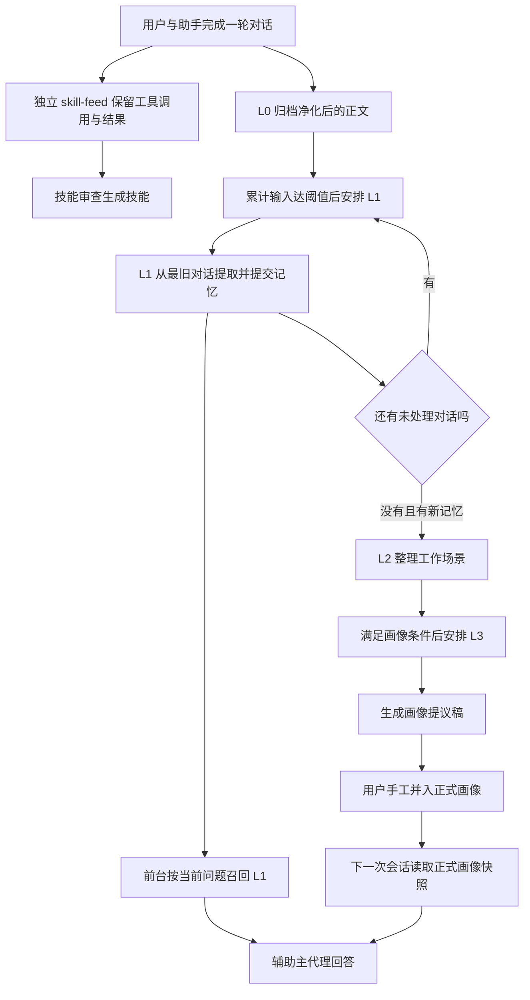
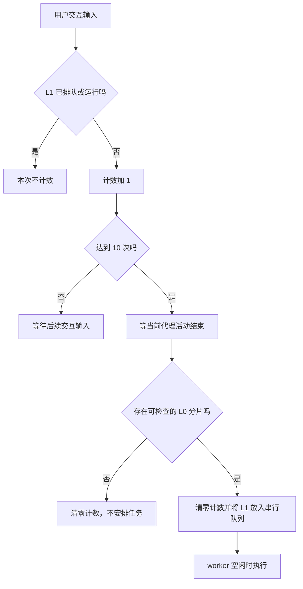
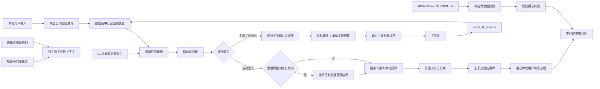
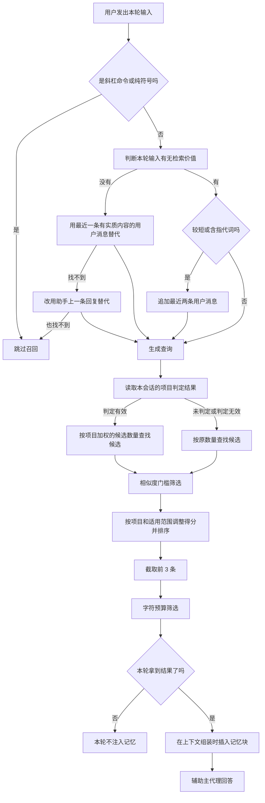
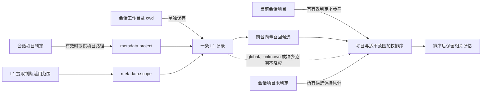
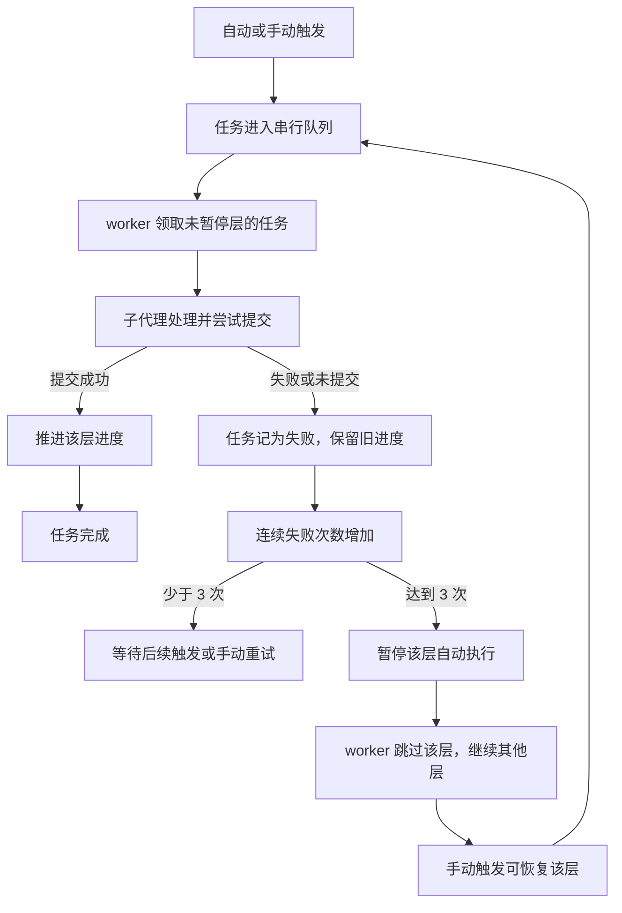
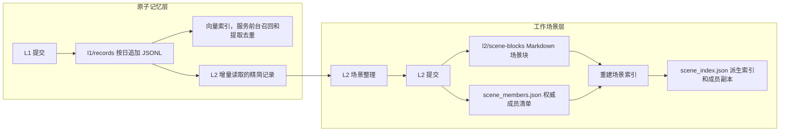

# memory-system 扩展架构说明

源码核查基准：2026-10-02 的 HEAD（`fe7f5ee`；核查开始时工作区干净）。本文说明该源码状态对应的功能和流程。队列互斥及会话生命周期章节于 2026-10-05 按本次实现更新。

## 怎样阅读这份说明

先读第 1–2 节，了解各层的分工和一次完整的处理过程；第 3–7 节解释归档、进度、保存、读取与项目归属；第 8 节说明失败、停止、恢复和日常维护。实现依据放在相关说明末尾的引用块中，跳过引用块也可以读懂流程。

配套资料：

- [功能与流程说明写作原则](C:/Users/leaf/.pi/agent/extensions/memory-system/功能与流程说明写作原则.md)：本文与后续维护采用的表达原则。
- [项目归属定义](C:/Users/leaf/.pi/agent/extensions/memory-system/项目归属定义.md)：项目概念和归属判据的权威定义；定义要求与当前实现的差异见第 7 节。
- [实现与历史参考](C:/Users/leaf/.pi/agent/extensions/memory-system/记忆系统实现与历史参考.md)：完整保留重构前的参数、字段、事故、测试结果、未闭环事项和退役流程，按原章节编号查阅。历史记录中的“现行”和“未闭环”只表示记录当时的状态。

## 1. 系统负责什么

这个扩展把日常对话逐步整理成可复用的记忆，并在后续回答中提供相关信息。它同时承担两件事：后台积累和整理记忆，前台为当前问题读取记忆。

| 层次 | 负责的事情 | 产物及用途 |
| --- | --- | --- |
| L0：对话归档 | 从主会话中保留净化后的用户与助手正文 | 按天保存的对话，供 L1 提取 |
| L1：原子记忆 | 提炼能够单独理解和复用的事实、任务、方法、资产 | 记忆记录及向量索引，供前台召回和 L2 整理 |
| L2：工作场景 | 把相关原子记忆组织成有背景、判断逻辑和操作步骤的场景 | 场景文件及成员清单，供维护与 L3 生成画像 |
| L3：画像提议 | 从场景中归纳长期偏好、协作方式和用户特征 | 画像提议稿；用户手工并入正式画像后才参与注入 |

主代理还可以直接保存一条 L1 记忆，不必等待后台提取。前台回答时，一方面读取会话开始时的文件快照，另一方面按当前问题召回 L1。当前尚未启用 L2 场景导航注入，也尚未用项目标签过滤召回结果。

旧文件库仍提供快照读取；旧的保存工具、后台记忆审查和关键词检索已经退役。技能审查仍在运行，但使用独立的 `skill-feed` 归档，保留 `user`、`assistant`、`tool_call` 和 `tool_result` 四类记录，并通过单独的游标推进；`system` 与 `thinking` 不写入 feed。它的产物进入技能库。工作流保存入口目前处于休眠状态。

> **实现依据**：[index.ts](C:/Users/leaf/.pi/agent/extensions/memory-system/index.ts) 的扩展注册与会话事件处理连接归档、提取和前台读取；[memory/pipeline/worker.ts](C:/Users/leaf/.pi/agent/extensions/memory-system/memory/pipeline/worker.ts) 的 `setupPipelineWorker()` 串行调度 L1、L2、L3。正式快照是 profile 下的 `MEMORY.md` / `USER.md`，L3 自动写入的是 `USER-temp.md`。

## 2. 一次完整的记忆流程

用户发起对话，助手完成当前回复后，系统归档尚未归档的会话正文。L1 空闲时累计用户交互输入，达到 10 次后安排后台提取。提取从最旧的未处理对话开始，完成一批后继续消化积压，积压排空且有新记忆时才安排 L2。

L2 读取新记忆和有关的已有场景，提交整理结果。L3 根据新记忆累计量、场景变化或显式请求判断是否需要生成画像提议。三层后台任务共用一条串行队列，L3 排在 L1、L2 之后。画像提议需要用户手工并入正式画像。

后续用户提出问题时，主代理读取正式文件快照，并按当前问题召回相关 L1 记忆。后台子代理分别读取自己的任务所需资料，不继承主代理已经注入的记忆块。



图中“安排任务”和“执行任务”是两个时刻：任务先排队，调度器空闲后才执行。启动子代理只表示已经派发；成功提交才是本轮记忆处理完成的依据。

> **实现依据**：[memory/pipeline/worker.ts](C:/Users/leaf/.pi/agent/extensions/memory-system/memory/pipeline/worker.ts) 的 `decideNextAfterL1()` 决定继续 L1、安排 L2 或结束接力；[memory/pipeline/jobs-db.ts](C:/Users/leaf/.pi/agent/extensions/memory-system/memory/pipeline/jobs-db.ts) 的 `listQueued()` 和各层 `completeRunning…()` 记录执行顺序与提交完成状态。

## 3. L0：把对话归档成共同输入

### 3.1 什么时候归档，归档哪些内容

每次主代理活动结束，系统检查主会话中新增的行，只归档用户与助手的正文。后台子代理自己的提取、工具调用和提交过程不会进入这份归档，避免下一轮把“如何提取记忆”又当成用户对话学习。

净化时先过滤角色，再把图片中的大段编码替换为图片占位，应用内置及可选的净化规则，最后丢弃空内容、斜杠命令和纯图片占位。归档按本地日期追加到当日文件，同一天的多个会话可以混排。每条保留来源会话、消息编号、角色、正文、消息时间、归档时间和会话工作台。

> **实现依据**：[memory/l0/index.ts](C:/Users/leaf/.pi/agent/extensions/memory-system/memory/l0/index.ts) 的 `archiveSessionIncrement()` 读取增量并追加分片；[memory/l0/sanitize.ts](C:/Users/leaf/.pi/agent/extensions/memory-system/memory/l0/sanitize.ts) 的 `shouldCaptureL0()` 决定是否保留净化结果；[index.ts](C:/Users/leaf/.pi/agent/extensions/memory-system/index.ts) 的 `agent_settled` 处理用 `PI_SUBAGENT_CHILD` 排除子代理进程。
>
> **存储细节**：归档在 `{profile}/memoryDB/l0/conversations/{YYYY-MM-DD}.jsonl`；每行字段为 `sessionKey / recordedAt / id / role / content / timestamp / cwd`。工作台优先取 `ctx.cwd`，无法取得时尝试从会话目录名解码。净化规则包括 generic、memory、framework 和可选的 `l0-sanitize-rules.json`。

### 3.2 为什么只保留对话正文

L1 要提取的是结论和可复用经验。用户需求通常出现在工具调用前，助手的根因判断、行动结论通常出现在工具调用后，因此大段源码和命令输出不必全部归档。2026-08-23 的对照验证保留了这一设计：在“语法报错 → 读取文件 → 判断 Node 版本不支持可选链”的排查中，工具中间内容被过滤，根因结论仍在助手正文中。

这个取舍有两个盲区：单独的推理块不保留；助手遇到工具报错却只说“重试”时，错误细节也可能丢失。原文提出过给工具结果补一条短摘要的增强方案，目前未实施。

> **实现与验证依据**：[memory/l0/session-parser.ts](C:/Users/leaf/.pi/agent/extensions/memory-system/memory/l0/session-parser.ts) 负责会话消息解析；[原 §3.1 的对照、腾讯原版依据及可选增强](C:/Users/leaf/.pi/agent/extensions/memory-system/记忆系统实现与历史参考.md#original-3) 完整保留在参考文档。增强设想是在归档过滤处保留工具名、结果前 200 字和错误标志，并转成助手摘要，未作为当前行为。

### 3.3 归档失败后会怎样

每个来源会话都有独立的归档进度，记录已归档到第几行。追加成功，或者这轮没有值得保留的内容，才把进度移到会话末尾；写入失败则保留旧进度，之后仍从该位置重读。

L1 与技能审查走两条独立的归档通道。L1 读取 L0 的两角色正文归档，并使用 `l0/cursor.json`；技能审查读取 `skill/feed/<sessionKey>.jsonl` 中的 `user`、`assistant`、`tool_call` 和 `tool_result` 记录，保留工具调用和结果，但丢弃 `system` 与 `thinking`。skill-feed 归档游标保存在 `skill/cursor.json`，审查进度另保存在 `state/review-cursor.json`。一条通道失败或处理较慢，不会推进另一条通道的进度。旧记忆审查的消费流程保留在退役资料中。

> **实现依据**：[memory/l0/index.ts](C:/Users/leaf/.pi/agent/extensions/memory-system/memory/l0/index.ts) 的 `archiveSessionIncrement()` 用 `{profile}/memoryDB/l0/cursor.json` 保存“会话绝对路径 → 已归档行号”；[skill/feed-cleaner.ts](C:/Users/leaf/.pi/agent/extensions/memory-system/skill/feed-cleaner.ts) 的 `archiveSkillFeedIncrement()` 写入四类记录并使用独立归档游标；[skill/reviewer.ts](C:/Users/leaf/.pi/agent/extensions/memory-system/skill/reviewer.ts) 将 feed 文件交给审查代理；审查完成游标由 [memory/review/review-cursor.ts](C:/Users/leaf/.pi/agent/extensions/memory-system/memory/review/review-cursor.ts) 保存。

## 4. 进度：怎样知道处理到了哪里

各层处理不同的输入，速度也不同，因此分别记录进度。L0 和 skill-feed 归档看各自的会话行号；L1 提取看对话归档时间，场景整理看记忆编号，画像处理看场景更新时间及新记忆累计量；技能审查另记上一次审查完成后的 feed 时间边界。

| 进度 | 表示什么 | 何时推进 |
| --- | --- | --- |
| L0 归档进度 | 每个会话归档到哪一行 | 归档写入成功或本轮无可保存内容 |
| L1 提取进度 | 对话处理到哪个归档时间 | 成功提交该批记忆与实际处理位置 |
| L2 整理进度 | 原子记忆处理到哪个编号 | 成功提交场景整理结果 |
| L3 画像进度 | 上次处理到的场景变化及累计新记忆数 | 成功完成本轮画像提交并清零累计量 |
| skill-feed 归档进度 | 每个会话原料写入到哪一行 | 追加成功或本轮没有可写入内容 |
| 技能审查进度 | 上一次完成审查后记录的 feed 时间边界 | 审查子代理返回后 |

L1 为每个 L0 日分片保存已消费的 UTF-8 字节偏移，按分片名和文件行序读取追加内容。读取器只返回完整行，每批最多 25 条 user/assistant 消息；游标之前最近 5 条只帮助理解背景，不能再提取。L1 提交成功后才保存读取器返回的下一份游标，因此相同归档时间的消息不会被边界截断。

> **实现依据**：[memory/l1/config.ts](C:/Users/leaf/.pi/agent/extensions/memory-system/memory/l1/config.ts) 的 `listL0Files()` 按分片大小和字节偏移列出待读文件；[memory/l1/read-tool.ts](C:/Users/leaf/.pi/agent/extensions/memory/l1/read-tool.ts) 的 `readL0Increment()` 按完整 JSONL 行读取并返回 `messages / background / nextCursor / truncated`。
>
> **进度载体**：L1 为 `l1/cursor.json {version:2, files:{"YYYY-MM-DD.jsonl": byteOffset}}`（旧 `{lastRecordedAt}` 首次读取时兼容迁移）；L2 为 `l2/cursor.json {lastRecordId}`，L3 为 `l3/cursor.json {lastPersonaUpdate, memoriesSinceLastPersona, lastTriggeredAt, lastCommittedAt}`。L2 显式请求画像更新另写 `l3/pending-trigger.json {personaSignal, personaReason, at}`，由主进程读取后删除。

两处历史兼容细节会影响维护：技能审查的进度文件字段名仍沿用早期的行号结构；L2 则依靠 L1 编号中的时间判断增量。改动这些结构时，读写两端必须一起迁移，否则可能静默漏处理。

> **关键细节**：[memory/l2/config.ts](C:/Users/leaf/.pi/agent/extensions/memory-system/memory/l2/config.ts) 的 `recordEpochMs()` 解析 `l1_{epochMs}_{random}`；无法解析时返回 0，相关记录可能永远落在 L2 水位之前。变更编号格式必须同步解析器。审查文件在 `{profile}/state/review-cursor.json`，2026-09-14 从 profile 根移入；现行 `sessionPath` 实际存 ISO 时间，`line` 存 `Date.now()`，读写侧共同依赖这一遗留口径。文件更新通常采用临时文件再重命名，Windows 目标已存在时使用相应覆盖处理。

## 5. 主代理主动记录与文件快照

主代理在对话中发现应当记住的内容时，可以直接保存成 L1。最少提供内容和记忆类型，系统补齐编号、时间、来源会话等信息。这条路径不推进后台提取的进度，也不直接安排 L2，避免把尚未提取的对话误标为已经处理。

主代理主动记录不等待后台价值复核，也不受后台子代理的停写标记与运行级锁阻拦；真正的文件追加仍经过跨进程提交锁。场景归属最好先查询现有场景清单，再选择相应场景，具体见第 6.1.4 节。

> **实现依据**：[memory/l1/commit-tool.ts](C:/Users/leaf/.pi/agent/extensions/memory-system/memory/l1/commit-tool.ts) 的 `registerL1CommitTool()` 中 `source="main-agent"` 分支补齐默认字段并保留 `metadata.origin="main-agent"`；[memory/l1/write-lock.ts](C:/Users/leaf/.pi/agent/extensions/memory-system/memory/l1/write-lock.ts) 的 `acquireWriteLock()` 保护两条路径的文件写入。

正式记忆文件和画像文件在会话开始时读取成快照，每轮回答使用同一份快照。L3 写的是画像提议稿，用户手工并入正式画像后，下一次会话开始时才会读到这些变化。

旧的显式保存、后台记忆审查、关键词倒排检索及相关召回工具均已退役。原流程图、字符限制、曾经的注入缺口和退役原因保留在参考文档；不能据此调用已经删除的入口。

> **实现依据**：[memory/core/store.ts](C:/Users/leaf/.pi/agent/extensions/memory-system/memory/core/store.ts) 的 `MemoryStore` 和 [memory/core/manager.ts](C:/Users/leaf/.pi/agent/extensions/memory-system/memory/core/manager.ts) 的 `MemoryManager` 提供 `MEMORY.md` / `USER.md` 快照；[退役流程资料](C:/Users/leaf/.pi/agent/extensions/memory-system/记忆系统实现与历史参考.md#retired) 保留旧 `memory`、`memory-reviewer`、`get_memory`、jieba 检索与 workflow 休眠状态。

## 6. 后台保存与前台读取

### 6.1 后台：从对话到画像提议

#### 6.1.1 L1 怎样计数、触发和提取记忆

L1 把归档对话提炼成可以独立使用的记忆。它在后台分批处理，每批成功后记录处理进度。

**先累计输入，再安排任务。** 当 L1 没有排队或运行中的任务时，用户每通过交互界面发送一次输入，计数加 1。工具调用、后台通知和自动跟进不增加计数。L1 已经排队或运行时，新的用户输入也不计入下一轮次数。

当前阈值是 **10 次输入**。从零开始累计到第 10 次，等这次回复及当前代理活动结束，系统把 L1 任务放入串行队列并清零计数。没有可检查的 L0 分片时，也清零计数，但不安排任务。连续失败而暂停时，停止自动排队，恢复方式见第 8 节。



> **实现依据**：[memory/l1/index.ts](C:/Users/leaf/.pi/agent/extensions/memory-system/memory/l1/index.ts) 的 `setupL1Extractor()` 在用户交互输入时累计次数，并在当前代理活动结束后检查阈值、确认有 L0 分片后入队。

任务真正开始时才准备输入，使用当时的提取进度、模式、项目清单和场景候选，避免排队期间这些信息已经变化。

> **实现依据**：[memory/l1/index.ts](C:/Users/leaf/.pi/agent/extensions/memory-system/memory/l1/index.ts) 的 `setupL1Extractor()` 在 `input` 回调计数，在 `agent_settled` 回调检查并入队，内部 `executeJob()` 执行时调用 `buildL1Task()`；[memory/l1/config.ts](C:/Users/leaf/.pi/agent/extensions/memory-system/memory/l1/config.ts) 的 `L1_INTERVAL` 当前为 10。`hasActiveL1()` 同时检查排队和运行状态。

**从最早的未读行开始消化积压。** 一次读取最多返回 25 条新消息；每个分片的字节偏移精确落在完整 JSONL 行末尾。相同归档时间的消息仍按各自行位置逐批消费，不需要扩批到时间组边界。背景消息只作理解，不再提取。成功后还有增量就继续排下一批，无需再等 10 次输入；全部积压排空且有未整理的新记忆，才安排 L2。

L1 忙碌期间的对话仍进入 L0，由这条积压处理链继续消费。时间戳只保留作追溯信息，读取进度按文件字节偏移推进，因此同一批 flush 写入的多条消息也可安全分批。

> **实现依据**：[memory/l1/read-tool.ts](C:/Users/leaf/.pi/agent/extensions/memory-system/memory/l1/read-tool.ts) 的 `readL0Increment()` 实现逐分片字节游标；[agents/l1-extractor.md](C:/Users/leaf/.pi/agent/extensions/memory-system/agents/l1-extractor.md) 规定处理全部返回消息并将完整 `nextCursor` 交给 `l1_commit`；[memory/pipeline/worker.ts](C:/Users/leaf/.pi/agent/extensions/memory/pipeline/worker.ts) 的 `decideNextAfterL1()` 接续积压处理。

**提取、查重，再统一提交。** 提取代理先读取当前模式的规则，过滤空内容、命令、提示注入与框架噪音，再提炼事实、任务、方法和资产。候选记忆按每块最多 50 条查询批量查重，每条取 5 个相似候选，按块内索引对应原记忆。成功块保留结果，失败块才降级读取最近 30 天记录；成功查询返回空候选表示没有匹配。文本回退先按同 ID 的最后状态归并，再排除删除记录。更新、合并或跳过前须读取候选完整正文，不能仅凭截断预览裁决。

通过格式和价值校验后，提交工具追加记忆、维护向量索引并推进实际处理进度。更新和合并会就地将旧记录标为删除，再追加新记录。提取代理不能自行改写记忆文件，直接写入会被执行约束拦截。向量更新失败不撤销已经落盘的记忆，但会留下观测信息。查询向量只有在最终内容与查询文本完全一致时才可复用；改写或合并后的正文须重新嵌入。

无值得保存的记忆时，提交空 `records` 与完整 `nextCursor`，推进读取进度且不创建空场景。每条记忆独立记录本批内、同一会话的实际出处；场景的 `message_ids` 仅表示覆盖范围。事件时间来自消息 `timestamp`（epoch 毫秒），换算为 ISO；`recordedAt` 是归档时间，不能代替事件时间。

> **实现依据**：[memory/search/embedding/tool.ts](C:/Users/leaf/.pi/agent/extensions/memory-system/memory/search/embedding/tool.ts) 提供 `embed_and_search` 批量去重；[memory/l1/commit-tool.ts](C:/Users/leaf/.pi/agent/extensions/memory-system/memory/l1/commit-tool.ts) 的 `registerL1CommitTool()` 统一提交。批量结果保留 `record_id` 和每条 `queryVector`，候选正文预览最多 200 字符；向量随记录传回可避免提交进程再次嵌入。记录按提交当天本地日期写入 `memoryDB/l1/records/`，向量化需要启用开关并配置可用模型。

| 用户操作 | 命令 | 效果 |
| --- | --- | --- |
| 立即请求 L1 | `/my-memory:l1-trigger` | 不等输入次数，仍排入同一串行队列；可恢复暂停层 |
| 选择提取模式 | `/my-memory:l1-mode [code\|chat]` | 默认 code；任务执行时读取当前模式 |

#### 6.1.2 L1 怎样检查格式与保存价值

保存前先做格式检查。存活记录必须有非空内容、合法的四类记忆类型；提供的优先级必须在 0–100 之间，缺省补为 70 并记录补齐数量。违反硬性格式要求会拒绝整批提交，错误指出对应记录的位置。

缺少来源消息编号，或内容超过单条召回的 300 字符预算，只报告数量，不阻止写入。较长内容以后召回时可能被截成半句，这也是提取阶段需要控制长度的原因。

> **实现依据**：[memory/l1/commit-tool.ts](C:/Users/leaf/.pi/agent/extensions/memory-system/memory/l1/commit-tool.ts) 的 `registerL1CommitTool()` 在写盘路径执行格式闸门；合法类型是 `work_fact / work_task / work_method / work_artifact`，来源字段为 `source_message_ids`。原有越界类型、缺失来源和长度分布见 [2026-09-17 记录](C:/Users/leaf/.pi/agent/extensions/memory-system/记忆系统实现与历史参考.md#history-08)。

格式合格不一定意味着值得保存。流水账、只记表象等问题交给一次独立模型复核：只提供保存判据和候选记忆，不重新提供大段对话原料。复核可以保留、丢弃或改类型，不重写内容；丢弃和改型必须有理由，没有理由的丢弃以及未覆盖的记录都按保留处理。

这项复核只用于后台提取。它在取得提交写锁之前运行，避免等待模型时占住写锁。判据直接摘自提取规则中的五个标记段，保证规则单源。判据不足 200 字符、调用失败或解析失败时，仍继续保存，并报告复核被跳过。被丢弃的候选另写审计日志，可以检查是否误拦。

> **实现依据**：[memory/l1/value-check.ts](C:/Users/leaf/.pi/agent/extensions/memory-system/memory/l1/value-check.ts) 的 `runValueCheck()`、`parseVerdicts()` 负责复核与裁决解析；[util/agent-loop.ts](C:/Users/leaf/.pi/agent/extensions/memory-system/util/agent-loop.ts) 的 `runAgentLoopOnce` 执行无工具判定，默认 1 轮，上限钳在 1–3 轮。判据来自 `extract-{mode}-personal.md`，写锁等待默认 10 秒；配置在 `l1.valueCheck {enabled, maxTurns, timeoutMs, maxRecordChars}`，被丢弃的候选写入 `l1/value-check-log.jsonl`，返回中的 `valueCheck.skipped` 表示跳过。

2026-09-17 的验证包含 59 项检查，当时真实 provider 首跑仍待观察。254 条样本中正则无法可靠区分合理的资产记录与流水账；详细样本口径保留在参考文档，不把旧的待观察状态直接当作今天的故障。

#### 6.1.3 L2 怎样组织、合并和归档场景

**接收输入。** L1 积压排空且有新的存活记忆后，系统安排一次 L2。L2 读取自己进度之后的记忆，并批量读取相关已有场景，再决定新建、更新、合并、删除、归档或恢复。主代理每 2 秒检查队列，在活动结束时也会推动调度；两个窗口共享队列，只能有一个管线任务运行。

L2 一轮应集中提交一次。批量读取最多 30 个场景；单块超过 24,000 字符会标明截断，合计超过 96,000 字符的后续块整块留待另读。确定要改写的截断或遗漏块必须补读，不能凭摘要覆盖它们。

> **实现依据**：[memory/l2/config.ts](C:/Users/leaf/.pi/agent/extensions/memory-system/memory/l2/config.ts) 的 `buildL2Task()` 准备增量任务；[memory/l2/scene-read-tool.ts](C:/Users/leaf/.pi/agent/extensions/memory-system/memory/l2/scene-read-tool.ts) 的 `readSceneBlocks()` 返回截断或遗漏标记，只接受裸 `.md` 文件名；[memory/l2/commit-tool.ts](C:/Users/leaf/.pi/agent/extensions/memory-system/memory/l2/commit-tool.ts) 的 `registerL2CommitTool()` 返回 `commitSeq`，第二次成功提交起附提醒并记日志。

**保存结构。** 每个场景包括创建时间、更新时间、摘要和整理热度，以及九部分正文：工作场景、适用条件、核心 SOP、判断逻辑、禁忌与反模式、关键事实依据、相关任务与资产、演化记录、待确认问题。成员清单记录该场景包含哪些 L1 记忆。

场景索引可以根据文件重建，成员清单则单独保存，避免重建索引时丢掉归属。每次提交后全量重建按热度排序的索引，再推进整理进度。L1 的稳定场景标签帮助判断语义归属，L2 的场景文件名另有命名体系，不能把标签当成文件路径。

> **实现依据**：[memory/l2/commit-tool.ts](C:/Users/leaf/.pi/agent/extensions/memory-system/memory/l2/commit-tool.ts) 的 `formatSceneBlock()`、`syncSceneIndex()` 保存块文件并重建索引。`sceneWrites` 支持 `create / update / merge / delete / consolidate / archive / restore`；文件名须匹配 `^[\w\u4e00-\u9fff-]+\.md$`，元数据夹在 `-----META-START-----` 区段。成员权威载体为 `l2/index/scene_members.json`，索引为 `l2/index/scene_index.json`；进度为 `lastRecordId`。`scene_name` 是语义提示，`buildL2Task()` 不把它变成路径映射。

**先控制数量，再安全合并。** 活跃场景默认上限为 15。系统在写入前预演整批操作，按“是否真的增加文件”计数，因此换一个动作名也不能绕过上限。净收缩操作可以在已经超限时执行，让系统仍有办法腾出空间；恢复归档会增加活跃场景，需要先留出名额。

合并场景时，要先读源块和已经存在的目标块，再提交完整合并稿。系统先备份并检查完整性，写好目标后才删除源块。中途失败最多暂时留下重复块，避免源已删除而目标尚未保存。创建时间取最早值，热度取最大值，成员取并集，已有目标的内容和成员也纳入保护。

> **实现依据**：[memory/l2/commit-tool.ts](C:/Users/leaf/.pi/agent/extensions/memory-system/memory/l2/commit-tool.ts) 的 `checkSceneLimit()` 按落盘效果预演；`checkConsolidation()`、`backupSceneBlocks()`、`consolidationMeta()` 支撑安全合并。上限来自 `l2.maxScenes`，任务的 `MaxScenes / SceneCountWarning` 提供数量与分级指引。
>
> **关键细节**：显式成员漏覆盖会拒绝；源正文至少 3 行而新正文不足源合计 50% 会拒绝，低于 80% 警告；目标已存在时，对“旧目标 + 源”正文的覆盖不足 50% 也拒绝。正文 id 引用遗漏给出警告。备份位于 `memoryDB/backups/l2-consolidate-<tag>/`，含清单及已有目标的 `*.target-before.md`，保留最近 5 份。兼容的旧 `merge` 加独立 `delete` 缺少同等校验，不再推荐；原有 3 次静默损失及 -42.8% / -41.7% 取证见历史参考。备份不用 `git stash`，原因是 08-18 的密钥丢失事故。

**用归档腾空间。** 暂时不需要的场景可以搬出活跃目录，保留完整内容、成员归属和操作账，之后可以恢复。程序提供热度、成员数、有命中成员数、最近召回日、从场景更新以来的活跃日数及摘要，由整理代理判断该归档哪个并写明理由。曝光量不能直接当成冷热评分，因此没有自动按分数淘汰场景。

默认创建不足 7 个日历天的场景不能归档，归档目录已有同名也不能覆盖。每批最多归档一个块；同批不能既归档一个块又把它作为合并源。归档中的成员仍保留 L1 高价值保护。需要腾空间时再按需读取归档指引，完整规则不常驻每轮提示。

> **实现依据**：[memory/l2/archive-facts.ts](C:/Users/leaf/.pi/agent/extensions/memory-system/memory/l2/archive-facts.ts) 的 `buildArchiveFacts()` 和 `checkArchiveHardBlocks()` 提供事实及硬性限制；[memory/l2/archive-tool.ts](C:/Users/leaf/.pi/agent/extensions/memory-system/memory/l2/archive-tool.ts) 的 `buildArchiveGuide()` 返回按需规则；[memory/l1/fix-tool.ts](C:/Users/leaf/.pi/agent/extensions/memory-system/memory/l1/fix-tool.ts) 的 `isHighValue()` 同时检查活跃与归档成员。

归档先保存成员、追加账目，再移动场景文件，最后清除活跃成员条目。崩溃造成的孤儿条目、缺账或搁浅成员，在下一次搬移操作中自愈；只读查询不会修改文件。归档成员清单是权威资料，不能假定能从正文完整重建。

> **实现依据**：[memory/l2/archive.ts](C:/Users/leaf/.pi/agent/extensions/memory-system/memory/l2/archive.ts) 的 `archiveSceneBlock()`、`restoreSceneBlock()`、`reconcileArchive()` 实现搬移与恢复；归档位于和 `scene-blocks/` 平级的 `l2/archive/`，其中 `.md` 文件决定存在性，`scene_members.json` 保留成员，`ledger.jsonl` 记录 `{op, filename, at, reason, by, ...}`。指引登记在 `prompts/guides/l2-archive.md`，橙/红级数量预警才附加载指针。完整测量和已知缺口见 [2026-09-27 记录](C:/Users/leaf/.pi/agent/extensions/memory-system/记忆系统实现与历史参考.md#history-20)。

#### 6.1.4 L1 怎样选择稳定的工作场景

工作场景池让同一议题下的记忆持续归入同一个场景。排查、实现、验证等活动变化时继续复用原场景；议题改变时才新建。场景有不可复用的编号和唯一的稳定标签，记录中的名字只是保存当时的快照，场景池才是当前归属依据。

提取时提供最近 60 天使用过、尚未被合并的场景，最多 40 条。排序优先考虑同项目，其次同会话工作台，再按最近使用时间。项目和工作台都无法取得时，只按最近使用排序。这里的项目排序仍从场景标签前缀判断，尚未消费新项目标签。

> **实现依据**：[memory/l1/scene-pool.ts](C:/Users/leaf/.pi/agent/extensions/memory-system/memory/l1/scene-pool.ts) 的 `selectScenePoolEntries()`、`buildScenePoolLines()`、`projectOf()` 提供候选；[memory/l1/config.ts](C:/Users/leaf/.pi/agent/extensions/memory-system/memory/l1/config.ts) 的 `detectBatchCwd()` 取最近 L0 分片末尾 50 行的工作台众数，`detectBatchProject()` 从正文绝对路径匹配已知项目并排除盘符根、临时目录、家目录等过宽项。场景池是 `l1/scenes.json`，编号如 `sc0001`，标签形如“项目｜议题”；无候选输出 `ScenePool: (无)`。

提取代理复用场景时只回传编号，新建时提供稳定标签和理由；提交端据编号取正式名字，避免模型改写名字造成场景碎片化。别名和合并去向在读取时解析，历史记录不改写。

主代理主动记录可以先查询场景清单，再选择编号；也可以给出显式场景名供匹配。主代理显式名字未匹配到时保留原名，但不自动登记进池。没有可靠归属时，系统明确标成未归类，不根据工作台猜一个最近场景。

> **实现依据**：[memory/l1/scene-pool.ts](C:/Users/leaf/.pi/agent/extensions/memory-system/memory/l1/scene-pool.ts) 的 `createSceneResolver()`、`findSceneByNameOrAlias()`、`resolveMergedTarget()` 支撑场景解析；[memory/l1/commit-tool.ts](C:/Users/leaf/.pi/agent/extensions/memory-system/memory/l1/commit-tool.ts) 在提交写锁内解析、追加记录并写回池。复用给 `scene_id`，新建给 `new_scene_name / new_scene_reason`，中间字段落盘前剥离。主代理查询工具是 `list_l1_scenes`；缺失或非法场景时分别使用 `main-agent-live`、`未分类场景`，附 `metadata.sceneFallback=true` 与提示。

池写回失败会发通知并留下日志；记录已经带上解析后的名字，后续批次可以重建缺失条目。池还保存工作台列表、别名、合并去向、来源、创建及最近使用时间、使用次数和新建理由。维护脚本支持报告、聚类、播种和合并报告，默认只读，只有明确应用播种时写入。

2026-09-15 改用编号前，248 条记录裂成 100 个名字，锚点复用率仅 15.5%。完整基线、批次复用指标和工作台误归属样本在参考文档中保留。

> **实现与统计依据**：[scripts/l1-admin/scene-pool.mjs](C:/Users/leaf/.pi/agent/extensions/memory-system/scripts/l1-admin/scene-pool.mjs) 提供 `report / cluster / seed / merge-report`，只有 `seed --apply` 写入；[原场景池记录](C:/Users/leaf/.pi/agent/extensions/memory-system/记忆系统实现与历史参考.md#original-6) 保留 89 项早期回归和后续基线。批次按同一提交的 `createdAt` 划分，复用指编号对应条目的创建时间早于该批；旧 `anchor-log.jsonl` 已停止写入但保留为基线。池条目字段为 `cwds / aliases / mergedInto / origin / createdAt / lastUsedAt / useCount / newSceneReason`，来源包括 `seed / extract / main-agent`。

#### 6.1.5 L1、L2 失败后怎样接着处理

只有提交成功才推进各层进度。未提交就结束、派发失败或到硬上限后被停止，都会记录失败；旧进度保留，下一次仍读取未处理输入。当前没有独立死信队列，也没有当轮立即重试，重新运行依靠后续触发或手动请求。

L1 自动任务入队时已经清零计数。未暂停时，后续再累计 10 次有效输入可以请求重跑；手动触发可以立即请求。L2 仍在 L1 排空且存在新记忆时安排，也可以手动请求。L2 持续失败会让场景陈旧，画像更新也可能停滞，但 L1 仍可以继续保存记忆。

同层连续失败达到阈值后暂停自动执行，该层的排队项保留，调度器跳过它们，让其他层继续。手动恢复时若已有被暂停的排队项，就恢复这一项；运行中则拒绝重复请求。三层共用串行调度，异常停止与写入保护详见第 8 节。

> **实现依据**：[memory/pipeline/worker.ts](C:/Users/leaf/.pi/agent/extensions/memory-system/memory/pipeline/worker.ts) 的 `pickNextClaimable()` 跳过暂停层，`decideManualTrigger()` 区分新请求、恢复排队项与正在运行；[memory/failure-state.ts](C:/Users/leaf/.pi/agent/extensions/memory-system/memory/failure-state.ts) 保存失败计数和暂停状态。L1、L2 的进度分别由 `l1_commit / l2_commit` 推进，不依赖文件修改时间或进程内回调。

#### 6.1.6 L3 怎样生成画像提议，何时生效

L3 从场景中归纳长期画像。每次主代理活动结束都会评估是否需要更新，L2 也可以明确提出请求。满足条件只表示把任务排队；执行时再次检查条件，并保留原先是自动、显式请求还是手动触发的意图，避免等待期间状态变化造成误跑或误跳过。

| 判断顺序 | 条件 | 目的 |
| --- | --- | --- |
| 显式请求 | L2 请求画像更新，或用户手动触发 | 立即请求一次画像处理 |
| 首次生成 | 有场景且从未形成画像 | 从已有场景开始建立画像 |
| 恢复正文 | 曾生成画像，但正式画像正文丢失 | 重新形成提议 |
| 首个场景 | 只有一个场景、已累计新记忆、仍无画像正文 | 补足首次生成入口 |
| 累计阈值 | 新记忆累计达到 30 条 | 定期重新归纳 |

已有正式画像而场景没有更新时，普通自动评估会跳过，并记录原因。L3 排在 L1、L2 之后，连续失败 3 次暂停自动处理；手动触发可以恢复，但仍走同一队列。

> **实现依据**：[memory/l3/trigger.ts](C:/Users/leaf/.pi/agent/extensions/memory-system/memory/l3/trigger.ts) 的 `evaluateTrigger()` 实现 P1、P2、P2.5、P3、P4；[memory/l3/index.ts](C:/Users/leaf/.pi/agent/extensions/memory-system/memory/l3/index.ts) 的 `setupL3Persona()`、内部 `queueTrigger()` 与 `executeJob()` 分别评估入队及执行。`L3_INTERVAL=30`，失败阈值为 3；[memory/l3/signal.ts](C:/Users/leaf/.pi/agent/extensions/memory-system/memory/l3/signal.ts) 的 `writePendingTrigger()` / `consumePendingTrigger()` 传递并消费跨进程请求。没有真正提交也算失败。

**每次改一条，写入提议稿。** 子代理先读正式画像去重，再对提议稿逐条新增、更新或删除。每次只能操作一条，修改与删除必须用特征片段定位，恰好匹配一条才允许；找不到或匹配多条就返回候选让它重新选择。

单条最多 500 字符；整篇工作副本最多 2,200 字符，分隔符也计入预算。工作副本由正式画像条目加上提议稿独有条目组成，因此预算对应人工并入后的整体用量。副本原本超限时，允许真正减少用量的操作，避免连腾出空间的第一步也被拒绝。

> **实现依据**：[memory/l3/edit-tool.ts](C:/Users/leaf/.pi/agent/extensions/memory-system/memory/l3/edit-tool.ts) 的 `registerL3EditTool()` 每次执行一项；[memory/l3/entries.ts](C:/Users/leaf/.pi/agent/extensions/memory-system/memory/l3/entries.ts) 的 `normalizeEntryText()`、`locateEntry()`、`entryBudget()` 限制单行、不含 `§` 或 HTML 注释，并计算正文及 `\n§\n` 分隔符长度。总限额单源为 [memory/core/types.ts](C:/Users/leaf/.pi/agent/extensions/memory-system/memory/core/types.ts) 的 `USER_CHAR_LIMIT`。

工作副本在本轮第一次成功写入前播种一次；之后沿用本轮提议稿，不再每次重新并入正式画像，避免删除过的条目又复活。首次操作被拒绝时不切换副本口径，保留用户放入提议稿的候选。第一次实际写入前，本进程只备份一次：已有提议稿就备份它，否则备份正式画像，写回沿用既有行尾。

> **实现依据**：[memory/l3/user-file.ts](C:/Users/leaf/.pi/agent/extensions/memory-system/memory/l3/user-file.ts) 的 `seedProposalEntries()`、`l3RunEntries()`、`markRunSeeded()` 管理一次播种；`ensureRunBackup()` 保存到 `backups/user-backups/`，`writeUserTempFile()` 原子写提议稿。正式 `USER.md` 在 L3 路径中只读；目标是 profile 下的 `USER-temp.md`。

**提交本轮进度，再由用户并入。** 即使本轮没有改任何条目，也要完成提交，推进场景进度并清零计数，否则相同场景会被反复处理。提交结果和通知卡片说明这是“画像提议，待并入”；正式画像及当前注入快照不会被自动改动。

用户可以手工挑选并入，之后保留或删除提议稿均可：保留时下轮按精确文本去重，删除时下轮从正式画像重新播种。正式画像的变化要到新会话快照才进入回答。

> **实现依据**：[memory/l3/commit-tool.ts](C:/Users/leaf/.pi/agent/extensions/memory-system/memory/l3/commit-tool.ts) 的 `registerL3CommitTool()` 只收尾，不接受整篇内容；[memory/l3/index.ts](C:/Users/leaf/.pi/agent/extensions/memory-system/memory/l3/index.ts) 的 `reportProposalDiff()` 报告提议变化，同位置改写会分别计入增加与删除。`refreshUserSnapshot()` 保留为空操作，因为 L3 没有更改 live 文件。2026-09-16 条目化和 09-28 提议稿改动的事故及验证见历史参考第 11.7、11.21 节。

### 6.2 前台：主代理怎样读取记忆

主代理每轮回答可以使用两类记忆。旧文件库在会话开始时读入系统提示快照；L1 原子记忆则根据当前问题从向量库中召回。二者用途不同：文件快照提供稳定背景，L1 召回提供与本轮问题相关的历史事实。



自动召回与文件快照的生效时机不同：文件在会话启动时读入并保持固定；L1 召回每轮重新查询，结果只有在上下文组装时才真正插入。默认等待模式最多等 1 秒；异步模式不等待，结果准备好后只能在之后发生的上下文组装中插入。主动查询使用同一调度器，但不会传入当前会话项目，因此保持向量相似度顺序，再作为工具结果进入对话；项目加权只用于自动注入路径。

> **实现依据**：[memory/core/store.ts](C:/Users/leaf/.pi/agent/extensions/memory-system/memory/core/store.ts) 的 `loadFromDisk()` 生成文件快照；[index.ts](C:/Users/leaf/.pi/agent/extensions/memory-system/index.ts) 的 `before_agent_start` 发起自动召回，`context` 处理将结果插在最近一条用户消息后；[memory/search/recall-l1-records-tool.ts](C:/Users/leaf/.pi/agent/extensions/memory-system/memory/search/recall-l1-records-tool.ts) 的 `scheduler.request()` 提交主动查询，其 `demand` 载荷不含 `sessionProject`，因此不会触发项目加权排序。

自动召回的查询不是把用户原话直接送进向量库，而是先判断这句话有没有检索价值。用户说“同意”“提交”“需要”这类应答和推进词时，本身不含要检索的主题；此时改用对话里最近一条有实质内容的用户消息替代，必要时用助手上一条回复替代（推进类指令的真实意图常写在助手那边）。两类内容都找不到时跳过本轮召回，不发起向量查询。有实质内容时，问题较短或含指代词才会追加最近两条用户消息帮助解析指代，不把助手或工具回复拼进查询。

拿到查询后，先在向量库中找出较多候选，再按项目和适用范围调整每条得分，最后取前几条注入。最终得分是相似度乘以一个系数：同属当前项目的记忆不打折；属于其他项目、且明确只在该项目成立的记忆打七五折；没有项目的通用件和无法判断归属的记忆保持原分——通用经验换个项目依然成立，不能因为不属于当前项目就不告诉主代理。相似度门槛和字符预算随后继续生效，默认单条最多 300 字符、总量最多 2,000 字符，可能没有任何候选通过筛选。

当前会话是否已判定出项目，决定这套加权是否启用。判定结果来自会话级的项目归属记录，只有判定有效时才参与加权；没有记录或判定器未能判出项目时，所有候选保持原分，行为与加权上线前一致。



图中“查找候选”一步在已判定出项目时会多找一倍：加权会把同项目记忆往前提，如果只按最终条数去找，被压后的同项目记忆就没有机会参与排序。自动召回默认最多等待 1 秒，已经就绪的结果才注入本轮上下文；异步模式不等待，查询完成后再准备后续注入。无论哪种模式，本轮单次回答可能赶不上结果。需要更多结果时，主代理可以主动调用 `recall_l1_records`，默认取 5 条，结果作为工具返回内容留在对话里。

> **实现依据**：[memory/search/hybrid-recall.ts](C:/Users/leaf/.pi/agent/extensions/memory-system/memory/search/hybrid-recall.ts) 的 `recallL1Records()` 实际只做 L1 向量余弦召回；[memory/search/recall-scheduler.ts](C:/Users/leaf/.pi/agent/extensions/memory-system/memory/search/recall-scheduler.ts) 的 `createRecallScheduler()` 串行协调召回。自动注入最多 3 条，工具默认最多 5 条；默认 `minScore=0.2`，配置位于 `{profile}/memoryDB/config/application-propertis.json` 的 `recall` 节。名称中的 `hybrid` 不代表 jieba 与向量融合。
>
> 查询加工与加权排序的依据：[util/query-noise.ts](C:/Users/leaf/.pi/agent/extensions/memory-system/util/query-noise.ts) 的 `isNoisePrompt()` 判断本轮输入是否只是应答或推进词，`buildQueryText()` 在有实质内容、可用历史替代、应当跳过之间选择；[util/recall-score.ts](C:/Users/leaf/.pi/agent/extensions/memory-system/util/recall-score.ts) 的 `scoreRecord()` 按适用范围与项目归属返回三类系数（不打折、七五折、不打折），`CROSS_PROJECT_WEIGHT` 为七五折的取值来源；同文件的 `PROJECT_WEIGHT_FETCH_MULTIPLIER` 说明候选数量放大一倍的原因。
>
> 加权的启用条件：[index.ts](C:/Users/leaf/.pi/agent/extensions/memory-system/index.ts) 的 `before_agent_start` 按会话键读取 `readSessionJudg()` 的判定结果，只有判定有效时才把项目路径随召回请求传下去。

召回完成不等于已经进入主代理上下文。自动注入会在上下文组装事件中，把就绪的 `<l1-records>` 块放在最近一条用户消息之后，不写入会话历史文件；没有用户消息时才追加到末尾。系统提示规则放在记忆块之后。旧文件快照则一直作为系统提示前缀。

> **实现依据**：[index.ts](C:/Users/leaf/.pi/agent/extensions/memory-system/index.ts) 的 `before_agent_start` 准备召回结果，`context` 处理把块插入本轮上下文副本；注入默认 `blocking` 最多等 1 秒，`async` 不等待，`inject` 是可丢弃的 latest-wins 单槽请求，`demand` 工具召回必须等待底层结束。向量库位于 `memoryDB/search/vectors/l1-vectors.sqlite`，只有检测到真实向量行时才认为可用；当前默认 embedding 是 1024 维，具体随模型配置而变。

向量库未就绪或召回失败时，主代理仍可读取旧文件快照，只是没有 L1 自动召回。主代理可按需使用 `recall_l1_records`，清除判断为无效的记忆则使用 `clear_invalid_l1_records`。每轮主动召回与无效清除合计遵守提示中的最多 3 次约定。向量库维护命令只列出、补建或重建向量，不改变每轮注入流程。

> **实现依据**：[prompts/backends/tool-reminder.md](C:/Users/leaf/.pi/agent/extensions/memory-system/prompts/backends/tool-reminder.md) 的 `[Memory Recall]` 提示说明自动召回可能尚未就绪、主动召回和清除操作次数；[memory/search/recall-l1-records-tool.ts](C:/Users/leaf/.pi/agent/extensions/memory-system/memory/search/recall-l1-records-tool.ts) 注册主代理主动查询；向量维护命令为 `/my-memory:l1:embedding:list`、`backfill` 和 `rebuild`。

#### 6.2.1 子代理怎样读取自己的工作资料

后台提取、场景整理和画像生成分别运行在独立子代理进程。主进程的系统提示快照、自动注入块和待注入上下文不会随任务传入。主进程把必要的文件路径、进度位置和任务说明发给子代理；子代理再用自己的工具读取所需资料，读取结果只出现在它自己的对话中。

| 子代理 | 读取内容 | 提交或输出 |
| --- | --- | --- |
| L1 提取 | L0 增量、相似旧记忆、项目判断与场景候选 | 通过提交工具保存 L1 |
| L2 整理 | 新的 L1 记忆、现有场景块、需要时读取归档规则 | 通过提交工具保存场景 |
| L3 画像 | 正式画像（去重参照）、提议稿和变化场景 | 逐条编辑提议稿并提交进度 |

向量去重与前台召回共用向量数据，但服务不同使用者：前者向提取代理提供相似旧记录，帮助判断是否新增或改写；后者向主代理提供回答所需的相关记忆。向量去重不计入前台命中统计。

> **实现依据**：[agents/l1-extractor.md](C:/Users/leaf/.pi/agent/extensions/memory-system/agents/l1-extractor.md)、[agents/l2-scene-organizer.md](C:/Users/leaf/.pi/agent/extensions/memory-system/agents/l2-scene-organizer.md) 和 [agents/l3-persona-generator.md](C:/Users/leaf/.pi/agent/extensions/memory-system/agents/l3-persona-generator.md) 是扩展随包携带的子代理定义；`util/spawn.ts` 的 `loadAgentDefinition()` 从本扩展的 `agents/` 目录读取文件，`index.ts` 中的 `PI_SUBAGENT_CHILD` 守卫阻止子代理注册主代理注入和后台调度。各代理分别使用 `read_l0_increment / embed_and_search / l1_commit`、`read_l1_increment / read_scene_blocks / l2_commit`、`read / l3_edit / l3_commit`。

### 6.3 L1 命中与质量评估

系统分开记录自动注入、主代理工具召回和无效命中。一次检索只是候选结果，只有自动注入块真正进入上下文时才记注入命中；工具路径在召回结果返回时记命中。对同一轮里注入和工具结果的重复记录只计一次。记忆被用户判断为无用并从上下文清除时，记录无效命中。

记录保存在独立的 SQLite 统计库，不和向量库混在一起。有效命中等于命中次数减去无效命中次数，并保证不小于零。补充的 JSON 侧车供不能读取本地分片目录的记录查看器使用。

> **实现依据**：[memory/stats/l1-hit-stats-db.ts](C:/Users/leaf/.pi/agent/extensions/memory-system/memory/stats/l1-hit-stats-db.ts) 的 `L1HitStatsDB.recordHits()`、`recordInvalid()` 保存统计，数据库位于 `l1/hit-stats.sqlite`；命中来源为 `inject_hits / tool_hits`，总命中 `hits`、无效数 `invalid_hits`、有效数 `effective_hits`，并保存最近命中时间。

质量分在读取时计算，不写回记忆记录。没有使用反馈的新记忆，前 7 个日历日按其优先级获得最低保护分；其余记忆按有效命中和反馈质量评分，再根据活跃会话日衰减。用户不开工的日期不增加衰减天数，重新工作后才继续计时。

热度用于排序，不能单独决定删除。只有实际被多次召回后又频繁判为无效，或低优先级记录长期没有有效使用，才可以成为淘汰候选。高优先级记忆、方法类记忆和曾经有效使用过的记忆受到保护；优先级保护阈值随全库分布取第 75 百分位，最低为 60。

> **实现依据**：[memory/l1/quality.ts](C:/Users/leaf/.pi/agent/extensions/memory-system/memory/l1/quality.ts) 的 `calcQuality()`、`judgePrune()` 分别计算质量与淘汰资格。活跃日来自 `l0/conversations/*.jsonl` 文件名；质量衰减为 `exp(-days/14)`，无效反馈最多扣减 80%，保护候选使用优先级 P75 与 60 下限。新记录保护用真实日历年龄，而非活跃日。

此时钟按全局是否有会话活动计算，不区分具体项目；多个项目长期并行时，某项目停止而其他项目仍活跃，该项目的记忆也会继续衰减。早期实测 213 条记录、11 个活跃会话日和 16 个日历日，平均衰减从 0.479 变为 0.666；这些数字属于当时样本。命中统计停更和提取优先级通胀也曾被记录为待观察事项，不能在没有新证据时标成当前故障。

> **实现依据**：[memory/l1/active-days.ts](C:/Users/leaf/.pi/agent/extensions/memory-system/memory/l1/active-days.ts) 的 `loadActiveDayKeys()` 以归档文件名取活跃日；提供的记录查看器兼容旧数组与带 `generatedAt / activeDays / stats` 的侧车。更早的统计快照和当时的待观察项见 [原 §6.2.4](C:/Users/leaf/.pi/agent/extensions/memory-system/记忆系统实现与历史参考.md#original-6)。

## 7. 工作目录、项目和记忆适用范围

### 7.1 三个概念各有用途

`cwd` 表示会话工作台，也就是 pi 从哪个目录启动；项目标签表示一条记忆归属于哪个工作单元；适用范围表示这条记忆是否只适用于某个项目，还是通用或尚无法判断。三者不能互相替代。按项目统计或组织记忆时，不用 `cwd` 推断项目。

项目的定义、正反例、证据要求与判定准则以[《项目归属定义》](C:/Users/leaf/.pi/agent/extensions/memory-system/项目归属定义.md)为准：项目是有专有身份、可以独立交付的最小工作单元；Git 仓库边界与项目边界不同，一个仓库可以容纳多个项目。项目归属判定按文件路径向上匹配登记目录，最近的已登记根优先；无法判定时可以使用容器目录兜底。正文路径证据优先于会话启动目录，禁止用关键词猜测，也不能把场景的 `cwds` 当成项目真源。

> **定义依据**：[项目归属定义.md](C:/Users/leaf/.pi/agent/extensions/memory-system/项目归属定义.md) 规定项目的三项特征、分类词机械规则、路径向上查找、证据顺序、登记判据及实测数据。该文是口径真源，修改定义须同步评测尺子 `scripts/fixtures/l1-project-scope/ruler.json` 并重跑。

### 7.2 记忆怎样标记项目和适用范围

每条记忆有两个彼此配合的标签：`metadata.project` 表示挂靠的项目路径；`metadata.scope` 表示适用范围。范围只有三种合法值：`self` 表示项目专属，`global` 表示确定不属于任何项目，`unknown` 表示当前无法判断。`global` 和 `unknown` 都必须把 `project` 留空，但两者含义不同：前者是明确的通用记忆，后者是显式弃权。不要把已作废的 `subtree` 加回取值集合。



这张图里的关系是“保存标签后参与排序”，不是硬过滤：项目专属且属于其他项目的记忆会降权，但仍可能被召回；通用、未知或没有范围标签的记忆不降权。`cwd` 单独记录为来源环境，不会替代项目标签。

> **实现依据**：[memory/l1/project-scope.ts](C:/Users/leaf/.pi/agent/extensions/memory-system/memory/l1/project-scope.ts) 的 `projectForScope()` 约束范围与项目标签组合；[util/recall-score.ts](C:/Users/leaf/.pi/agent/extensions/memory-system/util/recall-score.ts) 的 `scoreRecord()` 对跨项目 `self` 记忆降权，对 `global / unknown` 不降权；[memory/search/hybrid-recall.ts](C:/Users/leaf/.pi/agent/extensions/memory-system/memory/search/hybrid-recall.ts) 在相似度门槛后排序截断，不硬过滤跨项目候选。

提取代理逐条判断适用范围；提交端按该记忆所属会话的项目判定填写项目标签，并记录判定来源。主代理直接保存同样经过这个写入契约。删除标记行不重写标签；对原数据做标签整理使用回填脚本，默认先预览，再按受控脚本写入。

> **实现依据**：[memory/l1/project-scope.ts](C:/Users/leaf/.pi/agent/extensions/memory-system/memory/l1/project-scope.ts) 的 `normalizeScope()`、`normalizeProjectTag()`、`projectForScope()` 与 `SCOPE_HELP` 定义闭集及联动规则；[memory/l1/commit-tool.ts](C:/Users/leaf/.pi/agent/extensions/memory-system/memory/l1/commit-tool.ts) 在非删除记录上写入 `metadata.project / projectSource`，保留会话 `cwd`；[scripts/backfill-project-scope.mts](C:/Users/leaf/.pi/agent/extensions/memory-system/scripts/backfill-project-scope.mts) 回填存量。

**定义和现行实现的差异**：权威定义建议按文件路径证据逐批确定项目；当前仍按会话维护判定结果，在候选路径变化时调用模型，并每 20 轮兜底重判。记忆提交时按记录的会话编号读取这份结果。若没有成功结果，当前实现会把项目来源记为 `fallback`，但项目路径留空；这不满足权威定义“判不出时必须退回会话工作台或已知根”的要求。逐批判定和非空兜底都是当前尚未实现到位的部分，因此这里把目标口径与现行实现分开陈述。

> **现行实现依据**：[util/judg-session-project/setup.ts](C:/Users/leaf/.pi/agent/extensions/memory-system/util/judg-session-project/setup.ts) 的 `setupJudgSessionProject()` 在主进程的 `agent_settled` 处理候选变化及每 20 轮兜底重判；[util/judg-session-project/index.ts](C:/Users/leaf/.pi/agent/extensions/memory-system/util/judg-session-project/index.ts) 的 `persistJudgement()` 复用于在线判定和离线回填。它按 sessionKey 建立单飞，候选提取失败不覆盖旧值，模型判定失败保留原值并在下轮重试。候选规则、准确率区间、家目录规则和回填样本见 [原 §11.22](C:/Users/leaf/.pi/agent/extensions/memory-system/记忆系统实现与历史参考.md#history-22)；准确率样本量为 n=20，精确率受覆盖率分母影响，必须连区间一起引用。

自动注入会读取当前会话项目和记忆的 `metadata.project / metadata.scope`，只用于候选的相对排序，不会硬过滤跨项目记忆；主代理主动工具查询没有传入项目判定，保持原余弦排序。场景池的同项目优先仍读取场景名中 `｜` 前的标签前缀。项目标签质量仍需继续实测，不能把尚未启用的硬过滤描述成现状。

> **实现依据**：[memory/l1/scene-pool.ts](C:/Users/leaf/.pi/agent/extensions/memory-system/memory/l1/scene-pool.ts) 的 `projectOf()` 从场景名取项目提示；[index.ts](C:/Users/leaf/.pi/agent/extensions/memory-system/index.ts) 只给自动注入载荷附上有效的会话项目；[memory/search/hybrid-recall.ts](C:/Users/leaf/.pi/agent/extensions/memory-system/memory/search/hybrid-recall.ts) 在此情况下调用 [util/recall-score.ts](C:/Users/leaf/.pi/agent/extensions/memory-system/util/recall-score.ts) 的 `scoreRecord()` 调整排序得分，不移除异项目候选。存量覆盖率、跨项目召回占比和回填准确率的测量口径见[项目归属定义 §6–§7](C:/Users/leaf/.pi/agent/extensions/memory-system/项目归属定义.md)。

## 8. 失败、停止与日常恢复

### 8.1 失败时怎样保住进度

L1、L2 只有各自的提交工具成功后才推进游标。派发返回、子代理停止或调用超时本身不代表已完成。未成功提交时进度停在旧位置，下次仍能读到该批输入；因此失败后的代价通常是重做，而不是漏掉未提交内容。

队列记录任务状态与各层连续失败次数。某层失败达到 3 次后，该层暂停自动执行，调度器跳过该层队列项而继续处理其他层。L1、L2、L3 都在一个串行 worker 中处理；场景块和画像提议的并发写入另有写者锁。

同一 profile 即使被多个 Pi 进程使用，也只能认领一个后台任务。入队时，同层已有排队或运行任务会返回原任务；查重和插入一起完成，避免并发触发产生重复项。认领时，检查整条队列空闲和将任务改为运行状态一起完成。若旧数据已经存在同层多个运行任务，提交完成信号会记日志并拒绝模糊结算，保留这些任务供排查。

> **实现依据**：[jobs-db.ts](memory/pipeline/jobs-db.ts) 的 `enqueue()` 使用写事务，`claim()` 使用带全局空闲条件的原子 UPDATE；`completeRunning()` 只允许唯一匹配任务完成。[worker.ts](memory/pipeline/worker.ts) 的预查询只用于快速退出，不承担互斥保证。



> **实现依据**：[memory/pipeline/jobs-db.ts](C:/Users/leaf/.pi/agent/extensions/memory-system/memory/pipeline/jobs-db.ts) 记录 queued、running、done 与 failed；[memory/pipeline/worker.ts](C:/Users/leaf/.pi/agent/extensions/memory-system/memory/pipeline/worker.ts) 的 `waitWhileRunning()` 等待真实完成信号，`pickNextClaimable()` 跳过暂停层；失败阈值及恢复状态见 [memory/failure-state.ts](C:/Users/leaf/.pi/agent/extensions/memory-system/memory/failure-state.ts)。L1 成功标记由 `l1_commit` 写入；L2 成功由 `l2_commit` 写入；L3 成功由 `l3_commit` 写入。

重要失败会在聊天区显示卡片，一般过程和每轮观测进入按层日志；终端直接输出只保留少量必要的例外。子代理进程不能直接把卡片显示在主会话中，会先追加到通知队列，由主进程在任务收尾时取出显示。

> **实现依据**：[util/notice.ts](C:/Users/leaf/.pi/agent/extensions/memory-system/util/notice.ts) 的 `noticeCard()`、`noticeReport()`、`notice()` 与 `logEvent()` 是通知出口；`drainNoticeCards()` 把 `logs/notices.jsonl` 中的子进程通知交给主进程渲染。聊天卡片写入会话，但不进入模型上下文；一行提示和底部状态用于短期展示；日志文件按 5 MB 轮转一代。

### 8.2 慢任务何时继续等、何时停止

系统无法靠会话文件暂时没有增长就判断子代理死掉：模型一轮长时间生成期间，会话文件可能完全不变。默认运行 600 秒后进入软阈值阶段并只记日志、继续等待；默认 30 分钟硬上限才会启动停止流程。阈值可在统一配置中心的 `subagent` 节调整，非法值回退默认值，硬上限不小于软阈值。

达到硬上限后，系统先请求该层写工具停止写入，留 10 秒让正在执行的提交结束，再停止子进程并确认退出。确认退出后才修复可能的半写文件和索引，再将任务结算为失败并释放该层；确认不了时保留该层写入隔离 30 分钟，但其他层可以继续。停止标记 5 分钟过期，避免崩溃残留长期挡住写入。

> **实现依据**：[memory/pipeline/subagent-liveness.ts](C:/Users/leaf/.pi/agent/extensions/memory-system/memory/pipeline/subagent-liveness.ts) 的 `waitJobWithLiveness()` 区分提示阈值与硬上限；[memory/pipeline/subagent-kill.ts](C:/Users/leaf/.pi/agent/extensions/memory-system/memory/pipeline/subagent-kill.ts) 的 `stopSubagent()` 执行停止、确认和修复；[memory/pipeline/timeout-config.ts](C:/Users/leaf/.pi/agent/extensions/memory-system/memory/pipeline/timeout-config.ts) 的 `loadSubagentTimeouts()` 读取统一配置。字段为 `softMs / hardMs / killGraceMs / holdMsUnconfirmed / stopRequestTtlMs`，运行锁还可配心跳和过期时间。

### 8.3 写者锁怎样防止重叠写入

队列锁负责调度同一时刻由谁执行任务；运行级锁由真正要写入的子代理持有，防止主进程重启或恢复误判释放队列后，旧子代理仍在写而新子代理又开始同层写入。每层各有一把运行锁，获得锁后跨整个代理运行持有，并定期续期。

回收锁时优先看持有进程是否已经退出，其次检查心跳是否过期，最后才看总过期时间。持有者资料不可读时保守等待，不据此贸然放行。主代理主动保存 L1 不受后台运行锁阻挡，但仍通过提交级文件写锁串行追加。

> **实现依据**：[memory/pipeline/run-lock.ts](C:/Users/leaf/.pi/agent/extensions/memory-system/memory/pipeline/run-lock.ts) 的 `acquireRunLock()`、`readRunLockOwner()`、`forceReleaseRunLock()` 维护每层写者锁，位于 `memoryDB/state/run-lock-<layer>.lock/`；正常结束时释放，异常退出后按 PID、心跳和过期时间回收。默认心跳 30 秒、失活阈值 60 秒、总过期缺省为两倍硬上限；不可读的 owner 不自动视为无主。

### 8.4 会话关闭、重开与 profile 切换

关闭会话会停止轮询和新任务派发。在途任务继续按原有提交和超时规则收尾；其数据库连接保留到执行器、轮询及收尾回调结束。空闲时立即释放连接，关闭流程不等待完整的模型任务。

关闭后重开或切换 profile，旧任务的完成状态、失败计数、日志及 L1 后续排队仍写回原 profile。旧会话的状态栏、即时通知和卡片不再更新。关闭期间产生的后续任务保存在原队列，该 profile 的有效会话恢复后继续派发；重开同一 profile 时不会把本进程仍监督的任务当作孤儿回收。

> **实现依据**：[worker.ts](memory/pipeline/worker.ts) 的 `reset()` 使会话代次失效并停止调度，执行范围固定原 profile；[jobs-db.ts](memory/pipeline/jobs-db.ts) 的连接租约协调释放。[index.ts](index.ts) 在关闭时先暂停 worker，并在启动恢复时跳过仍被监督的任务。[L1](memory/l1/index.ts)、[L2](memory/l2/index.ts)、[L3](memory/l3/index.ts) 在结束前停止轮询及早退回调，持久化状态使用任务原 profile。

### 8.5 手动操作与排查入口

| 需要做什么 | 操作 | 说明 |
| --- | --- | --- |
| 立即重试 L1 | `/my-memory:l1-trigger` | 熔断时恢复已排队任务或新增一项 |
| 选择 L1 模式 | `/my-memory:l1-mode [code\|chat]` | 默认 code |
| 立即请求 L2 | `/my-memory:l2-trigger` | 进入 L1/L2/L3 共用队列 |
| 立即请求 L3 | `/my-memory:l3-trigger` | 强制请求但仍经过同一队列 |
| 提前停止一层代理 | `/my-memory:subagent-kill <l1|l2|l3> [jobId]` | 人工确认代理已卡住时使用同一停止和修复序列 |
| 查看或整理 L2 归档 | `/my-memory:l2:archive-list`、`:archive <file> --reason "…"`、`:restore <file>` | 写操作会检查 L2 运行锁 |

检查日志时，按 `recall / l1 / l2 / l3 / pipeline / store / l0 / skill / notice / judg` 范围查找 `memoryDB/logs/` 下的日志；每份日志 5 MB 轮转一代。配置集中在 `memoryDB/config/application-propertis.json`，这是支持注释的 JSONC 文件，读取时不能用裸 `JSON.parse`。

> **实现依据**：[memory/paths.ts](C:/Users/leaf/.pi/agent/extensions/memory-system/memory/paths.ts) 定义 profile 目录；[config/app-config.ts](C:/Users/leaf/.pi/agent/extensions/memory-system/config/app-config.ts) 的 `loadAppProps()` 读取 JSONC 配置，`saveAppSection()` 合并写入；[util/jsonc.ts](C:/Users/leaf/.pi/agent/extensions/memory-system/util/jsonc.ts) 的 `parseJsonc()` 负责解析。

## 9. 关键实现和数据位置

以下索引方便从功能跳转到代码；对应功能如何运行，请先读前文相关段落。

### 9.1 关键实现

| 功能 | 代码位置 |
| --- | --- |
| 扩展挂载、主代理上下文和工具注册 | [index.ts](C:/Users/leaf/.pi/agent/extensions/memory-system/index.ts) |
| L0 归档、消息解析、净化 | [memory/l0/index.ts](C:/Users/leaf/.pi/agent/extensions/memory-system/memory/l0/index.ts)、[session-parser.ts](C:/Users/leaf/.pi/agent/extensions/memory-system/memory/l0/session-parser.ts)、[sanitize.ts](C:/Users/leaf/.pi/agent/extensions/memory-system/memory/l0/sanitize.ts) |
| L1 计数、任务、读取、提交、场景池 | [memory/l1/index.ts](C:/Users/leaf/.pi/agent/extensions/memory-system/memory/l1/index.ts)、[config.ts](C:/Users/leaf/.pi/agent/extensions/memory-system/memory/l1/config.ts)、[read-tool.ts](C:/Users/leaf/.pi/agent/extensions/memory-system/memory/l1/read-tool.ts)、[commit-tool.ts](C:/Users/leaf/.pi/agent/extensions/memory-system/memory/l1/commit-tool.ts)、[scene-pool.ts](C:/Users/leaf/.pi/agent/extensions/memory-system/memory/l1/scene-pool.ts) |
| L1 格式、价值、质量和反馈 | [value-check.ts](C:/Users/leaf/.pi/agent/extensions/memory-system/memory/l1/value-check.ts)、[quality.ts](C:/Users/leaf/.pi/agent/extensions/memory-system/memory/l1/quality.ts)、[memory/stats/l1-hit-stats-db.ts](C:/Users/leaf/.pi/agent/extensions/memory-system/memory/stats/l1-hit-stats-db.ts) |
| L2 任务、读场景、提交与归档 | [memory/l2/config.ts](C:/Users/leaf/.pi/agent/extensions/memory-system/memory/l2/config.ts)、[scene-read-tool.ts](C:/Users/leaf/.pi/agent/extensions/memory-system/memory/l2/scene-read-tool.ts)、[commit-tool.ts](C:/Users/leaf/.pi/agent/extensions/memory-system/memory/l2/commit-tool.ts)、[archive.ts](C:/Users/leaf/.pi/agent/extensions/memory-system/memory/l2/archive.ts)、[archive-facts.ts](C:/Users/leaf/.pi/agent/extensions/memory-system/memory/l2/archive-facts.ts)、[archive-tool.ts](C:/Users/leaf/.pi/agent/extensions/memory-system/memory/l2/archive-tool.ts) |
| L3 触发、条目编辑、画像文件 | [memory/l3/trigger.ts](C:/Users/leaf/.pi/agent/extensions/memory-system/memory/l3/trigger.ts)、[index.ts](C:/Users/leaf/.pi/agent/extensions/memory-system/memory/l3/index.ts)、[entries.ts](C:/Users/leaf/.pi/agent/extensions/memory-system/memory/l3/entries.ts)、[edit-tool.ts](C:/Users/leaf/.pi/agent/extensions/memory-system/memory/l3/edit-tool.ts)、[commit-tool.ts](C:/Users/leaf/.pi/agent/extensions/memory-system/memory/l3/commit-tool.ts)、[user-file.ts](C:/Users/leaf/.pi/agent/extensions/memory-system/memory/l3/user-file.ts) |
| 队列、失败、停止与写者锁 | [memory/pipeline/jobs-db.ts](C:/Users/leaf/.pi/agent/extensions/memory-system/memory/pipeline/jobs-db.ts)、[worker.ts](C:/Users/leaf/.pi/agent/extensions/memory-system/memory/pipeline/worker.ts)、[subagent-liveness.ts](C:/Users/leaf/.pi/agent/extensions/memory-system/memory/pipeline/subagent-liveness.ts)、[subagent-kill.ts](C:/Users/leaf/.pi/agent/extensions/memory-system/memory/pipeline/subagent-kill.ts)、[run-lock.ts](C:/Users/leaf/.pi/agent/extensions/memory-system/memory/pipeline/run-lock.ts) |
| 前台召回、调度和向量 | [memory/search/hybrid-recall.ts](C:/Users/leaf/.pi/agent/extensions/memory-system/memory/search/hybrid-recall.ts)、[recall-scheduler.ts](C:/Users/leaf/.pi/agent/extensions/memory-system/memory/search/recall-scheduler.ts)、[memory/search/embedding/tool.ts](C:/Users/leaf/.pi/agent/extensions/memory-system/memory/search/embedding/tool.ts)、[vector-store/store.ts](C:/Users/leaf/.pi/agent/extensions/memory-system/memory/search/vector-store/store.ts) |
| 提示词注册和通知 | [prompts/registry.ts](C:/Users/leaf/.pi/agent/extensions/memory-system/prompts/registry.ts)、[util/notice.ts](C:/Users/leaf/.pi/agent/extensions/memory-system/util/notice.ts) |
| 技能审查的独立原料通道 | [skill/feed-cleaner.ts](C:/Users/leaf/.pi/agent/extensions/memory-system/skill/feed-cleaner.ts)、[skill/feed-reader.ts](C:/Users/leaf/.pi/agent/extensions/memory-system/skill/feed-reader.ts)、[skill/reviewer.ts](C:/Users/leaf/.pi/agent/extensions/memory-system/skill/reviewer.ts) |
| 项目判定和标签契约 | [util/judg-session-project/](C:/Users/leaf/.pi/agent/extensions/memory-system/util/judg-session-project/)、[memory/l1/project-scope.ts](C:/Users/leaf/.pi/agent/extensions/memory-system/memory/l1/project-scope.ts)、[项目归属定义.md](C:/Users/leaf/.pi/agent/extensions/memory-system/项目归属定义.md) |

提取代理定义随扩展分发，位于 [agents/l1-extractor.md](C:/Users/leaf/.pi/agent/extensions/memory-system/agents/l1-extractor.md)；自建 spawn 会从扩展自己的 `agents/` 目录读取。此前定义曾放在用户级 `~/.pi/agent/agents/`，那不是当前运行时的权威来源。L1 任务在 `memory/l1/config.ts` 组装，提供 L0 分片、进度位置、记忆目录、规则目录、模式、已知项目和场景候选。

> **相关工具**：[memory/search/recall-l1-records-tool.ts](C:/Users/leaf/.pi/agent/extensions/memory-system/memory/search/recall-l1-records-tool.ts) 注册主代理的 `recall_l1_records`；[memory/l2/scene-read-tool.ts](C:/Users/leaf/.pi/agent/extensions/memory-system/memory/l2/scene-read-tool.ts) 注册 `read_scene_blocks`；[memory/l2/archive-tool.ts](C:/Users/leaf/.pi/agent/extensions/memory-system/memory/l2/archive-tool.ts) 注册按需 `l2_archive_guide`；[memory/l1/scene-pool.ts](C:/Users/leaf/.pi/agent/extensions/memory-system/memory/l1/scene-pool.ts) 支撑 `list_l1_scenes`。

### 9.2 运行时数据

除有特殊说明外，下列位置相对于 `{profile}/memoryDB/`：

| 文件或目录 | 内容 |
| --- | --- |
| `l0/conversations/*.jsonl` | 按天的净化对话 |
| `l0/cursor.json` | 每个会话的归档行进度 |
| `skill/feed/<sessionKey>.jsonl` | 技能审查专用原料，包含用户、助手、工具调用与结果记录 |
| `skill/cursor.json` | 每个会话写入 skill-feed 的归档进度 |
| `l1/records/*.jsonl` | L1 原子记忆及追加式删除标记 |
| `l1/cursor.json`、`l1/scenes.json` | L1 进度及工作场景池 |
| `l1/hit-stats.sqlite`、`l1/hit-stats.json` | 命中统计库及查看器侧车 |
| `l1/value-check-log.jsonl` | 价值复核淘汰候选记录 |
| `l2/scene-blocks/*.md` | 活跃场景块 |
| `l2/index/scene_index.json`、`scene_members.json` | 可重建的场景索引及权威成员清单 |
| `l2/archive/` | 归档场景、成员清单和事件账 |
| `l2/cursor.json` | L2 已整理到的 L1 记录编号 |
| `search/vectors/l1-vectors.sqlite` | L1 向量索引 |
| `pipeline/jobs.sqlite` | L1、L2、L3 串行任务队列 |
| `logs/{scope}.log`、`logs/notices.jsonl` | 运行日志与跨进程通知 |
| `config/application-propertis.json` | 支持注释的统一 JSONC 配置 |
| `backups/l2-consolidate-<tag>/` | L2 合并前备份，保留最近 5 份 |

profile 根目录的 `MEMORY.md` 和 `USER.md` 是正式文件快照；`USER-temp.md` 是 L3 提议稿；`sub-memories/` 是旧系统遗留目录。`{profile}/state/review-cursor.json` 保存技能审查消费进度；它与 `skill/cursor.json`（原料归档进度）用途不同。`state/judg-session-project.json` 保存会话项目判定；`state/run-lock-<layer>.lock/` 保存各层写者锁。

> **实现依据**：[memory/paths.ts](C:/Users/leaf/.pi/agent/extensions/memory-system/memory/paths.ts) 集中定义路径常量。统一配置由 `config/app-config.ts` 合并读写；`config/*.legacy-20260902` 是收束前备份，旧配置仍有兜底读取路径，稳定后再清理。

### 9.3 L1 与 L2 的记忆数据结构

L1 保存一条条可以独立引用的原子记忆；L2 把多条 L1 记忆整理成一个带背景、适用条件和操作方法的工作场景。L1 文件保存记忆本身，L2 场景文件保存归纳后的内容，另用索引和成员清单记录检索信息以及“哪些 L1 记录被收进哪个场景”。



L1 的 JSONL 是原子记忆的保存记录；向量索引服务相似项查找，不代替 JSONL。L2 的场景正文保存在 Markdown 块中，成员 sidecar 记录场景包含哪些 L1 编号，场景索引则可以从场景块重建，并合并 sidecar 的成员副本。

> **实现依据**：[memory/l1/commit-tool.ts](C:/Users/leaf/.pi/agent/extensions/memory-system/memory/l1/commit-tool.ts) 的提交流程追加 L1 记录并更新向量；[memory/l2/read-tool.ts](C:/Users/leaf/.pi/agent/extensions/memory-system/memory/l2/read-tool.ts) 生成 L2 使用的精简增量；[memory/l2/commit-tool.ts](C:/Users/leaf/.pi/agent/extensions/memory-system/memory/l2/commit-tool.ts) 的 `syncSceneIndex()` 从场景块重建索引并合并成员 sidecar。

#### L1：一条记忆记录

每行是一条 JSON 记录，按日期追加到 `l1/records/YYYY-MM-DD.jsonl`。内容和类型标识记忆本身；来源消息编号帮助回看证据；场景编号和场景名表示它归属的工作场景；元数据承载项目、适用范围及其他补充属性。源消息发生时间与记录写入时间用途不同，不能混为一谈。

> **结构示例**：字段值用于说明形状；可选字段会因写入来源和记录内容而异。
>
> ```json
> {
>   "id": "l1_1790000000000_1234",
>   "content": "项目归属标签与会话工作目录应分别保存。",
>   "type": "work_method",
>   "priority": 82,
>   "scene_id": "sc0007",
>   "scene_name": "memory-system｜项目归属",
>   "source_message_ids": ["msg_001", "msg_002"],
>   "timestamps": ["2026-09-30T10:15:00.000Z"],
>   "createdAt": "2026-10-01T02:20:00.000Z",
>   "updatedAt": "2026-10-01T02:20:00.000Z",
>   "version": 1,
>   "sessionKey": "session_abc",
>   "sessionId": "abc",
>   "cwd": "C:/dev/workspace",
>   "deleted": false,
>   "metadata": {
>     "scope": "self",
>     "project": "C:/dev/code/xianhua",
>     "projectSource": "llm"
>   }
> }
> ```

四个核心字段是编号、正文、类型和优先级。默认 `code` 模式的类型分事实、任务、方法、资产四类；`chat` 模式使用 `persona / episodic / instruction`。优先级为 0–100。其他来源信息、场景归属、项目标签和时间字段按需出现；`metadata.scope` 与 `metadata.project` 分别表示适用范围和项目标签。子代理提交时必须给出来源消息编号；主代理主动记录可以省略，服务端会补齐默认值。写入时服务端统一生成或校正编号及记录写入时间。`timestamps` 保留源消息时间，`createdAt / updatedAt` 表示记录落盘时间。

记录以追加方式保存。修改或合并不会回头改旧行，而是追加删除旧版本的标记行和新版本；同一编号以最后一行为准，最后一行标记删除时，该编号不再作为存活记忆返回。L2 增量读取使用精简后的记录，只带场景整理所需的正文、类型、优先级、场景提示和版本时间等字段，不携带较大的元数据和来源编号列表。

> **实现依据**：[memory/search/embedding/record-loader.ts](C:/Users/leaf/.pi/agent/extensions/memory-system/memory/search/embedding/record-loader.ts) 的 `L1Record` 定义完整记录结构，`loadAllL1Records()` 按编号最后一行判定当前版本；[memory/l1/commit-tool.ts](C:/Users/leaf/.pi/agent/extensions/memory-system/memory/l1/commit-tool.ts) 的 `registerL1CommitTool()` 补齐写入字段并追加记录或删除标记；[memory/l2/read-tool.ts](C:/Users/leaf/.pi/agent/extensions/memory-system/memory/l2/read-tool.ts) 的 `CompactL1Record` 定义 L2 读取的精简结构。

#### L2：场景文件、索引和成员清单

一个场景块是 Markdown 文件，顶部保存创建时间、更新时间、摘要和热度，后面是场景正文。正文按工作场景、适用条件、核心 SOP、判断逻辑、禁忌与反模式、关键事实依据、相关任务与资产、演化记录、待确认问题这九个部分组织。

> **结构示例**：实际场景内容随主题变化；头部字段和正文分工如下。
>
> ```markdown
> -----META-START-----
> created: 2026-09-30T10:00:00.000Z
> updated: 2026-10-01T02:20:00.000Z
> summary: 说明项目归属标签的判定与使用边界。
> heat: 3
> -----META-END-----
>
> # 项目归属与记忆标签
>
> ## 工作场景
> ...
> ## 适用条件
> ...
> ## 核心 SOP
> ...
> ## 判断逻辑
> ...
> ## 禁忌与反模式
> ...
> ## 关键事实依据
> ...
> ## 相关任务与资产
> ...
> ## 演化记录
> ...
> ## 待确认问题
> ...
> ```

场景文件本身承载可读、可编辑的整理内容。场景索引是从活跃场景文件重建的快捷视图；成员清单单独保存 L1 记录编号，是场景与原子记忆之间的权威关联，不能只依赖索引或从场景正文重建。

> **索引与成员清单示例**：索引文件是数组；成员 sidecar 按场景文件名映射到所含 L1 编号。
>
> `l2/index/scene_index.json`：
>
> ```json
> [
>   {
>     "filename": "项目归属与记忆标签.md",
>     "summary": "说明项目归属标签的判定与使用边界。",
>     "heat": 3,
>     "created": "2026-09-30T10:00:00.000Z",
>     "updated": "2026-10-01T02:20:00.000Z",
>     "members": ["l1_1790000000000_1234"]
>   }
> ]
> ```
>
> `l2/index/scene_members.json`：
>
> ```json
> {
>   "项目归属与记忆标签.md": ["l1_1790000000000_1234"]
> }
> ```

提交场景修改后，系统重建场景索引并推进 L2 进度。索引中的 `members` 是从权威 sidecar 合并得到的展示副本；重建索引不会改变成员 sidecar。场景归档时也有独立的成员清单，避免场景移出活跃目录后失去这些关联。

> **实现依据**：[memory/l2/commit-tool.ts](C:/Users/leaf/.pi/agent/extensions/memory-system/memory/l2/commit-tool.ts) 的 `SceneMeta`、`SceneIndexEntry`、`formatSceneBlock()` 和 `syncSceneIndex()` 定义并写出场景结构；[memory/l2/config.ts](C:/Users/leaf/.pi/agent/extensions/memory-system/memory/l2/config.ts) 定义 `l2/index/scene_members.json` 路径；[memory/paths.ts](C:/Users/leaf/.pi/agent/extensions/memory-system/memory/paths.ts) 说明成员 sidecar 的权威性。

## 10. 流程图与历史图的范围

本文用 Mermaid 表达现行流程、组件关系和数据流，便于在 Markdown 中查看和随源码维护。短小且需要固定对齐的结构可以使用纯文本图；只有交互能明显帮助理解、且目标阅读环境支持时才采用 HTML 嵌入图。历史图中的颜色图例只适用于[实现与历史参考](C:/Users/leaf/.pi/agent/extensions/memory-system/记忆系统实现与历史参考.md#retired)，不代表本文现行图的编码规则。

旧保存、reviewer、jieba 注入和边界示意图见[实现与历史参考](C:/Users/leaf/.pi/agent/extensions/memory-system/记忆系统实现与历史参考.md#retired)。同目录四张 SVG 是较早的副本，不能代替本文现行说明。

## 11. 变更、事故和验证记录

现行流程以第 1–10 节及当前代码为准。历史记录完整见[实现与历史参考](C:/Users/leaf/.pi/agent/extensions/memory-system/记忆系统实现与历史参考.md)：包括 2026-09-11 至 09-30 每次调整的原因、取证、实现、验证结果和当时未闭环项，也包括旧系统原流程图和风险描述。

下表帮助按主题查找历史，不取代记录正文：

| 主题 | 原记录位置 | 现在应看 |
| --- | --- | --- |
| 旧写入链和旧检索退役 | 11.1–11.2 | 第 5 节与附录 A |
| 提示词统一管理 | 11.3 | 第 9.1 节 |
| 召回等待、注入和计数 | 11.5 | 第 6.2–6.3 节 |
| L2 场景上限与批量读取 | 11.6、11.16–11.17 | 第 6.1.3 节 |
| L3 条目提交、串行化及提议稿 | 11.7、11.11、11.21 | 第 6.1.6 节 |
| L1 闸门与价值复核 | 11.8 | 第 6.1.2 节 |
| L1 最旧优先 | 11.9 | 第 4、6.1.1 节 |
| 管线串行与熔断恢复 | 11.10、11.13–11.15 | 第 6.1.5、8 节 |
| 通知通道 | 11.12 | 第 8.1 节 |
| 超时停止和写者锁 | 11.18–11.19 | 第 8.2–8.3 节 |
| L2 场景归档 | 11.20 | 第 6.1.3 节 |
| 会话项目与 L1 标签 | 11.22–11.23 | 第 7 节和项目归属定义 |

原文 §1–§10 的每节细节也在历史参考按原编号保留，标为已被本文件正文替代，便于核对重构时没有漏掉参数或观察结果。它们与本文件互相链接，修改现行行为时请先更新本文件，再补历史记录。
